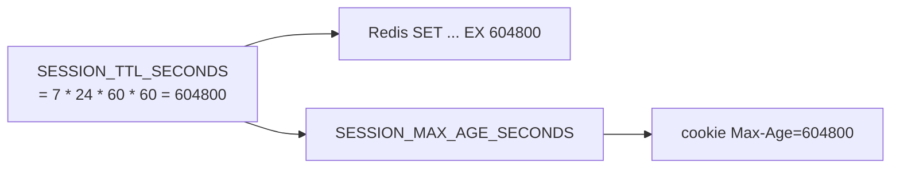

# TTL (time to live)

History: see [CHANGELOG.md](../CHANGELOG.md) or run `pnpm docs:history`

Area: Performance & Caching · Status: ✅ built · Step doc: [07 login](../../07-login-session.md)

## 1. In one line

A **TTL** is how long a piece of data lives before it expires by itself; our sessions have a 7-day
TTL in Redis, and the cookie has the same 7-day `Max-Age`, so both end together.

## 2. Real-life comparison

A parking ticket valid for 7 days: the car park forgets it automatically after that, and the
printed date on the ticket says the same.

## 3. Picture it



## 4. Where in our code

- Anchor: `apps/api/src/queries/sessions.ts` · `SESSION_TTL_SECONDS`, `create` (`"EX"`).
- Anchor: `apps/api/src/services/auth.ts` · `SESSION_MAX_AGE_SECONDS = sessions.SESSION_TTL_SECONDS`.
- Anchor: `apps/api/src/procedures/auth.ts` · `login` → `maxAge: authService.SESSION_MAX_AGE_SECONDS`.

Step by step:

1. One constant, defined in the query layer.
2. The service re-exports it so procedures don't import from `queries/` ([layered-api](layered-api.md)).
3. Redis deletes the key after 604,800 seconds; no cleanup job.
4. The browser deletes the cookie at the same time.
5. Fixed, not sliding: activity does not extend the session.

Other TTL-like settings in the system (from the infra side): CloudFront cache TTLs on
`/_next/static/*` ([cdn-caching](cdn-caching.md)), CloudWatch Logs retention
([cloudwatch-logs](cloudwatch-logs.md)).

## 5. See it yourself

```bash
docker exec minitickets-redis-1 redis-cli --scan --pattern 'session:*' | head -1   # copy one key
docker exec minitickets-redis-1 redis-cli TTL "<that key>"                        # e.g. 410430 (seconds left)
```

The `Set-Cookie` of a login shows `Max-Age=604800`.

**Break it on purpose:** `SET` without `EX`. Sessions never expire in Redis, even after the cookie
is gone; memory grows forever.

## 6. How it connects

- **Uses ←** [sessions-vs-jwt](sessions-vs-jwt.md), [sql-vs-nosql](sql-vs-nosql.md) (Redis expiry).
- **Gives →** automatic cleanup; bounded session lifetime for [session-cookie](session-cookie.md).

## 7. Our settings and WHY

7 days, fixed. WHY: a reasonable balance for a support tool: users don't log in every day, and a
stolen cookie works for at most a week.

## 8. Trade-offs

- **Pros:** zero maintenance; predictable.
- **Cons:** an active user is logged out after 7 days; a stolen cookie works until then (logout
  revokes it; nothing else does).

## 9. Alternatives and when to choose them

- **Sliding expiry:** `EXPIRE` on each request (or each day); stay logged in while active.
- **Absolute + idle timeouts:** e.g. 30 days max, 24 hours idle (banking-style).
- **Short sessions + refresh tokens:** common with JWTs.

## 10. What breaks, and how we'd notice

Cookie and Redis TTL drifting apart: either a cookie that points at nothing (the api says 401,
`useProfile` redirects) or a session nobody can use (wasted memory).

## 13. Interview answers at 3 levels

- **Simple:** Logins expire by themselves after 7 days.
- **Senior:** One constant, 604,800 seconds, used for Redis `EX` and the cookie's `Max-Age`, so they
  expire together and Redis cleans up by itself. It's a fixed, not sliding, expiry.
- **Lead:** TTLs are both a security control and a capacity control. For sessions I'd add idle
  timeout plus sliding renewal; for caches, TTLs bound staleness and need jitter to avoid
  synchronized expiry.

## 14. Follow-up questions interviewers ask

- *What happens at expiry mid-use?* Next call gets 401; the dashboard hook redirects to login.
- *Why jitter TTLs on caches?* So many keys don't expire at once (stampede).

## 15. Say it in 30 seconds

"Sessions live 7 days: one constant drives both Redis's EX and the cookie's Max-Age, so they expire
together and Redis cleans up without a job. It's a fixed expiry; sliding renewal would be the next
step."

## 16. Status

✅ built.

## Where it appears in the story

- [App story: 8. The service](../app-story.md#8-the-service)
