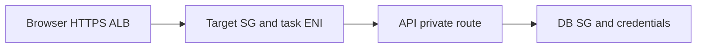

# Config from the environment (12-factor), build time vs run time

History: see [CHANGELOG.md](../CHANGELOG.md) or run `pnpm docs:history`

Area: DevOps & CI/CD · Status: ✅ built in repository; live acceptance is separate

## 1. In one line

Validate runtime configuration with Zod and env examples. Local credentials come from environment, approved CD uses OIDC, committed YAML defines shape and SSM defines the release. NEXT_PUBLIC values are public build inputs; API_INTERNAL_URL remains server runtime only.

## 2. Real-life comparison

Road signs find the right building, guards allow the right door and staff badges allow specific service actions.

## 3. Picture it

## 4. Where in our code

- Anchor: `apps/api/src/config/env.ts` · `EnvSchema`: every api setting is read from `process.env` and validated.
- Anchor: `apps/web/Dockerfile` · step 6, `ARG NEXT_PUBLIC_API_URL=""` → `ENV`: the build-time exception.
- Anchor: `infra/src/compute/task.ts` · `environment` (plain values) and `secrets` (from Secrets Manager).
- Anchor: `scripts/stack/env-checks.ts` · `checkEnvFile`, `checkRevalidateSecret`, `checkAgreement`, `checkShellOverrides`: `pnpm stack:check` checks the local env files against their `.env.example` (never printing a value).

`scripts/stack-up.ts` and `scripts/stack-check.ts` check containers, migrations, queues/table and ports. Run `pnpm stack:check`; owner starts with `pnpm dev`. Local apps use Postgres/Redis, ElasticMQ, DynamoDB Local and Moto for SNS/S3. Existing owner ports/processes are never restarted by agent checks.

## 5. See it yourself

`scripts/stack-up.ts` and `scripts/stack-check.ts` check containers, migrations, queues/table and ports. Run `pnpm stack:check`; owner starts with `pnpm dev`. Local apps use Postgres/Redis, ElasticMQ, DynamoDB Local and Moto for SNS/S3. Existing owner ports/processes are never restarted by agent checks.

Failure thought experiment: Why not call the script doctor? pnpm has a built-in command with that name that shadowed it.

## 6. How it connects

Uses the [current system](../00-big-picture.md); gives a concrete decision to the [scenario](../guides/interview-scenarios.md#network-boundaries) and [explorer tour](../guides/infra-explorer.html?tour=database-reach).

## 7. Our settings and WHY

Validate runtime configuration with Zod and env examples. Local credentials come from environment, approved CD uses OIDC, committed YAML defines shape and SSM defines the release. NEXT_PUBLIC values are public build inputs; API_INTERNAL_URL remains server runtime only. Reproducible setup prevents environment guessing and accidental data loss.

## 8. Trade-offs

Shared emulators are fast for humans; isolated tests avoid cross-test state. Testcontainers/devcontainers are possible later, not installed merely for documentation.

## 9. Alternatives and when to choose them

10x developers: consistent toolchain/devcontainer. 100x: image checks and documented emulator differences in CI.

## 10. What breaks and how we notice

Why not call the script doctor? pnpm has a built-in command with that name that shadowed it.

## 13. Interview answers at 3 levels

- **Simple:** Validate runtime configuration with Zod and env examples. Local credentials come from environment, approved CD uses OIDC, committed YAML defines shape and SSM defines the release. NEXT_PUBLIC values are public build inputs; API_INTERNAL_URL remains server runtime only.
- **Senior:** Use one idempotent setup command, env examples as the contract and a checker that prints exact fixes without secrets. Use the same AWS SDK operations locally against emulators, while naming their limits: no real IAM, SES delivery, AWS quotas or managed failover. Keep destructive reset separate and local-only.
- **Lead:** 10x developers: consistent toolchain/devcontainer. 100x: image checks and documented emulator differences in CI.

## 14. Follow-up questions with answers

Why not call the script doctor? pnpm has a built-in command with that name that shadowed it.

## 15. Say it in 30 seconds

Use one idempotent setup command, env examples as the contract and a checker that prints exact fixes without secrets. Use the same AWS SDK operations locally against emulators, while naming their limits: no real IAM, SES delivery, AWS quotas or managed failover. Keep destructive reset separate and local-only.

## 16. Status and production work

Repository implementation and local evidence are described above. Live AWS/CI execution remains owner acceptance. 10x: map all egress and proxy trust. 100x: segmentation, IPv6/endpoints and flow logs after a concrete need.

## Where it appears in the story

- [App story: 15. Docker](../app-story.md#15-docker)
