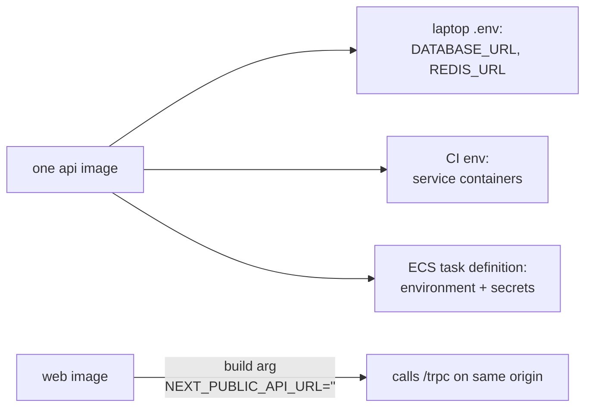

# Config from the environment (12-factor), build time vs run time

History: see [CHANGELOG.md](../CHANGELOG.md) or run `pnpm docs:history`

Area: DevOps & CI/CD · Status: ✅ built · Step doc: [11 docker](../../11-docker.md), [17 ECS api](../../17-infra-ecs-api.md), [18 ALB + web](../../18-infra-alb-web.md)

## 1. In one line

Settings that differ between laptop, CI and AWS come from **environment variables** at run time, so
one image runs everywhere; the one exception is `NEXT_PUBLIC_API_URL`, which Next.js bakes into the
browser JavaScript at **build** time, so we keep it empty.

## 2. Real-life comparison

A rental car: the same car for every customer; the customer brings their own destination
(environment). Only the paint colour (build-time setting) is decided at the factory, so you choose
one that suits everyone.

## 3. Picture it



## 4. Where in our code

- Anchor: `apps/api/src/config/env.ts` · `EnvSchema`: every api setting is read from `process.env` and validated.
- Anchor: `apps/web/Dockerfile` · step 6, `ARG NEXT_PUBLIC_API_URL=""` → `ENV`: the build-time exception.
- Anchor: `infra/src/compute/task.ts` · `environment` (plain values) and `secrets` (from Secrets Manager).

Step by step:

1. The api reads `PORT`, `HOST`, `WEB_ORIGIN`, `REDIS_URL`, `NODE_ENV`, `TRUST_PROXY_HOPS` and the
   database settings from the environment ([config-validation](config-validation.md)).
2. Locally they come from `apps/api/.env` (`tsx --env-file=.env`); in compose from
   `docker-compose.yml`; in CI from the job's `env`; on ECS from the task definition.
3. Secrets on ECS (`DB_USER`, `DB_PASSWORD`, `REDIS_URL`) are injected from Secrets Manager when the
   task starts; the task definition holds only ARNs ([secrets-management](secrets-management.md)).
4. The Dockerfiles set only non-secret defaults (`NODE_ENV=production`, `HOST=0.0.0.0`, `PORT`).
5. **Build time:** `NEXT_PUBLIC_*` values are copied into the browser bundle by `next build`. Empty
   means "same origin", so one web image works on AWS behind the ALB
   ([same-origin-routing](same-origin-routing.md)); compose and CI pass a localhost URL.

## 5. See it yourself

```bash
docker run --rm --entrypoint env minitickets-api | grep -E "NODE_ENV|HOST|PORT"
# NODE_ENV=production  HOST=0.0.0.0  PORT=4000   (recorded locally: the image's defaults, nothing secret)
```

On AWS: ECS console → task definition → container → Environment shows plain values and, for
secrets, only `valueFrom` ARNs.

**Break it on purpose:** build the web image with
`--build-arg NEXT_PUBLIC_API_URL=http://localhost:4100` and deploy it to AWS: every browser tries to
call `localhost:4100` on the visitor's own machine.

## 6. How it connects

- **Uses ←** [config-validation](config-validation.md), [secrets-manager](secrets-manager.md),
  [task-definition](task-definition.md).
- **Gives →** one image per commit for every environment ([immutable-image-tags](immutable-image-tags.md)).

## 7. Our settings and WHY

| Kind | Where it's set | Why |
| ---- | -------------- | --- |
| Plain run-time config | env vars (task definition, compose, `.env`) | Same image everywhere. |
| Secrets | Secrets Manager → env at task start | Never in images, git or Pulumi state as plain text. |
| Browser config | build arg, empty on AWS | Next.js bakes it in; empty avoids per-env images. |

## 8. Trade-offs

- **Pros:** build once, run anywhere; config changes don't need rebuilds (except `NEXT_PUBLIC_*`).
- **Cons:** env vars are visible to anything in the process (and in `/proc`); secrets are read only
  at start, so rotation needs a task restart.

## 9. Alternatives and when to choose them

- **Runtime config endpoint for the browser** (`/config.json`): change browser settings without a
  rebuild.
- **Fetch secrets at runtime** (SDK + caching): supports rotation without restarts.
- **AWS AppConfig / Parameter Store:** central config with change control.

## 10. What breaks, and how we'd notice

- A missing variable: the api exits at start with a clear message (fail fast).
- A wrong `NEXT_PUBLIC_API_URL` in an image: network errors in every browser; `client.ts` rejects
  values that aren't empty or `http(s)://`.

## 13. Interview answers at 3 levels

- **Simple:** The same app reads its settings from where it runs.
- **Senior:** Every api setting is an env var validated by Zod; the task definition sets plain values
  and injects secrets from Secrets Manager by ARN. The web's `NEXT_PUBLIC_API_URL` is build-time, so
  we leave it empty and use same-origin routing, giving one image per commit.
- **Lead:** Separate build from config so the artifact you tested is the artifact you run. Watch
  for build-time leaks of config (like `NEXT_PUBLIC_*`), and plan for secret rotation, which env vars
  at start time don't handle.

## 14. Follow-up questions interviewers ask

- *What's 12-factor?* A set of rules for cloud apps; factor III is "store config in the environment".
- *Why are `NEXT_PUBLIC_*` vars special?* They end up in JavaScript sent to browsers, fixed at build.

## 15. Say it in 30 seconds

"All api config comes from env vars validated at startup: .env locally, compose, CI env, and the ECS
task definition with secrets injected from Secrets Manager. The one build-time setting is the web's
NEXT_PUBLIC_API_URL, which we keep empty so the browser calls /trpc on the same origin and one image
works everywhere."

## 16. Status

✅ built.

## Where it appears in the story

- [App story: 15. Docker](../app-story.md#15-docker)
