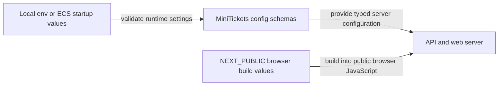

# Config from the environment (12-factor), build time vs run time

History: see [CHANGELOG.md](../CHANGELOG.md) or run `pnpm docs:history`

Area: DevOps & CI/CD · Status: ✅ built in repository; live acceptance is separate
<!-- interview-card: v2 -->

## 1. What is it?

Configuration separates environment-specific settings from application code. The same application package can receive different server settings without embedding secrets in its source or image.

## 2. Why do we need it?

MiniTickets reaches Docker services locally and AWS services after deployment. Rebuilding all server code merely to change a database endpoint would mix the program with the environment it runs in.

## 3. How does it work?

1. Keep server settings outside the source package.
2. Validate values where the runtime reads them.
3. Treat browser build-time values as a separate public contract.

## 4. How do we use it in MiniTickets?

API settings arrive through environment variables and ECS secret injection. The web’s internal API URL stays server-only. Public Next values are baked into the browser build. Committed YAML defines cloud shape; SSM holds release records.

## 5. Interview-ready answer

“MiniTickets keeps runtime settings separate from application code and validates them before use. Secrets arrive through the environment rather than images. Next’s public browser values are an explicit build-time exception, so they must never contain secrets. Local emulators help repeat setup, but their success cannot prove AWS permissions, delivery or managed-service behavior.”

## 6. Important follow-up questions

- **Is an environment variable automatically secret?** No. Browser public variables and logs can expose values.
- **Why is the internal API URL server-only?** Private service names are for server calls, not browser routing.
- **Does changing NEXT_PUBLIC config update an old image?** No. Its browser value was set during the build.
- **What if local configuration disagrees?** Use stack:check’s safe field/fix reporting; do not print secret values to compare them.

## 7. Advanced details

Technical reference

### Source references

- Anchor: `apps/api/src/config/env.ts` · `EnvSchema`: every api setting is read from `process.env` and validated.
- Anchor: `apps/web/Dockerfile` · step 6, `ARG NEXT_PUBLIC_API_URL=""` → `ENV`: the build-time exception.
- Anchor: `infra/src/compute/task.ts` · `environment` (plain values) and `secrets` (from Secrets Manager).
- Anchor: `scripts/stack/env-checks.ts` · `checkEnvFile`, `checkRevalidateSecret`, `checkAgreement`, `checkShellOverrides`: `pnpm stack:check` checks the local env files against their `.env.example` (never printing a value).

`scripts/stack-up.ts` and `scripts/stack-check.ts` check containers, migrations, queues/table and ports. Run `pnpm stack:check`; owner starts with `pnpm dev`. Local apps use Postgres/Redis, ElasticMQ, DynamoDB Local and Moto for SNS/S3. Existing owner ports/processes are never restarted by agent checks.

### Configuration and design

Validate runtime configuration with Zod and env examples. Local credentials come from environment, approved CD uses OIDC, committed YAML defines shape and SSM defines the release. NEXT_PUBLIC values are public build inputs; API_INTERNAL_URL remains server runtime only. Reproducible setup prevents environment guessing and accidental data loss.

### Checks and troubleshooting

Why not call the script doctor? pnpm has a built-in command with that name that shadowed it.

### Trade-offs and alternatives

Shared emulators are fast for humans; isolated tests avoid cross-test state. Testcontainers/devcontainers are possible later, not installed merely for documentation.

10x developers: consistent toolchain/devcontainer. 100x: image checks and documented emulator differences in CI.

### Further technical context

Use one idempotent setup command, env examples as the contract and a checker that prints exact fixes without secrets. Use the same AWS SDK operations locally against emulators, while naming their limits: no real IAM, SES delivery, AWS quotas or managed failover. Keep destructive reset separate and local-only.

### Related reading

Uses the [current system](../00-big-picture.md); gives a concrete decision to the [scenario](../guides/interview-scenarios.md#network-boundaries) and [explorer tour](../guides/infra-explorer.html?tour=database-reach).

[Open this piece in the city explorer](../guides/infra-explorer.html?concept=twelve-factor-config#chapter=8&piece=api-task).

## Where it appears in the story

- [App story: 15. Docker](../app-story.md#15-docker)

