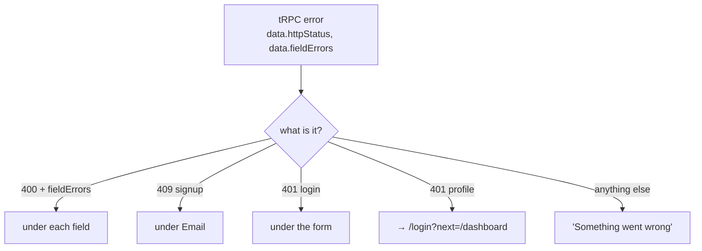

# Showing API errors in the UI (field errors, 401 redirect)

History: see [CHANGELOG.md](../CHANGELOG.md) or run `pnpm docs:history`

Area: Frontend · Status: ✅ built · Step doc: [06 signup api](../../06-signup-api.md), [09 dashboard](../../09-dashboard.md)

## 1. In one line

The UI reads the api's error by its **HTTP status** and **field errors**, and puts each one where the
user can act on it: under a field, under the form, or as a redirect to login.

## 2. Real-life comparison

A good receptionist sorts problems: "this box on your form is wrong" (field), "we can't find your
booking" (form-level), "your pass expired, please go to the front desk" (redirect), and never reads
out the internal error log.

## 3. Picture it



## 4. Where in our code

- Anchor: `apps/web/src/features/auth/components/signup-form.tsx` · `handleSubmit` → `onError`: 400 field errors, 409 under email, else generic.
- Anchor: `apps/web/src/features/auth/components/login-form.tsx` · `handleSubmit` → `onError`: 400 field errors, 401 message under the form, else generic.
- Anchor: `apps/web/src/features/account/hooks/use-profile.ts` · `useProfile`: a 401 sends the user to `/login?next=/dashboard`.
- Anchor: `apps/web/src/features/account/components/profile-card.tsx` · `ProfileCard`: loading, generic error, or data.

Step by step:

1. The api's `errorFormatter` gives every error the same shape: `message`, `data.code`,
   `data.httpStatus`, `data.fieldErrors` ([error-handling](error-handling.md)).
2. Forms first look for `fieldErrors` (server validation, 400) and show them under fields, focusing
   the first.
3. Signup: `httpStatus === 409` → `error.message` ("Email already registered") under Email.
4. Login: `401` → the api's message ("Invalid email or password") in a `role="alert"` under the
   form.
5. Anything else (500, network): "Something went wrong. Please try again." The api never sends
   internals, and the UI never shows raw errors either.
6. Profile: a 401 means the cookie exists but the session doesn't (expired, logged out elsewhere).
   `useProfile` redirects; `ProfileCard` keeps showing "Loading…" meanwhile instead of an error.

## 5. See it yourself

Error shapes recorded against a local api:

```bash
curl -s -X POST localhost:4000/trpc/auth.signup -H 'content-type: application/json' \
  -d '{"email":"nope","password":"short","confirmPassword":"x"}'
# {"error":{"message":"Invalid input",…,"data":{"code":"BAD_REQUEST","httpStatus":400,
#   "path":"auth.signup","fieldErrors":{"email":["Enter a valid email address"],…}}}}
curl -s localhost:4000/trpc/account.profile
# {"error":{"message":"You must be logged in",…,"data":{"code":"UNAUTHORIZED","httpStatus":401,…}}}
```

In the browser: sign up twice with the same email (any case): "Email already registered" appears
under Email (e2e: `signup.spec.ts`). Log in with a wrong password: the message is under the button
(e2e: `login.spec.ts`).

**Break it on purpose:** in `signup-form.tsx`, show `error.message` for every error. Now a 500
would say "Something went wrong" (the api already hides internals), but a network failure would show
a browser message like "Failed to fetch". The generic branch exists so users never see those.

## 6. How it connects

- **Uses ←** [error-handling](error-handling.md) (the shape), [http-status-codes](http-status-codes.md),
  [accessible-forms](accessible-forms.md) (where messages go).
- **Gives →** the end of the error path described in the [app story](../app-story.md).

## 7. Our settings and WHY

Map by status, not by message text: messages are for people and can change; status codes are the
contract. Show the api's message only for statuses where it is safe and helpful (400, 401 login, 409).

## 8. Trade-offs

- **Pros:** users get actionable messages; no internals leak; consistent across forms.
- **Cons:** each form repeats the mapping; new status codes need UI work.

## 9. Alternatives and when to choose them

- **A shared `mapApiError` helper:** once there are more forms.
- **Error boundaries** (`error.tsx` in the App Router): for unexpected render errors; not used yet.
- **Toasts:** for errors not tied to a form.

## 10. What breaks, and how we'd notice

- The api changes a status (e.g. 409 → 400): the duplicate-email message lands under the form
  instead of the field. The e2e test checks `#email-error`.
- A 401 redirect loop if login itself returned 401 for a valid user: not possible today; login is a
  public procedure.

## 13. Interview answers at 3 levels

- **Simple:** Errors show up where you can fix them, and we never show scary technical messages.
- **Senior:** All api errors share one shape with `httpStatus` and `fieldErrors`. Forms map 400
  field errors to fields, 409 to the email field, login's 401 to a form alert, and everything else to
  a generic message. A 401 on the profile query redirects to login, because the route guard only
  checks that a cookie exists.
- **Lead:** The error contract is part of the API design: a stable code and machine-readable field
  errors let the UI stay dumb. I'd centralise the mapping and add error boundaries and client error
  reporting once there are more screens.

## 14. Follow-up questions interviewers ask

- *Why redirect on 401 in the hook, not the component?* The hook owns the data rules; every
  component that uses it gets the same behaviour.
- *Why not show the server message for 500?* It is already generic, but the UI should not depend
  on that.

## 15. Say it in 30 seconds

"Every api error has the same shape: status code and field errors. Forms put 400 field errors under
fields, the duplicate email under Email, a failed login under the form, and everything else becomes
'Something went wrong'. A 401 on the profile redirects to login, because the cookie can outlive the
session."

## 16. Status

✅ built.
