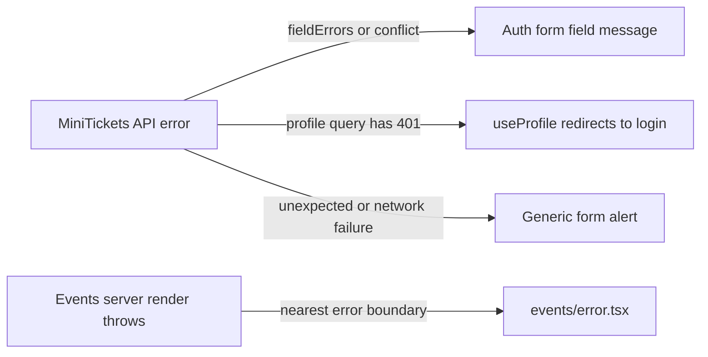

# Showing API errors in the UI (field errors, 401 redirect)

History: see [CHANGELOG.md](../CHANGELOG.md) or run `pnpm docs:history`

Area: Frontend · Status: ✅ built · Step doc: [06 signup api](../../06-signup-api.md), [09 dashboard](../../09-dashboard.md), [22 events SSR](../../22-events-ssr.md)
<!-- interview-card: v2 -->

## 1. What is it?

UI error handling turns a failed operation into feedback the user can act on. A field mistake, expired session and unexpected page failure need different responses.

## 2. Why do we need it?

A MiniTickets customer who mistypes an email should see the correction beside that field. A lost connection should produce a safe retry message instead of raw browser or server internals.

## 3. How does it work?



1. Read structured status and field information.
2. Place actionable errors near the control or operation they affect.
3. Use a boundary for unexpected rendering failures and preserve a diagnosis reference.

## 4. How do we use it in MiniTickets?

Signup maps validation to fields and duplicate email to Email. Login shows invalid credentials as a form error. useProfile handles expired authentication. The events route has a client error boundary with retry and a server error digest when supplied.

## 5. Interview-ready answer

“MiniTickets maps errors by stable status and field data rather than parsing message text. Forms show correctable failures where users can fix them, while unexpected failures use generic feedback. Expired profile authentication redirects through the data hook. Render failures use an error boundary, with a digest connecting safe UI feedback to server diagnosis.”

## 6. Important follow-up questions

- **Why not display every raw error message?** Network and internal errors can be confusing or reveal details; use known safe messages.
- **Why does the hook own the profile redirect?** Every component using that data receives the same expired-session behaviour.
- **Does a render boundary catch every event-handler failure?** No. Form and async operation failures need their own explicit handling.
- **What if the API changes 409 to another code?** The field mapping can break; keep the contract and relevant UI checks aligned.

## 7. Advanced details

<details>
<summary>Technical reference</summary>

### Current reading notes

Current events/error.tsx is built, so old text calling boundaries future work is obsolete. Query-prefetch failure is logged and omitted from dehydrated success data; browser querying can then show its query error. An actual render exception reaches the route boundary. Status codes guide mapping; the optional digest is diagnostic, not authorization.

### Implementation reference

- Anchor: `apps/web/src/features/auth/components/signup-form.tsx` · `handleSubmit` → `onError`: 400 field errors, 409 under email, else generic.
- Anchor: `apps/web/src/features/auth/components/login-form.tsx` · `handleSubmit` → `onError`: 400 field errors, 401 message under the form, else generic.
- Anchor: `apps/web/src/features/account/hooks/use-profile.ts` · `useProfile`: a 401 sends the user to `/login?next=/dashboard`.
- Anchor: `apps/web/src/features/account/components/profile-card.tsx` · `ProfileCard`: loading, generic error, or data.
- Anchor: `apps/web/src/features/events/components/event-list.tsx` · `EventList`: loading skeleton, generic error with a Retry button, empty state (only reached when the browser fetches by itself since Step 22).
- Anchor: `apps/web/src/app/events/error.tsx` · `EventsError`: Next.js error boundary for `/events`: generic message, `error.digest` as an id, Retry calls `retry()`.

Step by step:

1. The api's `errorFormatter` gives every error the same shape: `message`, `data.code`,
   `data.httpStatus`, `data.fieldErrors` ([error-handling](error-handling.md)).
2. Forms first look for `fieldErrors` (server validation, 400) and show them under fields, focusing
   the first.
3. Signup: `httpStatus === 409` → `error.message` ("Email already registered") under Email.
4. Login: `401` → the api's message ("Invalid email or password") in a `role="alert"` under the
   form.
5. Anything else (500, network): "Something went wrong. Please try again." The api never sends
   internals, and the UI never shows raw errors either.
6. Profile: a 401 means the cookie exists but the session doesn't (expired, logged out elsewhere).
   `useProfile` redirects; `ProfileCard` keeps showing "Loading…" meanwhile instead of an error.
7. Errors **while the server renders** a page (Step 22, `/events`): a failed `events.list` call on the
   server is not an error for the user (the browser fetches instead, step 5 applies). Anything that
   *throws* during the render (a missing `API_INTERNAL_URL`, a bug) is caught by `app/events/error.tsx`.
   In production Next.js hides the server error's message; the boundary shows our generic text and
   `Error id: <digest>`, the id of the full error in the web server's log. Retry calls the boundary's reset callback,
   which asks the server to render the page again.

### Inspection and historical evidence

Error shapes recorded against a local api:

```bash
curl -s -X POST localhost:4000/trpc/auth.signup -H 'content-type: application/json' \
  -d '{"email":"nope","password":"short","confirmPassword":"x"}'
# {"error":{"message":"Invalid input",…,"data":{"code":"BAD_REQUEST","httpStatus":400,
#   "path":"auth.signup","fieldErrors":{"email":["Enter a valid email address"],…}}}}
curl -s localhost:4000/trpc/account.profile
# {"error":{"message":"You must be logged in",…,"data":{"code":"UNAUTHORIZED","httpStatus":401,…}}}
```

In the browser: sign up twice with the same email (any case): "Email already registered" appears
under Email (e2e: `signup.spec.ts`). Log in with a wrong password: the message is under the button
(e2e: `login.spec.ts`).

**Break it on purpose:** in `signup-form.tsx`, show `error.message` for every error. Now a 500
would say "Something went wrong" (the api already hides internals), but a network failure would show
a browser message like "Failed to fetch". The generic branch exists so users never see those.

### Settings and reasoning

Map by status, not by message text: messages are for people and can change; status codes are the
contract. Show the api's message only for statuses where it is safe and helpful (400, 401 login, 409).

### Trade-offs

- **Pros:** users get actionable messages; no internals leak; consistent across forms.
- **Cons:** each form repeats the mapping; new status codes need UI work.

### Alternatives and scaling

- **A shared `mapApiError` helper:** once there are more forms.
- **Error boundaries** (`error.tsx` in the App Router): for unexpected render errors; `app/events/error.tsx` is built.
- **Toasts:** for errors not tied to a form.

### Failure diagnosis

- The api changes a status (e.g. 409 → 400): the duplicate-email message lands under the form
  instead of the field. The e2e test checks `#email-error`.
- A 401 redirect loop if login itself returned 401 for a valid user: not possible today; login is a
  public procedure.

### Further questions

- *Why redirect on 401 in the hook, not the component?* The hook owns the data rules; every
  component that uses it gets the same behaviour.
- *Why not show the server message for 500?* It is already generic, but the UI should not depend
  on that.

### Related reading

- [http-status-codes](http-status-codes.md)
- [accessible-forms](accessible-forms.md)
- [app story](../app-story.md)

[Open this piece in the city explorer](../guides/infra-explorer.html?concept=ui-error-handling#chapter=0&piece=laptop-web).

## Where it appears in the story

- [App story: 11. The error path back to the UI](../app-story.md#11-the-error-path-back-to-the-ui)

</details>
