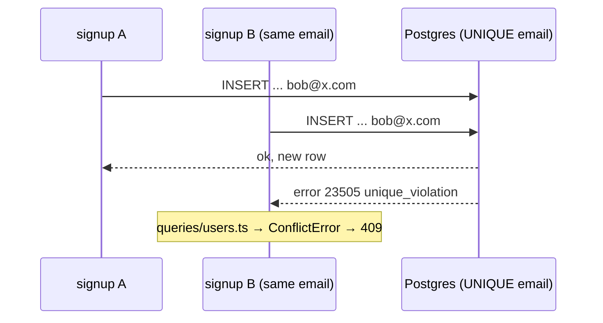

# Unique constraint vs check-then-insert (race condition)

History: see [CHANGELOG.md](../CHANGELOG.md) or run `pnpm docs:history`

Area: Data · Status: ✅ built · Step doc: [06 signup api](../../06-signup-api.md)

## 1. In one line

Signup does **not** ask "does this email exist?" before inserting; it inserts and lets Postgres's
**unique constraint** reject the duplicate atomically, because check-then-insert has a race.

## 2. Real-life comparison

Two people ask a receptionist "is room 12 free?", both hear "yes", both walk in. A lock on the door
(the constraint) means only the first one gets in, however close together they arrive.

## 3. Picture it



## 4. Where in our code

- Anchor: `apps/api/src/services/auth.ts` · `signup`: hash, then insert straight away (the comment explains the race).
- Anchor: `apps/api/src/queries/users.ts` · `create`, `isUniqueViolation`: translate `23505` into `ConflictError("Email already registered")`.
- Anchor: `apps/api/src/db/schema/users.ts` · `email: text("email").notNull().unique()`.

Step by step:

1. The input schema lowercases and trims the email, so `Bob@X.com` and `bob@x.com` are the same
   value ([validation-at-boundaries](validation-at-boundaries.md)).
2. `signup` hashes the password, then calls `users.create`.
3. Postgres checks the unique index during the insert; of two concurrent inserts exactly one wins.
4. The loser gets SQLSTATE `23505`. Drizzle wraps driver errors, so `isUniqueViolation` checks
   `err.code` and `err.cause.code`.
5. It throws `ConflictError`; anything else is rethrown untouched (a real 500).
6. The UI shows the 409 under the email field ([ui-error-handling](ui-error-handling.md)).

## 5. See it yourself

e2e: `signup.spec.ts` "same email in a different case shows 409 under the email field".

Try the race by hand (bash, local api):

```bash
BODY='{"email":"race-'$RANDOM'@example.com","password":"correct-horse-battery","confirmPassword":"correct-horse-battery"}'
for i in 1 2; do curl -s -o /dev/null -w '%{http_code}\n' -X POST localhost:4000/trpc/auth.signup \
  -H 'content-type: application/json' -d "$BODY" & done; wait
# one 200 and one 409, whichever arrives first
```

(Recorded against the local api: `200` and `409`.)

**Break it on purpose:** replace the insert with "`findByEmail`, then insert if missing" and remove
`.unique()`. Sequential tests still pass, but parallel requests create two rows with one email.

## 6. How it connects

- **Uses ←** [drizzle-schema](drizzle-schema.md), [indexing](indexing.md) (the constraint is backed
  by a unique index).
- **Gives →** correct data under concurrency; 409 for [ui-error-handling](ui-error-handling.md);
  the reason mutations don't retry ([retry-policy](retry-policy.md)).

## 7. Our settings and WHY

Let the database enforce the rule; translate the error in the query layer. WHY: only the database
sees all writers at once; services stay free of Postgres codes.

## 8. Trade-offs

- **Pros:** correct under any concurrency; one round-trip instead of two.
- **Cons:** we spend an argon2 hash (slow on purpose) before learning it's a duplicate; the 409
  reveals that an email has an account ([user-enumeration](user-enumeration.md)).

## 9. Alternatives and when to choose them

- **`INSERT … ON CONFLICT DO NOTHING RETURNING`:** no exception; check whether a row came back.
- **Transaction with `SERIALIZABLE`:** for rules a constraint can't express.
- **Advisory locks:** for "only one at a time" jobs, not row uniqueness.

## 10. What breaks, and how we'd notice

- Removing the constraint in a migration: duplicates silently appear.
- Another unique column later: `isUniqueViolation` doesn't say which one; the message would be wrong
  (check the constraint name then).

## 13. Interview answers at 3 levels

- **Simple:** The database itself refuses a second account with the same email.
- **Senior:** We insert directly and rely on the unique constraint; Postgres's unique index makes
  the check and the insert one atomic step, so of two concurrent signups one gets `23505`, which the
  query layer turns into `ConflictError` → 409. Check-then-insert would let both through.
- **Lead:** Invariants belong in the database when concurrency is possible; application checks are
  for nice messages only. The same pattern applies to stock, seats or usernames.

## 14. Follow-up questions interviewers ask

- *What's a race condition?* The result depends on timing between concurrent actions.
- *Why not lock the table?* Kills concurrency; the unique index already does the job.

## 15. Say it in 30 seconds

"Signup doesn't check whether the email exists first, because two requests could both see 'free'
and both insert. We insert directly; the unique constraint lets exactly one win, and the query layer
turns Postgres's 23505 into a ConflictError, which becomes a 409 under the email field."

## 16. Status

✅ built.

## Where it appears in the story

- [App story: 8. The service](../app-story.md#8-the-service)
