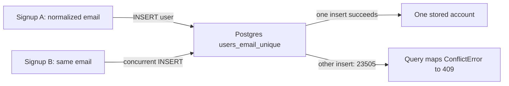

# Unique constraint vs check-then-insert (race condition)

History: see [CHANGELOG.md](../CHANGELOG.md) or run `pnpm docs:history`

Area: Data · Status: ✅ built · Step doc: [06 signup api](../../06-signup-api.md)
<!-- interview-card: v2 -->

## 1. What is it?

A unique constraint prevents two stored rows from sharing a value that must be distinct. It resolves concurrent inserts where a separate “does it exist?” check cannot.

## 2. Why do we need it?

Two MiniTickets signups can ask whether one email is available at the same moment. Both may hear yes; only the database can decide who actually stores that email.

## 3. How does it work?



1. Normalize the email and prepare the new user.
2. Insert directly with the unique constraint present.
3. Translate the losing insert into a clear conflict response.

## 4. How do we use it in MiniTickets?

Signup trims and lowercases email, hashes the password and calls the user query. The query recognises the driver’s unique-violation code and throws a business conflict. Booking uses a separate per-user idempotency uniqueness rule.

## 5. Interview-ready answer

“MiniTickets relies on a database unique constraint for signup rather than check-then-insert. Two concurrent requests can both pass a preliminary lookup, but only one can store the normalized email. The query layer maps the unique violation to a conflict response. This protects the invariant across writers without locking the whole table.”

## 6. Important follow-up questions

- **Could an application precheck still help?** It may improve feedback, but the database constraint must remain authoritative.
- **Why not lock the whole users table?** It would reduce unrelated concurrency; the unique index already coordinates conflicting values.
- **What does duplicate signup reveal?** The email has an account; that enumeration trade-off needs an explicit product policy.
- **What if another unique field is added?** Map the violated constraint precisely so its failure is not mislabeled as duplicate email.

## 7. Advanced details

<details>
<summary>Technical reference</summary>

### Current reading notes

queries/users.ts checks SQLSTATE 23505 both directly and through a wrapped cause. Input normalization makes email case variants conflict. Password hashing happens before insert, so duplicate requests still pay that computation cost. Historical local concurrent evidence was one 200 and one 409. Alternatives include ON CONFLICT handling or serializable transactions for invariants not expressible as simple uniqueness.

### Implementation reference

- Anchor: `apps/api/src/services/auth.ts` · `signup`: hash, then insert straight away (the comment explains the race).
- Anchor: `apps/api/src/queries/users.ts` · `create`, `isUniqueViolation`: translate `23505` into `ConflictError("Email already registered")`.
- Anchor: `apps/api/src/db/schema/users.ts` · `email: text("email").notNull().unique()`.

Step by step:

1. The input schema lowercases and trims the email, so `Bob@X.com` and `bob@x.com` are the same
   value ([validation-at-boundaries](validation-at-boundaries.md)).
2. `signup` hashes the password, then calls `users.create`.
3. Postgres checks the unique index during the insert; of two concurrent inserts exactly one wins.
4. The loser gets SQLSTATE `23505`. Drizzle wraps driver errors, so `isUniqueViolation` checks
   `err.code` and `err.cause.code`.
5. It throws `ConflictError`; anything else is rethrown untouched (a real 500).
6. The UI shows the 409 under the email field ([ui-error-handling](ui-error-handling.md)).

### Inspection and historical evidence

e2e: `signup.spec.ts` "same email in a different case shows 409 under the email field".

Try the race by hand (bash, local api):

```bash
BODY='{"email":"race-'$RANDOM'@example.com","password":"correct-horse-battery","confirmPassword":"correct-horse-battery"}'
for i in 1 2; do curl -s -o /dev/null -w '%{http_code}\n' -X POST localhost:4000/trpc/auth.signup \
  -H 'content-type: application/json' -d "$BODY" & done; wait
# one 200 and one 409, whichever arrives first
```

(Recorded against the local api: `200` and `409`.)

**Break it on purpose:** replace the insert with "`findByEmail`, then insert if missing" and remove
`.unique()`. Sequential tests still pass, but parallel requests create two rows with one email.

### Settings and reasoning

Let the database enforce the rule; translate the error in the query layer. WHY: only the database
sees all writers at once; services stay free of Postgres codes.

### Trade-offs

- **Pros:** correct under any concurrency; one round-trip instead of two.
- **Cons:** we spend an argon2 hash (slow on purpose) before learning it's a duplicate; the 409
  reveals that an email has an account ([user-enumeration](user-enumeration.md)).

### Alternatives and scaling

- **`INSERT … ON CONFLICT DO NOTHING RETURNING`:** no exception; check whether a row came back.
- **Transaction with `SERIALIZABLE`:** for rules a constraint can't express.
- **Advisory locks:** for "only one at a time" jobs, not row uniqueness.

### Failure diagnosis

- Removing the constraint in a migration: duplicates silently appear.
- Another unique column later: `isUniqueViolation` doesn't say which one; the message would be wrong
  (check the constraint name then).

### Further questions

- *What's a race condition?* The result depends on timing between concurrent actions.
- *Why not lock the table?* Kills concurrency; the unique index already does the job.

### Related reading

- [drizzle-schema](drizzle-schema.md)
- [indexing](indexing.md)
- [retry-policy](retry-policy.md)

[Open this piece in the city explorer](../guides/infra-explorer.html?concept=unique-constraint-race#chapter=24&piece=code-store).

## Where it appears in the story

- [App story: 8. The service](../app-story.md#8-the-service)

</details>
