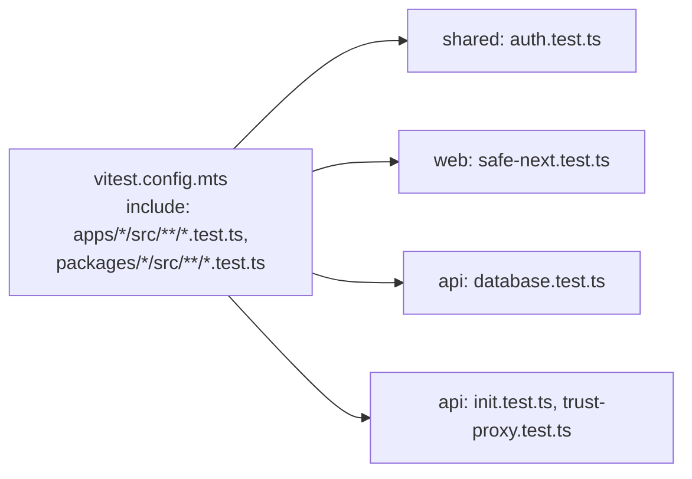

# Unit tests (Vitest, next to the code)

History: see [CHANGELOG.md](../CHANGELOG.md) or run `pnpm docs:history`

Area: Testing · Status: ✅ built · Step doc: [10 CI](../../10-ci.md)

## 1. In one line

**Unit tests** check one small piece of logic in isolation, fast and without servers; ours are
Vitest files named `*.test.ts` next to the code they test.

## 2. Real-life comparison

Testing each light bulb on a bench before wiring the house. Quick, cheap, and if one fails you know
exactly which bulb.

## 3. Picture it



## 4. Where in our code

- Anchor: `vitest.config.mts` · `include`: which files are unit tests (e2e `*.spec.ts` are never picked up).
- Anchor: `packages/shared/src/schemas/auth.test.ts` · `SignupInput`: trims/lowercases email; mismatch error on `confirmPassword`.
- Anchor: `apps/web/src/features/auth/lib/safe-next.test.ts` · `getSafeNext`: 6 cases including 4 attacks.
- Anchor: `apps/api/src/queries/events-cache.test.ts` · `getUpcomingFromCache`, `setUpcomingInCache`: fake Redis client; checks the key, the `EX` TTL and the 100 ms timeout (fake timers).
- Anchor: `apps/api/src/services/events.test.ts` · `listUpcomingEvents`: service test with in-memory fakes of the query layer and the cache layer (no Postgres, no Redis): hit, miss, Redis error, corrupt value.

Our test files (7 files, 34 tests when I last ran `pnpm test`):

| File | What it checks |
| ---- | -------------- |
| `packages/shared/src/schemas/auth.test.ts` | Email normalisation; password mismatch path |
| `apps/web/src/features/auth/lib/safe-next.test.ts` | Open-redirect protection |
| `apps/api/src/config/database.test.ts` | Local vs AWS database settings, SSL on, clear errors |
| `apps/api/src/trpc/init.test.ts` | Error mapping ([in-process-api-tests](in-process-api-tests.md)) |
| `apps/api/src/config/trust-proxy.test.ts` | Real client IP behind proxies ([in-process-api-tests](in-process-api-tests.md)) |
| `apps/api/src/services/events.test.ts` | `events.list` rules, and the cache-aside paths with fake cache and query layers ([cache-aside](cache-aside.md)) |
| `apps/api/src/queries/events-cache.test.ts` | Cache key, `EX` TTL and the 100 ms timeout, with a fake Redis client |

## 5. See it yourself

```bash
pnpm test                 # all unit tests, about a quarter of a second here
pnpm test safe-next       # one file
```

**Break it on purpose:** in `getSafeNext`, drop `!next.startsWith("//")`: the "protocol-relative
URL" case fails with a clear diff.

## 6. How it connects

- **Uses ←** Vitest 5 (root `devDependencies`).
- **Gives →** the fast layer of the [testing-pyramid](testing-pyramid.md); runs in the
  [ci-pipeline](ci-pipeline.md) quality job.

## 7. Our settings and WHY

One root Vitest config for all packages; tests beside the code; pure functions and schemas first.
WHY: fast enough to run on every save; easy to find the test for a file.

## 8. Trade-offs

- **Pros:** milliseconds; precise failures; no infrastructure.
- **Cons:** services and queries aren't unit-tested (they need Postgres/Redis or mocks); no coverage
  reporting.

## 9. Alternatives and when to choose them

- **Jest:** the older standard; Vitest is faster with ESM/TypeScript.
- **Testing with mocks** for services: possible, but mocks can lie (explain-only card `mocking`).
- **Integration tests with real stores** (Testcontainers): for queries and services.

## 10. What breaks, and how we'd notice

A test file named `*.spec.ts` under `src/`: Vitest ignores it (the pattern is `*.test.ts`), and it
silently never runs.

## 13. Interview answers at 3 levels

- **Simple:** Small automatic checks for small pieces of code.
- **Senior:** Vitest with one root config that picks up `*.test.ts` in every package. We test pure
  logic: schemas, the redirect guard, config parsing, plus error mapping and proxy handling through
  in-process calls. They run in the quality job before anything slower.
- **Lead:** Unit tests should cover rules that are easy to get subtly wrong (security checks, parsing,
  mappings). For services I'd prefer integration tests against real Postgres and Redis over heavy
  mocking.

## 14. Follow-up questions interviewers ask

- *What do you unit-test vs e2e-test?* Rules and edge cases in units; user journeys end to end.
- *Coverage target?* Not a number; cover risky logic.

## 15. Say it in 30 seconds

"Vitest, one root config, tests next to the code as .test.ts. Five files today: shared schemas, the
open-redirect guard, database config parsing, the error mapper and the trust-proxy logic. They run in
well under a second and gate the CI quality job."

## 16. Status

✅ built.

## Where it appears in the story

- [App story: 14. The testing pyramid](../app-story.md#14-the-testing-pyramid)
