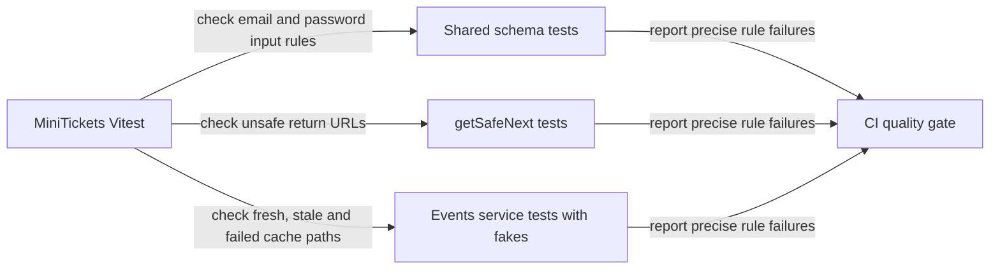

# Unit tests (Vitest, next to the code)

History: see [CHANGELOG.md](../CHANGELOG.md) or run `pnpm docs:history`

Area: Testing · Status: ✅ built · Step doc: [10 CI](../../10-ci.md)

<!-- interview-card: v2 -->

## 1. What is it?

A unit test checks a small rule in isolation. It should run quickly and tell us which rule failed without needing a running application.

## 2. Why do we need it?

A malicious return URL can redirect a user away after login. Testing several dangerous URLs directly is faster and clearer than repeating an entire login journey for each case.

## 3. How does it work?

1. Choose risky rules and representative edge cases.
2. Control dependencies and time so outcomes are repeatable.
3. Use real-store tests separately for guarantees a fake cannot demonstrate.

## 4. How do we use it in MiniTickets?

Vitest finds tests beside source files. Schemas, redirect protection, configuration parsing and service decisions have focused checks. Cache tests use fake dependencies and clocks; those checks demonstrate application decisions, not real Redis or database behavior.

## 5. Interview-ready answer

“MiniTickets uses fast unit tests for rules that are easy to get subtly wrong: validation, redirects, configuration and cache decisions. Tests live beside the source, with controlled dependencies where useful. I judge them by the risks they cover and the failures they explain, rather than a coverage percentage. Actual transaction and network behavior need other tests.”

## 6. Important follow-up questions

- **What should stay out of a unit test?** Claims about real database locking, network reach or AWS permissions.
- **Can fakes mislead us?** Yes. A fake can agree with our assumption while the real service behaves differently.
- **What if a test is never discovered?** Check the filename pattern; our unit tests use .test.ts.
- **Do you target a coverage number?** Prioritize risky rules and meaningful edge cases, then inspect gaps.

## 7. Advanced details

Technical reference

### Configuration and examples

`vitest.config.mts` selects `apps/*/src/**/*.test.ts` and `packages/*/src/**/*.test.ts`; e2e `*.spec.ts` is not selected. One root config keeps tests beside code. Root dependencies provide Vitest; this rewrite makes no version upgrade.

Examples: `packages/shared/src/schemas/auth.test.ts` checks trimmed/lowercased email and mismatch on `confirmPassword`; `apps/web/src/features/auth/lib/safe-next.test.ts` covers open redirects, historically six cases including four attacks. Database config tests cover local/AWS settings, TLS and errors. tRPC init/proxy tests run real code in process. Events service tests fake queries/cache for hit, miss, errors and corrupt values; cache-query tests fake Redis and timers for keys, TTL and **100 ms** budgets.

### Historical evidence and limits

The original card’s seven files / 34 tests and older five-file answer are historical snapshots, superseded by later handbook evidence of **404 Vitest tests**. Its statement that services/queries are untested is obsolete: the listed service/query tests already use fakes. The original `EX` TTL reference describes an earlier cache version; current cache expiry uses millisecond budgets. Counts/speed were not rerun here. No coverage report is claimed.

`pnpm test` runs the suite; `pnpm test safe-next` selects matching tests. Removing the protocol-relative-URL rejection would make its security case fail; no such edit was made. Jest is an alternative; real-store integration tests, potentially with Testcontainers, cover gaps that extensive mocking cannot establish.

### Code anchors

- Anchor: `vitest.config.mts` · `include`: which files are unit tests (e2e `*.spec.ts` are never picked up).
- Anchor: `packages/shared/src/schemas/auth.test.ts` · `SignupInput`: trims/lowercases email; mismatch error on `confirmPassword`.
- Anchor: `apps/web/src/features/auth/lib/safe-next.test.ts` · `getSafeNext`: 6 cases including 4 attacks.
- Anchor: `apps/api/src/queries/events-cache.test.ts` · `getUpcomingFromCache`, `setUpcomingInCache`: fake Redis client checks keys, millisecond expiry and the 100 ms timeout with fake timers.
- Anchor: `apps/api/src/services/events.test.ts` · `listUpcomingEvents`: service test with in-memory fakes of the query layer and the cache layer (no Postgres, no Redis): hit, miss, Redis error, corrupt value.

### Related reading

[in-process-api-tests](in-process-api-tests.md) · [cache-aside](cache-aside.md) · [testing-pyramid](testing-pyramid.md) · [ci-pipeline](ci-pipeline.md)

[Open this concept in the city explorer](../guides/infra-explorer.html?concept=unit-tests#chapter=13&piece=github).

## Where it appears in the story

- [App story: 14. The testing pyramid](../app-story.md#14-the-testing-pyramid)

