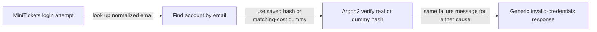

# User enumeration: equal timing, one error message

History: see [CHANGELOG.md](../CHANGELOG.md) or run `pnpm docs:history`

Area: Auth & Security · Status: 🟡 partial (login is protected; signup still says "Email already registered") · Step doc: [07 login](../../07-login-session.md)
<!-- interview-card: v2 -->

## 1. What is it?

User enumeration means discovering which accounts exist by comparing an application’s responses. Different messages or response times can reveal an email’s membership.

## 2. Why do we need it?

If MiniTickets says “unknown email” separately from “wrong password,” attackers can build a list of customers. Similar timing differences can provide another clue even with identical text.

## 3. How does it work?



1. Look up the account.
2. Perform password verification even when the email is unknown.
3. Return the same login failure message for unknown email and wrong password.

## 4. How do we use it in MiniTickets?

Login uses a dummy hash and shared error text. Signup still returns a conflict for an existing email, so account enumeration is not fully closed. Historical local timings are illustrative, not proof that every side channel is eliminated.

## 5. Interview-ready answer

“MiniTickets reduces login enumeration with identical failure messages and one Argon2 verification for both known and unknown emails. That removes an obvious message and work difference, but it is not a constant-time guarantee for the whole request. Signup still reveals existing emails, so a complete design would address that flow too.”

## 6. Important follow-up questions

- **Does equal text remove every leak?** No. Timing, status and other account flows can still reveal information.
- **Why verify a dummy hash?** It avoids the cheap unknown-user path.
- **How could signup improve?** An email-verification flow can use the same public response for new and existing accounts.
- **Why add rate limits?** They reduce attack throughput, while not fixing the underlying disclosure by themselves.

## 7. Advanced details

<details>
<summary>Technical reference</summary>

### Source references

- Anchor: `apps/api/src/services/auth.ts` · `DUMMY_HASH`, `login`: one argon2 verify always; one message for both failures.
- Anchor: `packages/shared/src/schemas/auth.ts` · `LoginInput`: no password rules at login (they would hint at the policy).

Step by step:

1. `findByEmail` may return nothing.
2. `verify(user?.passwordHash ?? DUMMY_HASH, password)`: an unknown email still costs one argon2
   verify. `DUMMY_HASH` uses the same parameters as real hashes, so the work is the same.
3. Both failures throw `UnauthorizedError("Invalid email or password")` → 401.
4. `LoginInput` only requires a non-empty password (max 128).

**Measured** on the owner's laptop against a local api: 20 logins with a wrong password for a known
email averaged **0.0099 s**; 20 for an unknown email averaged **0.0090 s**. (One run, one machine;
not a statistical test. The code comment says "about 10 ms measured on a dev laptop; depends on CPU and
argon2 settings", which matches this run.)

**The gap:** `auth.signup` returns 409 "Email already registered", so anyone can test an email at
signup. The e2e test even checks that message.

### Configuration and design

Dummy verify + one message at login. Signup left as-is for now. WHY: login is the high-volume attack
surface; fixing signup needs an email-verification flow (send "you already have an account" by
email), which we don't have.

### Checks and troubleshooting

```bash
E=you@example.com   # an email that exists locally
for kind in "$E" "nobody-$RANDOM@example.com"; do
  curl -s -o /dev/null -w "$kind %{http_code} %{time_total}s\n" -X POST localhost:4000/trpc/auth.login \
    -H 'content-type: application/json' -d "{\"email\":\"$kind\",\"password\":\"wrong-password\"}"
done
```

Both 401, similar times. Run it many times; single requests are noisy.

**Isolated thought experiment (not performed):** return early when `user` is undefined (skip `verify`). Unknown emails now
answer much faster than wrong passwords: the timing leaks which emails exist.

- Someone "optimises" the dummy verify away: timing leak. A test measuring timing would be flaky;
  code review and the comment in `login` guard it.
- Different error messages slip in: the e2e "wrong password" test checks the exact text.

- *How would you fix signup?* Verify-by-email flow with the same response for new and existing
  emails.
- *And password reset?* Always "if the account exists, we sent an email".

### Trade-offs and alternatives

- **Pros:** login reduces obvious message/work differences, without proving zero side channels; cheap to implement.
- **Cons:** every unknown-email attempt costs a full hash (CPU); signup still leaks.

- **Email-based signup:** always answer "check your email"; the email says either "welcome" or "you
  already have an account". Closes the signup leak.
- **Rate limiting** is built for login; signup limiting/CAPTCHA are possible extensions to reduce attack throughput.
- **Constant-time comparisons** for any secret compare (tokens).

### Further technical context

`login` always runs one argon2 verify, against a dummy hash with the same parameters
  when the email is unknown, and throws the same 401 message for both cases; the login schema has no
  password rules. Signup still returns 409 for a taken email, which is a known gap.

### Related reading

- **Uses ←** [password-hashing](password-hashing.md) (verify cost), [error-handling](error-handling.md).
- **Gives →** harder credential stuffing reconnaissance; pairs with future rate limiting (planned
  card `rate-limiting`).

[Open this piece in the city explorer](../guides/infra-explorer.html?concept=user-enumeration#chapter=8&piece=api-task).

## Where it appears in the story

- [App story: 8. The service](../app-story.md#8-the-service)

</details>
