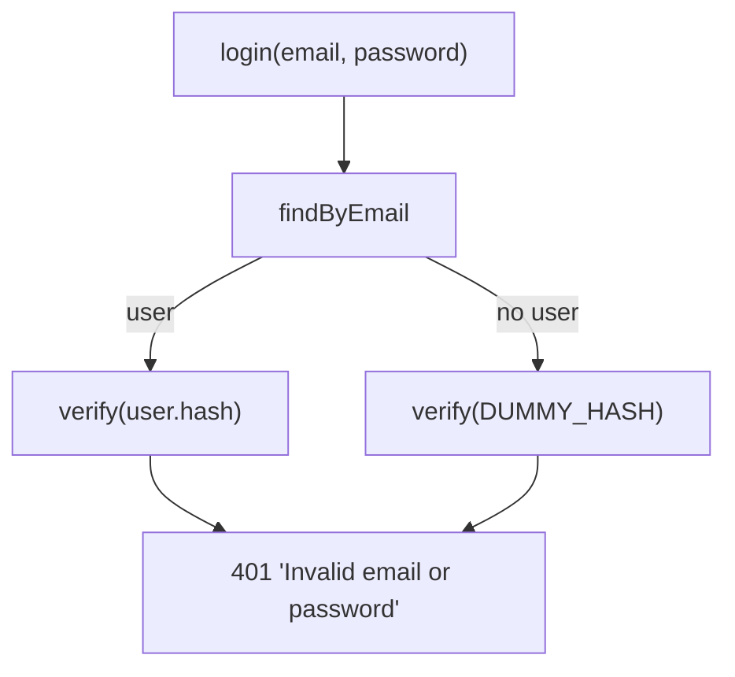

# User enumeration: equal timing, one error message

History: see [CHANGELOG.md](../CHANGELOG.md) or run `pnpm docs:history`

Area: Auth & Security · Status: 🟡 partial (login is protected; signup still says "Email already registered") · Step doc: [07 login](../../07-login-session.md)

## 1. In one line

**User enumeration** is finding out which emails have accounts by watching how the app answers;
our login gives the same message and takes about the same time for "unknown email" and "wrong
password".

## 2. Real-life comparison

A doorman who says "sorry, can't let you in" in the same tone and after the same pause whether or
not your name is on the list, so nobody learns who the members are.

## 3. Picture it



## 4. Where in our code

- Anchor: `apps/api/src/services/auth.ts` · `DUMMY_HASH`, `login`: one argon2 verify always; one message for both failures.
- Anchor: `packages/shared/src/schemas/auth.ts` · `LoginInput`: no password rules at login (they would hint at the policy).

Step by step:

1. `findByEmail` may return nothing.
2. `verify(user?.passwordHash ?? DUMMY_HASH, password)`: an unknown email still costs one argon2
   verify. `DUMMY_HASH` uses the same parameters as real hashes, so the work is the same.
3. Both failures throw `UnauthorizedError("Invalid email or password")` → 401.
4. `LoginInput` only requires a non-empty password (max 128).

**Measured** on the owner's laptop against a local api: 20 logins with a wrong password for a known
email averaged **0.0099 s**; 20 for an unknown email averaged **0.0090 s**. (One run, one machine;
not a statistical test. The code comment estimates "~50 ms" for a verify; on this laptop it was
faster.)

**The gap:** `auth.signup` returns 409 "Email already registered", so anyone can test an email at
signup. The e2e test even checks that message.

## 5. See it yourself

```bash
E=you@example.com   # an email that exists locally
for kind in "$E" "nobody-$RANDOM@example.com"; do
  curl -s -o /dev/null -w "$kind %{http_code} %{time_total}s\n" -X POST localhost:4000/trpc/auth.login \
    -H 'content-type: application/json' -d "{\"email\":\"$kind\",\"password\":\"wrong-password\"}"
done
```

Both 401, similar times. Run it many times; single requests are noisy.

**Break it on purpose:** return early when `user` is undefined (skip `verify`). Unknown emails now
answer much faster than wrong passwords: the timing leaks which emails exist.

## 6. How it connects

- **Uses ←** [password-hashing](password-hashing.md) (verify cost), [error-handling](error-handling.md).
- **Gives →** harder credential stuffing reconnaissance; pairs with future rate limiting (planned
  card `rate-limiting`).

## 7. Our settings and WHY

Dummy verify + one message at login. Signup left as-is for now. WHY: login is the high-volume attack
surface; fixing signup needs an email-verification flow (send "you already have an account" by
email), which we don't have.

## 8. Trade-offs

- **Pros:** login reveals nothing; cheap to implement.
- **Cons:** every unknown-email attempt costs a full hash (CPU); signup still leaks.

## 9. Alternatives and when to choose them

- **Email-based signup:** always answer "check your email"; the email says either "welcome" or "you
  already have an account". Closes the signup leak.
- **Rate limiting and CAPTCHA** on login and signup: makes enumeration slow.
- **Constant-time comparisons** for any secret compare (tokens).

## 10. What breaks, and how we'd notice

- Someone "optimises" the dummy verify away: timing leak. A test measuring timing would be flaky;
  code review and the comment in `login` guard it.
- Different error messages slip in: the e2e "wrong password" test checks the exact text.

## 13. Interview answers at 3 levels

- **Simple:** Login never tells you whether the email exists.
- **Senior:** `login` always runs one argon2 verify, against a dummy hash with the same parameters
  when the email is unknown, and throws the same 401 message for both cases; the login schema has no
  password rules. Signup still returns 409 for a taken email, which is a known gap.
- **Lead:** Enumeration matters because it feeds credential stuffing and phishing. Close every
  channel: messages, timing, signup and reset flows, then add rate limiting so the remaining signal
  is too slow to use.

## 14. Follow-up questions interviewers ask

- *How would you fix signup?* Verify-by-email flow with the same response for new and existing
  emails.
- *And password reset?* Always "if the account exists, we sent an email".

## 15. Say it in 30 seconds

"Login gives the same 401 'Invalid email or password' and takes about the same time whether the
email exists or not: unknown emails are verified against a dummy argon2 hash. Signup still says
'Email already registered', which leaks; the fix is an email-verification signup flow plus rate
limiting."

## 16. Status

🟡 partial. **To make it production-grade:** email-verified signup with one response for both
cases, the same for password reset, and rate limiting on auth endpoints.
