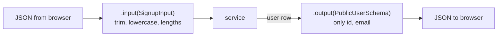

# Validation at boundaries: input and output schemas

History: see [CHANGELOG.md](../CHANGELOG.md) or run `pnpm docs:history`

Area: API · Status: ✅ built · Step doc: [04 signup form](../../04-signup-form.md), [06 signup api](../../06-signup-api.md)

## 1. In one line

Every piece of data that **enters** the api is checked by a Zod schema (`.input()`), and every
answer that **leaves** is filtered by one (`.output()`), so a password hash can never be sent even
by mistake.

## 2. Real-life comparison

Customs at both ends of a border: incoming luggage is checked against a list of what's allowed, and
outgoing luggage is checked against a list of what may leave. Whatever is not on the list stays
behind.

## 3. Picture it



## 4. Where in our code

- Anchor: `apps/api/src/procedures/auth.ts` · `signup`, `login`: `.input(SignupInput)`, `.input(LoginInput)`, `.output(PublicUserSchema)`.
- Anchor: `apps/api/src/procedures/account.ts` · `profile`: `.output(ProfileSchema)`.
- Anchor: `packages/shared/src/schemas/auth.ts` · `SignupInput`, `LoginInput`, `PublicUserSchema`: the shared schemas.

Step by step:

1. `SignupInput`: email is trimmed and lowercased **then** checked as an email
   (`.pipe(z.email(...))`); password 8-128 characters; `.refine` puts "Passwords do not match" on
   `confirmPassword`.
2. tRPC runs `.input()` before the procedure body. Invalid → `ZodError` → 400 with `fieldErrors`
   ([error-handling](error-handling.md)).
3. The procedure gets the **parsed** value: `"  Bob@X.com "` arrives as `"bob@x.com"`, so the
   unique email constraint works case-insensitively.
4. `.output(PublicUserSchema)` parses the service's return value and sends the **parsed** value.
   Zod objects drop unknown keys by default, so only `id` and `email` can leave. (Verified in the
   installed `@trpc/server` 11.19.0 source: `outputValidatorMiddleware` replaces `result.data`
   with the parsed data; if parsing fails it throws `INTERNAL_SERVER_ERROR` "Output validation
   failed".) The services also pick fields by hand: two locks.
5. The browser runs the same schemas for fast feedback ([accessible-forms](accessible-forms.md));
   the server never trusts that.
6. Other boundaries: env vars at startup ([config-validation](config-validation.md)), the
   `?next=` URL parameter ([open-redirect](open-redirect.md)).

## 5. See it yourself

```bash
curl -s -X POST localhost:4000/trpc/auth.signup -H 'content-type: application/json' \
  -d '{"email":"nope","password":"short","confirmPassword":"x"}'
# 400, fieldErrors for email, password and confirmPassword (recorded against a local api)
```

Unit test: `packages/shared/src/schemas/auth.test.ts` ("trims and lowercases the email").

**Break it on purpose:** in `services/auth.ts` `signup`, return the whole `user` row. The response
still contains only `id` and `email`: `.output()` strips `passwordHash`. Now also remove
`.output(...)`: the hash goes to the browser. That is why both exist.

## 6. How it connects

- **Uses ←** [monorepo](monorepo.md) (shared package), Zod 4.
- **Gives →** safe inputs for services; [end-to-end-types](end-to-end-types.md) (output schemas
  shape the web types); [user-enumeration](user-enumeration.md) (no password rules on login).

## 7. Our settings and WHY

| Rule | Why |
| ---- | --- |
| Normalise before validating (trim, lowercase) | One email, one account, whatever the case. |
| `max(128)` on passwords | A huge string would make argon2 slow: a cheap denial of service. |
| No password rules on `LoginInput` | Only "does it match?"; rules would reveal the policy. |
| `.output()` on every procedure | Defence in depth against leaking fields. |

## 8. Trade-offs

- **Pros:** one schema for browser and server; types inferred (`z.infer`); safe outputs.
- **Cons:** `.output()` costs a parse per response; schemas are code to maintain.

## 9. Alternatives and when to choose them

- **JSON Schema with Fastify's built-in validation:** fast, language-neutral; for plain REST routes.
- **Valibot / ArkType:** smaller or faster Zod-like libraries.
- **Database constraints only:** last line of defence, bad error messages.

## 10. What breaks, and how we'd notice

- A missing `.input()`: the procedure receives `undefined` or anything; TypeScript complains about
  missing input types in most cases.
- A schema that rejects valid data: users can't sign up; e2e signup tests fail.

## 13. Interview answers at 3 levels

- **Simple:** The server checks everything coming in and filters everything going out.
- **Senior:** Shared Zod schemas validate inputs in `.input()` (normalising email first, length
  limits on passwords) and filter outputs with `.output()`, so a hash can't leak even if a service
  returns the full row. The browser runs the same schemas for UX only.
- **Lead:** Validate at every trust boundary (HTTP, env, URL params, and later queues), parse don't
  just check, and filter outputs as well as inputs. One schema shared by both sides prevents drift.

## 14. Follow-up questions interviewers ask

- *Why validate on the server if the client already did?* Anyone can call the api directly.
- *Parse vs validate?* Parsing returns a cleaned, typed value (`bob@x.com`), not just yes/no.

## 15. Say it in 30 seconds

"Every input is parsed with a shared Zod schema that also normalises it, like lowercasing the
email, and every output is filtered by a schema, so a password hash can't leave even if a service
returns too much. The browser runs the same schemas for fast feedback, but the server never trusts
it."

## 16. Status

✅ built.
