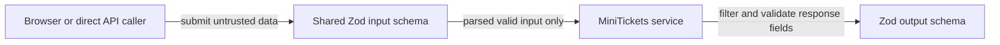

# Validation at boundaries: input and output schemas

History: see [CHANGELOG.md](../CHANGELOG.md) or run `pnpm docs:history`

Area: API · Status: ✅ built · Step doc: [04 signup form](../../04-signup-form.md), [06 signup api](../../06-signup-api.md)
<!-- interview-card: v2 -->

## 1. What is it?

Boundary validation checks data whenever it crosses into a trusted part of the system. Parsing also produces the cleaned, typed value that later code should use.

## 2. Why do we need it?

The browser can send a malformed email or an extra sensitive field. MiniTickets must accept only supported inputs and send only intended outputs, even when callers bypass the form.

## 3. How does it work?



1. Parse incoming data with the appropriate schema.
2. Pass the parsed result into application work.
3. Parse outgoing responses through their public schema.

## 4. How do we use it in MiniTickets?

Shared schemas normalize email and bound password length. tRPC applies input and output schemas; browser checks provide quick feedback only. Environment variables, stored messages and redirect parameters have their own boundaries too.

## 5. Interview-ready answer

“MiniTickets validates at trust boundaries rather than relying on TypeScript or the browser. Shared Zod schemas turn input into cleaned values before services use it, and output schemas restrict the public response shape. This reduces malformed data and accidental field leaks. Database constraints and authorization remain necessary because valid input is not automatically permitted input.”

## 6. Important follow-up questions

- **Why validate again on the server?** Anyone can bypass browser validation with a direct request.
- **Parsing versus checking?** Parsing returns the accepted cleaned value, not just a yes/no result.
- **Does validation authorize an action?** No. A valid user ID may still refer to someone else’s record.
- **What if output parsing fails?** Treat it as a server error rather than sending an invalid response.

## 7. Advanced details

<details>
<summary>Technical reference</summary>

### Source references

- Anchor: `apps/api/src/procedures/auth.ts` · `signup`, `login`: `.input(SignupInput)`, `.input(LoginInput)`, `.output(PublicUserSchema)`.
- Anchor: `apps/api/src/procedures/account.ts` · `profile`: `.output(ProfileSchema)`.
- Anchor: `packages/shared/src/schemas/auth.ts` · `SignupInput`, `LoginInput`, `PublicUserSchema`: the shared schemas.
- Anchor: `apps/api/src/procedures/events.ts` · `list`: `.output(ListEventsOutput)` from `packages/shared/src/schemas/events.ts`.

Step by step:

1. `SignupInput`: email is trimmed and lowercased **then** checked as an email
   (`.pipe(z.email(...))`); password 8-128 characters; `.refine` puts "Passwords do not match" on
   `confirmPassword`.
2. tRPC runs `.input()` before the procedure body. Invalid → `ZodError` → 400 with `fieldErrors`
   ([error-handling](error-handling.md)).
3. The procedure gets the **parsed** value: `"  Bob@X.com "` arrives as `"bob@x.com"`, so the
   unique email constraint works case-insensitively.
4. `.output(PublicUserSchema)` parses the service's return value and sends the **parsed** value.
   Zod objects drop unknown keys by default, so only `id`, `email` and `role` can leave. (Verified in the
   installed `@trpc/server` 11.19.0 source: `outputValidatorMiddleware` replaces `result.data`
   with the parsed data; if parsing fails it throws `INTERNAL_SERVER_ERROR` "Output validation
   failed".) The services also pick fields by hand: two locks.
5. The browser runs the same schemas for fast feedback ([accessible-forms](accessible-forms.md));
   the server never trusts that.
6. Other boundaries: env vars at startup ([config-validation](config-validation.md)), the
   `?next=` URL parameter ([open-redirect](open-redirect.md)).

### Configuration and design

| Rule | Why |
| ---- | --- |
| Normalise before validating (trim, lowercase) | One email, one account, whatever the case. |
| `max(128)` on passwords | A huge string would make argon2 slow: a cheap denial of service. |
| No password rules on `LoginInput` | Only "does it match?"; rules would reveal the policy. |
| `.output()` on every procedure | Defence in depth against leaking fields. |

### Checks and troubleshooting

```bash
curl -s -X POST localhost:4000/trpc/auth.signup -H 'Origin: http://localhost:3000' -H 'content-type: application/json' \
  -d '{"email":"nope","password":"short","confirmPassword":"x"}'
# 400, fieldErrors for email, password and confirmPassword (recorded against a local api)
```

Unit test: `packages/shared/src/schemas/auth.test.ts` ("trims and lowercases the email").

**Isolated thought experiment (not performed):** in `services/auth.ts` `signup`, return the whole `user` row. The response
still contains only `id`, `email` and `role`: `.output()` strips `passwordHash`. Now also remove
`.output(...)`: the hash goes to the browser. That is why both exist.

- A missing `.input()`: the procedure receives `undefined` or anything; TypeScript complains about
  missing input types in most cases.
- A schema that rejects valid data: users can't sign up; e2e signup tests fail.

- *Why validate on the server if the client already did?* Anyone can call the api directly.
- *Parse vs validate?* Parsing returns a cleaned, typed value (`bob@x.com`), not just yes/no.

### Trade-offs and alternatives

- **Pros:** one schema for browser and server; types inferred (`z.infer`); safe outputs.
- **Cons:** `.output()` costs a parse per response; schemas are code to maintain.

- **JSON Schema with Fastify's built-in validation:** fast, language-neutral; for plain REST routes.
- **Valibot / ArkType:** smaller or faster Zod-like libraries.
- **Database constraints only:** last line of defence, bad error messages.

### Further technical context

Shared Zod schemas validate inputs in `.input()` (normalising email first, length
  limits on passwords) and filter outputs with `.output()`, so unknown output fields such as passwordHash are removed even if a service
  returns the full row. The browser runs the same schemas for UX only.

### Related reading

- **Uses ←** [monorepo](monorepo.md) (shared package), Zod 4.
- **Gives →** safe inputs for services; [end-to-end-types](end-to-end-types.md) (output schemas
  shape the web types); [user-enumeration](user-enumeration.md) (no password rules on login).

[Open this piece in the city explorer](../guides/infra-explorer.html?concept=validation-at-boundaries#chapter=8&piece=api-task).

## Where it appears in the story

- [App story: 7. The procedure](../app-story.md#7-the-procedure)
- [App story: 13. Validation at boundaries](../app-story.md#13-validation-at-boundaries)

</details>
