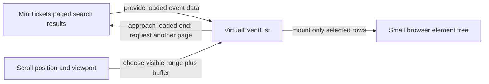

# Virtualization

History: see [CHANGELOG.md](../CHANGELOG.md) or run `pnpm docs:history`

Area: Frontend · Status: ✅ built in repository; live AWS acceptance is separate

<!-- interview-card: v2 -->

## 1. What is it?

Virtualization renders only the list rows near the visible screen. The full loaded list can exist as data without creating a page element for every row.

## 2. Why do we need it?

A visitor may browse thousands of MiniTickets events. Drawing every loaded row makes the browser do unnecessary layout and painting even though only a few rows are visible.

## 3. How does it work?

1. Fetch a bounded page of event data.
2. Calculate visible rows plus a small surrounding buffer.
3. Move the rendered window as the visitor scrolls and load more when needed.

## 4. How do we use it in MiniTickets?

`VirtualEventList` uses fixed-height rows and stable event IDs. Search pagination limits transfer; virtualization limits rendered elements. Loaded page memory is a separate concern, and the interface retains an accessible load-more control.

## 5. Interview-ready answer

“MiniTickets combines pagination with virtualization because they solve different costs. Search pages bound data transfer, while the virtual list bounds mounted browser elements. A visible window and small buffer keep scrolling work manageable. Fixed row heights simplify calculation, but accessibility, keyboard behavior and retained page memory still need attention. This does not make an inefficient SQL query efficient.”

## 6. Important follow-up questions

- **Does it reduce database rows scanned?** No. Indexes and pagination address database work.
- **Does a small element tree bound all memory?** No. Retained result pages can still accumulate.
- **Why fixed-height rows?** They simplify position calculation, but constrain layout and content.
- **When would plain pagination be better?** When simpler navigation and accessibility outweigh continuous scrolling.

## 7. Advanced details

Technical reference

### Implementation and historical exercise

`apps/web/src/features/events/components/virtual-event-list.tsx` → `VirtualEventList` renders fixed-height visible rows plus overscan, using stable event IDs. Search pages contain **50** rows. Load-more remains accessible; position semantics and keyboard use require review, not only a small DOM count.

`pnpm demo:search` seeds an isolated **10,000-event** dataset, checks ordering/query plans and related headless assertions; the virtual-list browser check bounds rendered rows. These are described exercises, not new execution or AWS acceptance from this rewrite.

### Alternatives and growth

Variable-height virtualization needs measurement or a library. Pagination is a valid simpler alternative. Bound retained pages as well as mounted elements. At greater scale, server ranking, narrower payloads or justified search infrastructure may matter more than another browser optimization. The full dataset should not become 10,000 mounted React rows.

### Code anchors

- Anchor: `apps/web/src/features/events/components/virtual-event-list.tsx` — `VirtualEventList`; follow the numbered comments at this boundary.

### Related reading

[current system](../00-big-picture.md) · [scenario](../guides/interview-scenarios.md#virtual-lists) · [explorer tour](../guides/infra-explorer.html?tour=search)

[Open this concept in the city explorer](../guides/infra-explorer.html?concept=virtualization#chapter=8&piece=web-task).

## Where it appears in the story

- [app-story: 1b. Search input, hydration and bounded rows](../app-story.md#1b-search-input-hydration-and-bounded-rows)

