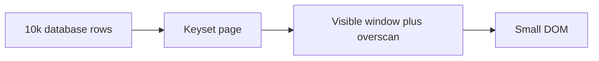

# Virtualization

History: see [CHANGELOG.md](../CHANGELOG.md) or run `pnpm docs:history`

Area: Frontend · Status: ✅ built in repository; live AWS acceptance is separate

## 1. In one line

Virtualization mounts only the visible fixed-height rows plus overscan. It bounds DOM work while keyset pages bound transfer; retained page memory is a separate limit and load-more remains accessible.

## 2. Real-life comparison

A catalogue with a bookmark: each question and position has its own identity, and only the visible page lies open.

## 3. Picture it

## 4. Where in our code

- Anchor: `apps/web/src/features/events/components/virtual-event-list.tsx` — `VirtualEventList`; follow the numbered comments at this boundary.

`apps/web/src/features/events/components/virtual-event-list.tsx` renders a bounded window. Search returns pages of 50. `pnpm demo:search` seeds an isolated 10k dataset, checks ordering/plans and runs related headless assertions. The virtual-list browser check bounds rendered rows.

## 5. See it yourself

Run `pnpm demo:search` and inspect the asserted outcome described above.

Failure thought experiment: Does virtualization reduce SQL rows scanned? No; indexes and pagination do that. Do not change a live stack to demonstrate it.

## 6. How it connects

Uses the [current system](../00-big-picture.md); gives a concrete decision to the [scenario](../guides/interview-scenarios.md#virtual-lists) and [explorer tour](../guides/infra-explorer.html?tour=search).

## 7. Our settings and WHY

Virtualization mounts only the visible fixed-height rows plus overscan. It bounds DOM work while keyset pages bound transfer; retained page memory is a separate limit and load-more remains accessible. Large DOM trees hurt layout, paint, memory and interaction.

## 8. Trade-offs

Fixed heights are simple but constrain content. Variable-height libraries add measurement. Virtual lists need accessible list position and keyboard testing; pagination is a valid alternative.

## 9. Alternatives and when to choose them

10x: bound retained pages as well as DOM. 100x: server-side ranking, narrower payloads and a search engine may matter more than another UI optimization.

## 10. What breaks and how we notice

Does virtualization reduce SQL rows scanned? No; indexes and pagination do that.

## 13. Interview answers at 3 levels

- **Simple:** Virtualization mounts only the visible fixed-height rows plus overscan.
- **Senior:** Pagination bounds transfer and database work; virtualization bounds mounted DOM nodes. They solve different problems. Keep stable event ids, a fixed-height window and overscan. Fetch the next keyset page before the user reaches the end. The full dataset should never become 10,000 React rows.
- **Lead:** 10x: bound retained pages as well as DOM. 100x: server-side ranking, narrower payloads and a search engine may matter more than another UI optimization.

## 14. Follow-up questions with answers

Does virtualization reduce SQL rows scanned? No; indexes and pagination do that.

What does virtualization primarily bound? **Mounted DOM nodes.**

## 15. Say it in 30 seconds

Pagination bounds transfer and database work; virtualization bounds mounted DOM nodes. They solve different problems. Keep stable event ids, a fixed-height window and overscan. Fetch the next keyset page before the user reaches the end. The full dataset should never become 10,000 React rows.

## 16. Status and production work

Repository implementation and local evidence are described above. Live AWS/CI execution remains owner acceptance. 10x: bound retained pages as well as DOM. 100x: server-side ranking, narrower payloads and a search engine may matter more than another UI optimization.

## Where it appears in the story

- [app-story: 1b. Search input, hydration and bounded rows](../app-story.md#1b-search-input-hydration-and-bounded-rows)
