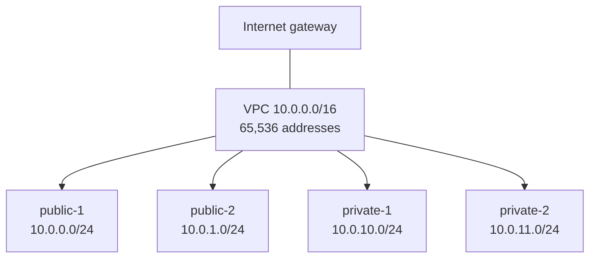

# VPC and CIDR blocks

History: see [CHANGELOG.md](../CHANGELOG.md) or run `pnpm docs:history`

Area: AWS Network · Status: ✅ built · Step doc: [12 network](../../12-infra-network.md)

## 1. In one line

A **VPC** (Virtual Private Cloud) is our own private, isolated network inside AWS, with an IP
address range written as a **CIDR block** (ours: `10.0.0.0/16`).

## 2. Real-life comparison

A private office building. Nobody walks in from the street unless we add a front door (the
internet gateway). The building's address range is every room number that starts with "10.0".

## 3. Picture it



**CIDR in one picture:** `/16` fixes the first 16 of 32 bits (`10.0`), leaving 16 bits free =
65,536 addresses. `/24` fixes 24 bits, leaving 256 (AWS keeps 5 per subnet, so 251 usable).

## 4. Where in our code

- Anchor: `infra/src/network.ts` · `vpc`: the VPC with `cidrBlock: "10.0.0.0/16"` and DNS turned on.

Step by step:

1. `new aws.ec2.Vpc(...)` with `cidrBlock: "10.0.0.0/16"`.
2. `enableDnsSupport: true` lets machines in the VPC look up names; `enableDnsHostnames: true` gives
   them names. RDS and ElastiCache endpoints are DNS names that resolve to private `10.0.x.x`
   addresses, so both must be on.
3. `tags: tagsFor(...)` (`infra/src/tags.ts`) adds `Project`, `Env`, `ManagedBy` and `Name`.
4. `vpc.id` is returned as `vpcId` and used by the security groups and target groups (both belong
   to exactly one VPC).

## 5. See it yourself

```bash
cd infra
aws ec2 describe-vpcs --profile ticketlite --vpc-ids $(pulumi stack output vpcId) \
  --query "Vpcs[0].[CidrBlock,State]"
aws ec2 describe-vpc-attribute --profile ticketlite --vpc-id $(pulumi stack output vpcId) \
  --attribute enableDnsHostnames
```

**Break it on purpose (thought experiment, do not apply):** a new subnet with `10.0.0.128/25`
overlaps `public-1` (`10.0.0.0/24`). AWS refuses it: one address can belong to only one subnet.

## 6. How it connects

- **Uses ←** the region ([regions-and-azs](regions-and-azs.md)).
- **Gives →** the home for [subnets](subnets.md), [route tables](route-tables.md),
  [security groups](security-groups.md) and [target groups](target-groups.md).

## 7. Our settings and WHY

| Setting | Value | Why |
| ------- | ----- | --- |
| `cidrBlock` | `10.0.0.0/16` | A private range (`10.x` is never used on the public internet), and room for many more subnets later. |
| DNS support + hostnames | on | RDS and Valkey are reached by DNS name. |
| One VPC | dev only | No prod stack exists. |

## 8. Trade-offs

- **Pros:** a big range costs nothing and avoids renumbering later.
- **Cons:** `10.0.0.0/16` is a very common choice. If we ever connect to another network (a peer
  VPC, an office VPN) that also uses it, the ranges clash and cannot be routed.

## 9. Alternatives and when to choose them

- **A less common range** (e.g. `10.42.0.0/16`): when the VPC will be peered or joined to a
  company network.
- **The default VPC** AWS creates in every region: fine for experiments, but all its subnets are
  public. We build our own so we control public vs private.
- **IPv6 in addition:** when clients or partners need IPv6; adds complexity to rules.

## 10. What breaks, and how we'd notice

- **DNS hostnames off:** the api cannot resolve the RDS and Valkey endpoints; connection errors at
  start (`ENOTFOUND`), `/ready` 503.
- **Range clash** with a peer network: peering or VPN routes are refused.

## 11. Reach / Allowed / Password

**Reach** starts here: anything outside the VPC cannot reach anything inside without a door (the
internet gateway) and a route. IAM and passwords are not part of a VPC.

## 12. Cost

A VPC, its subnets and route tables are free. Things inside it cost money (NAT gateways, public
IPv4 addresses, load balancers).

## 13. Interview answers at 3 levels

- **Simple:** A VPC is a private network in AWS. Ours is `10.0.0.0/16`.
- **Senior:** We create our own VPC with DNS support and hostnames on, so private endpoints like RDS
  resolve to `10.0.x.x`. It is split into four `/24` subnets, two public and two private, one of each
  per AZ. Security groups and target groups are scoped to this VPC.
- **Lead:** I plan CIDR ranges across all VPCs of a company up front, so peering and VPNs never
  clash, and I keep one VPC per environment and account, which gives a hard network boundary between
  dev and prod.

## 14. Follow-up questions interviewers ask

- *How many addresses in a /24, and how many usable?* 256; AWS reserves 5, so 251.
- *Can you change a VPC's CIDR?* You can add secondary ranges; you cannot change the primary.
- *Why private address ranges?* They are never routed on the public internet, so they cannot clash
  with public addresses.

## 15. Say it in 30 seconds

"Our VPC is `10.0.0.0/16` with DNS support and hostnames on, split into four `/24` subnets across
two AZs. It is the network boundary: nothing gets in without the internet gateway, a route and a
security group rule."

## 16. Status

✅ built.
