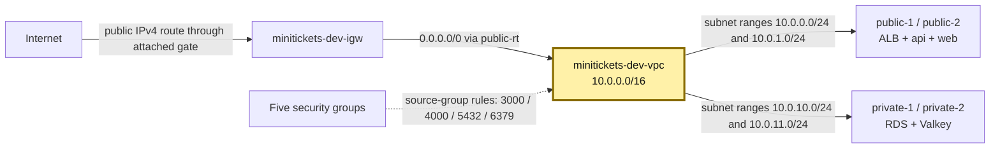
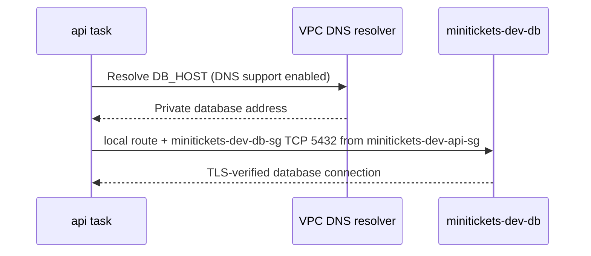

# VPC: our gated city

History: see [CHANGELOG.md](../CHANGELOG.md) or run `pnpm docs:history`

Area: AWS Network · Status: ✅ built · Step doc: [12 network](../../12-infra-network.md)
<!-- interview-card: v1 -->

## 1. In one line

MiniTickets puts its workers and databases inside one [VPC](../glossary.md#vpc): a private AWS network with house numbers `10.0.0.0/16`.

## 2. Where it sits

[Open this piece in the city explorer](../guides/infra-explorer.html?concept=vpc#chapter=24&piece=vpc).

## 3. How it works

## 4. What happens in MiniTickets

1. `createNetwork` builds `minitickets-dev-vpc` in `us-east-1`.
2. Its address range holds 65,536 addresses; a [CIDR](../glossary.md#c) is a compact way to write that range.
3. Four smaller neighborhoods divide those addresses across two available zones.
4. Public roads reach the internet gate. Private roads stay inside.
5. DNS, the name lookup service, resolves RDS and Valkey names. Both VPC DNS settings are enabled.

## 5. Reach / Allowed / Password

**Reach:** routes join neighborhoods; the gate joins public addresses to the internet.

**Allowed:** security groups still check each connection; a VPC grants no AWS API permission.

**Password:** not needed by the network; Postgres and Valkey check their own credentials.

## 6. In our code

`infra/src/network.ts` → `createNetwork` (`vpc`).

`infra/src/tags.ts` → `tagsFor`.

## 7. In the AWS console

In `us-east-1`: VPC → Your VPCs → `minitickets-dev-vpc` → **Resource map** → Show details. See four subnets, their road signs and the gate. [AWS map guide](https://docs.aws.amazon.com/vpc/latest/userguide/view-vpc-resource-map.html). Resource Groups & Tag Editor → Tag Editor → search `Project=minitickets` finds supported resources. Live inventory was not checked.

## 8. Good / Bad

**Good:** our network boundary is explicit; the address range leaves room to grow.

**Bad:** a common range can clash with another company's network; a city wall does not replace door guards.

## 9. Other choices

- Pick a less common range when joining a company network.
- Pick IPv6 alongside IPv4 when clients or network policy require it.

## 10. Connected to

| Neighbor | Direction | What allows it | Console check |
| --- | --- | --- | --- |
| [Subnets](subnets.md) | VPC → neighborhoods | Non-overlapping ranges inside `/16` | VPC → Subnets |
| [Road signs](route-tables.md) | VPC → paths | Same VPC ID; subnet associations | VPC → Route tables |
| [Door guards](security-groups.md) | Guard resources | Rules scoped to this VPC | EC2 → Security Groups |

## 11. When it breaks

- Wrong names fail → check VPC DNS resolution and app configuration → restore the missing setting.
- Joined networks cannot talk → compare address ranges → remove overlap before connecting them.

## 12. Say it in 30 seconds

“MiniTickets has one gated city: `10.0.0.0/16`. Four subnets separate public workers from private data. Routes provide roads, security groups guard doors, and credentials protect the stores. Those are separate checks; creating the VPC alone opens nothing.”

## 13. Likely follow-ups

- **Is the VPC one zone?** No. Our VPC spans the region; each subnet belongs to one zone.
- **Can the primary range change?** It cannot be resized in place; secondary ranges can be added.

## 14. Remember it

The city owns the addresses; roads and guards decide who can visit.

## 15. More detail

Reference notes, source anchors and earlier useful detail

- Anchor: `infra/src/network.ts` · `vpc`: the VPC with `cidrBlock: "10.0.0.0/16"` and DNS turned on.

### Addresses and boundaries

`/16` fixes 16 of IPv4's 32 bits and leaves 65,536 addresses. Each `/24` leaves 256; AWS reserves five, leaving 251 usable addresses. Subnet ranges cannot overlap. Adding `10.0.0.128/25` would overlap `public-1` and AWS would refuse it.

`enableDnsSupport` enables the VPC resolver; `enableDnsHostnames` controls assigned hostnames. Both are true here. The earlier card overstated that turning hostnames off alone necessarily breaks RDS resolution; check DNS support, resolver settings and the actual endpoint instead.

`vpcId` feeds security groups and target groups. `publicSubnetIds` and `privateSubnetIds` feed later layers through `infra/index.ts`. Tags are `Project=minitickets`, `Env=dev`, `ManagedBy=pulumi`, and `Name`. Only a dev stack exists; one VPC per environment/account is a future isolation choice.

A custom VPC makes placement explicit. The default VPC is convenient for experiments but begins with public subnets. IPv6 adds another family of routes and rules. A less common private range avoids future peering/VPN clashes. Private ranges are not routed on the public internet.

The VPC, subnets and route tables have no separate hourly charge. Gateways with processing charges, public IPv4 addresses, load balancers and hosted resources can add cost; old guide prices are historical examples, not a quote.

Read-only checks: `aws ec2 describe-vpcs` with the actual VPC ID, and `aws ec2 describe-vpc-attribute --vpc-id <actual-id> --attribute enableDnsHostnames`. Use `AWS_PROFILE=ticketlite`; never inspect secret values. The VPC Resource map is a network map, not an inventory of every application resource.

## Where it appears in the story

- [Infra story: 10. The network: VPC, subnets, route tables, internet gateway](../infra-story.md#10-the-network-vpc-subnets-route-tables-internet-gateway)
- [Big picture: 4. Components](../00-big-picture.md#4-components)
