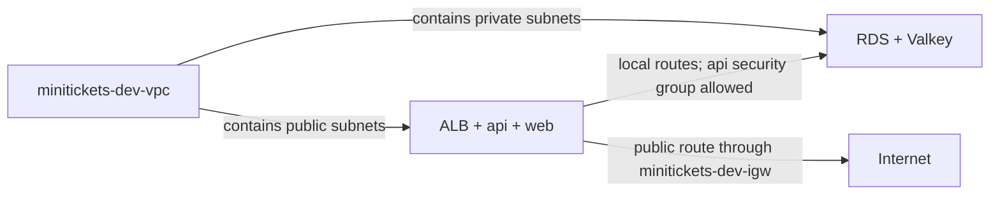

# VPC: our gated city

History: see [CHANGELOG.md](../CHANGELOG.md) or run `pnpm docs:history`

Area: AWS Network · Status: ✅ built · Step doc: [12 network](../../12-infra-network.md)
<!-- interview-card: v2 -->

## 1. What is it?

A [VPC](../glossary.md#vpc) is a private network in AWS. MiniTickets uses it to give its applications and databases a shared address space with controlled connections.

## 2. Why do we need it?

A booking API needs to reach its database without putting that database on the public internet. Think of an office: visitors use reception, while staff reach internal rooms.

## 3. How does it work?

1. The VPC supplies private addresses.
2. Subnets divide those addresses into smaller areas.
3. Routes choose paths; security groups allow particular connections.

## 4. How do we use it in MiniTickets?

The ALB, api and web use public subnets. RDS and Valkey use private subnets. API calls to the stores stay within the VPC; network placement does not replace passwords.

## 5. Interview-ready answer

“MiniTickets uses a VPC to control how its components connect. Public entry and application tasks share the network with private data stores. Subnets organize placement, routes provide paths, and security groups restrict callers. Keeping those responsibilities separate makes access problems easier to diagnose.”

## 6. Important follow-up questions

- **Does a VPC make everything secure?** No. Routes, security rules and application authentication still matter.
- **Does it belong to one availability zone?** No. It spans a region; each subnet belongs to one zone.
- **What if two connected networks use overlapping addresses?** Routing becomes ambiguous; plan non-overlapping ranges before joining them.
- **What if a database name stops resolving?** Check DNS settings and the configured endpoint before blaming database credentials.

## 7. Advanced details

Technical reference

### Implementation and operations

`infra/src/network.ts` → `createNetwork` creates `minitickets-dev-vpc` in `us-east-1`; `infra/src/tags.ts` → `tagsFor` supplies the tags. Four subnets span the first two available zones. The original topology places ALB/api/web in the public pair and RDS/Valkey in the private pair. API resolves `DB_HOST`, then connects to the private address through the local route and `minitickets-dev-db-sg` allowing TCP 5432 from `minitickets-dev-api-sg`; TLS verifies the database connection.

VPC → Your VPCs → `minitickets-dev-vpc` → **Resource map** → Show details displays the subnets, tables and gateway. Resource Groups & Tag Editor → Tag Editor → search `Project=minitickets` finds supported resources. Live inventory was not checked. Security groups are scoped to the VPC; subnet associations select route tables. A VPC grants neither AWS API permissions nor store credentials.

- Anchor: `infra/src/network.ts` · `vpc`: the VPC with `cidrBlock: "10.0.0.0/16"` and DNS turned on.

### Addresses and boundaries

`/16` fixes 16 of IPv4's 32 bits and leaves 65,536 addresses. Each `/24` leaves 256; AWS reserves five, leaving 251 usable addresses. Subnet ranges cannot overlap. Adding `10.0.0.128/25` would overlap `public-1` and AWS would refuse it.

`enableDnsSupport` enables the VPC resolver; `enableDnsHostnames` controls assigned hostnames. Both are true here. The earlier card overstated that turning hostnames off alone necessarily breaks RDS resolution; check DNS support, resolver settings and the actual endpoint instead.

`vpcId` feeds security groups and target groups. `publicSubnetIds` and `privateSubnetIds` feed later layers through `infra/index.ts`. Tags are `Project=minitickets`, `Env=dev`, `ManagedBy=pulumi`, and `Name`. Only a dev stack exists; one VPC per environment/account is a future isolation choice.

A custom VPC makes placement explicit. The default VPC is convenient for experiments but begins with public subnets. IPv6 adds another family of routes and rules. A less common private range avoids future peering/VPN clashes. Private ranges are not routed on the public internet.

The VPC, subnets and route tables have no separate hourly charge. Gateways with processing charges, public IPv4 addresses, load balancers and hosted resources can add cost; old guide prices are historical examples, not a quote.

Read-only checks: `aws ec2 describe-vpcs` with the actual VPC ID, and `aws ec2 describe-vpc-attribute --vpc-id <actual-id> --attribute enableDnsHostnames`. Use `AWS_PROFILE=ticketlite`; never inspect secret values. The VPC Resource map is a network map, not an inventory of every application resource.

### Related reading

- [CIDR](../glossary.md#c)
- [AWS map guide](https://docs.aws.amazon.com/vpc/latest/userguide/view-vpc-resource-map.html)
- [Subnets](subnets.md)
- [Road signs](route-tables.md)
- [Door guards](security-groups.md)

[Open this piece in the city explorer](../guides/infra-explorer.html?concept=vpc#chapter=24&piece=vpc).

## Where it appears in the story

- [Infra story: 10. The network: VPC, subnets, route tables, internet gateway](../infra-story.md#10-the-network-vpc-subnets-route-tables-internet-gateway)
- [Big picture: 4. Components](../00-big-picture.md#4-components)

