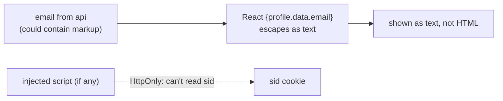

# XSS (cross-site scripting)

History: see [CHANGELOG.md](../CHANGELOG.md) or run `pnpm docs:history`

Area: Auth & Security · Status: 🟡 partial (React escaping + HttpOnly cookie; no Content-Security-Policy) · Step doc: [07 login](../../07-login-session.md)

## 1. In one line

**XSS** is an attacker's JavaScript running inside our page; React escapes everything we render, and
the session cookie is HttpOnly so even injected script can't steal it, but we have no
Content-Security-Policy yet.

## 2. Real-life comparison

A notice board where anyone can pin a note. If the board shows notes as written text (escaping), a
note saying "open the safe" is just text. If it treats notes as instructions, the note runs. HttpOnly
is the safe key kept where notes can't reach.

## 3. Picture it



## 4. Where in our code

- Anchor: `apps/api/src/procedures/auth.ts` · `cookieOptions.httpOnly: true`: limits the damage.
- Anchor: `apps/web/src/features/account/components/profile-card.tsx` · `{profile.data.email}`: user data rendered through React's escaping.

Step by step:

1. React turns `{value}` into a text node; `<`, `>` and quotes are never parsed as HTML.
2. We never use `dangerouslySetInnerHTML`, `eval`, or put user data into `href` without checks
   (`getSafeNext` refuses `javascript:` URLs: [open-redirect](open-redirect.md)).
3. Emails are validated as emails, which already blocks most markup at signup.
4. HttpOnly: even if a script ran, `document.cookie` has no `sid` (e2e-tested,
   [session-cookie](session-cookie.md)).
5. **Missing:** a Content-Security-Policy header that would stop inline or third-party scripts from
   running at all.

## 5. See it yourself

```bash
grep -rn "dangerouslySetInnerHTML\|eval(" apps/web/src     # nothing
```

On AWS or locally, check response headers of `/`: there is no `content-security-policy` header.

**Break it on purpose (thought experiment):** render
`<div dangerouslySetInnerHTML={{ __html: profile.data.email }} />`. Any HTML stored in a user field
would now run in every viewer's browser.

## 6. How it connects

- **Uses ←** React's rendering, [session-cookie](session-cookie.md),
  [validation-at-boundaries](validation-at-boundaries.md).
- **Gives →** protection of the session; pairs with [csrf](csrf.md).

## 7. Our settings and WHY

Rely on React escaping and HttpOnly; no raw HTML anywhere. WHY: the two strongest defaults, free.

## 8. Trade-offs

- **Pros:** no XSS sink in our code today; cookie theft impossible by design.
- **Cons:** an XSS bug could still act as the user (send requests from the page); no CSP as a second
  wall; third-party scripts (none today) would be trusted fully.

## 9. Alternatives and when to choose them

- **Content-Security-Policy** (with nonces in Next.js): blocks injected scripts; the next step.
- **Sanitisers (DOMPurify):** when rich text must be rendered.
- **Trusted Types:** browser-enforced rules for DOM sinks.

## 10. What breaks, and how we'd notice

A future feature showing ticket text as HTML (Markdown preview) without sanitising: stored XSS.
Nothing would alert us; code review and a CSP would.

## 13. Interview answers at 3 levels

- **Simple:** We show user text as text, never as code, and the login cookie can't be read by
  scripts.
- **Senior:** React escapes all rendered values and we have no `dangerouslySetInnerHTML`; redirect
  targets are validated so `javascript:` URLs can't sneak in; the session cookie is HttpOnly, which
  an e2e test checks. There's no CSP header yet.
- **Lead:** XSS defence is layers: safe rendering by default, sanitising where HTML is needed, a
  strict CSP with nonces, and HttpOnly cookies to limit impact. Tickets will bring user-written
  content, so CSP and a sanitiser come before that feature ships.

## 14. Follow-up questions interviewers ask

- *Stored vs reflected vs DOM XSS?* Saved in the database; echoed from the request; created by
  client-side code.
- *Does HttpOnly stop XSS?* No, it limits it: the script can't steal the cookie but can act as the
  user.

## 15. Say it in 30 seconds

"React escapes everything we render and we never use dangerouslySetInnerHTML, redirect targets are
validated, and the session cookie is HttpOnly so a script can't steal it. The gap is a
Content-Security-Policy, which should come before tickets bring user-written content."

## 16. Status

🟡 partial. **To make it production-grade:** a strict Content-Security-Policy (nonces), a sanitiser
for any rich text, security headers checked in CI.
