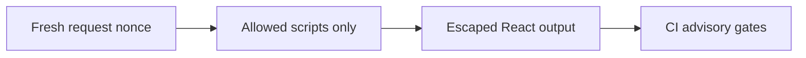

# XSS (cross-site scripting)

History: see [CHANGELOG.md](../CHANGELOG.md) or run `pnpm docs:history`

Area: Auth & Security · Status: ✅ built in repository; live AWS acceptance is separate

## 1. In one line

XSS runs attacker code in a trusted page. React escaping, HttpOnly cookies and nonce CSP reduce exposure; CSP is not a sanitizer and a trusted-origin injection could still bypass CSRF metadata.

## 2. Real-life comparison

A guard checks both the visitor and the particular action; a readable invitation is not permission to every room.

## 3. Picture it

## 4. Where in our code

- Anchor: `apps/api/src/procedures/auth.ts` — `cookieOptions`; follow the numbered comments at this boundary.
- Anchor: `apps/web/src/features/account/components/profile-card.tsx` — `memberSince`; follow the numbered comments at this boundary.

`apps/web/src/proxy.ts` generates/overwrites nonce headers; `lib/security-policy.ts` defines script policy; `lib/trpc/client.ts` disables Zod JIT to avoid eval probes. CI audits critical dependencies and scans three images with Trivy CRITICAL. `pnpm demo:security` asserts no CSP violations. Audit: 0 critical, one high braces and one moderate esbuild remain; image scan execution is unverified locally.

## 5. See it yourself

Run `pnpm demo:security` and inspect the asserted outcome described above.

Failure thought experiment: Why not enable unsafe-eval to silence Zod? Disable the optional JIT/probe instead, preserving production policy. Do not change a live stack to demonstrate it.

## 6. How it connects

Uses the [current system](../00-big-picture.md); gives a concrete decision to the [scenario](../guides/interview-scenarios.md#csp-xss) and [explorer tour](../guides/infra-explorer.html?tour=security-layers).

## 7. Our settings and WHY

XSS runs attacker code in a trusted page. React escaping, HttpOnly cookies and nonce CSP reduce exposure; CSP is not a sanitizer and a trusted-origin injection could still bypass CSRF metadata. Defense in depth reduces damage from accidental injection and known dependency flaws.

## 8. Trade-offs

Nonce pages require dynamic/no-store HTML. Style attributes remain allowed for current UI. Scanners cannot prove safety and unfixed findings need tracked decisions.

## 9. Alternatives and when to choose them

10x: report CSP violations with bounded sampling. 100x: dependency provenance, policies and attack-surface reviews.

## 10. What breaks and how we notice

Why not enable unsafe-eval to silence Zod? Disable the optional JIT/probe instead, preserving production policy.

## 13. Interview answers at 3 levels

- **Simple:** XSS runs attacker code in a trusted page.
- **Senior:** XSS executes unwanted code in a trusted page. Validate input, render escaped text and use a per-request nonce CSP to limit script execution. Production does not allow unsafe-eval. CI dependency and image scanners catch known advisories, not every vulnerability or malicious business rule. Gates need a clear severity policy and honest residual findings.
- **Lead:** 10x: report CSP violations with bounded sampling. 100x: dependency provenance, policies and attack-surface reviews.

## 14. Follow-up questions with answers

Why not enable unsafe-eval to silence Zod? Disable the optional JIT/probe instead, preserving production policy.

What must differ on each nonce HTML request? **The nonce.**

## 15. Say it in 30 seconds

XSS executes unwanted code in a trusted page. Validate input, render escaped text and use a per-request nonce CSP to limit script execution. Production does not allow unsafe-eval. CI dependency and image scanners catch known advisories, not every vulnerability or malicious business rule. Gates need a clear severity policy and honest residual findings.

## 16. Status and production work

Repository implementation and local evidence are described above. Live AWS/CI execution remains owner acceptance. 10x: report CSP violations with bounded sampling. 100x: dependency provenance, policies and attack-surface reviews.

## Where it appears in the story

- [app-story: 4b. Mutation admission and browser security](../app-story.md#4b-mutation-admission-and-browser-security)
