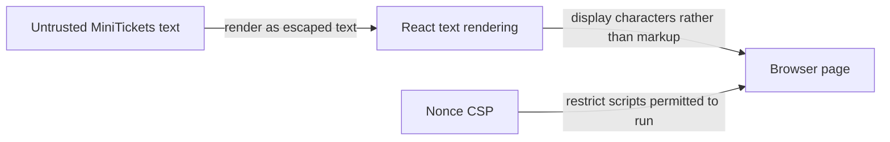

# XSS (cross-site scripting)

History: see [CHANGELOG.md](../CHANGELOG.md) or run `pnpm docs:history`

Area: Auth & Security · Status: ✅ built in repository; live AWS acceptance is separate
<!-- interview-card: v2 -->

## 1. What is it?

Cross-site scripting, or XSS, means attacker-controlled code runs inside a trusted website. It can act with the page’s access even when it cannot read a protected cookie.

## 2. Why do we need it?

A MiniTickets profile field containing script-like text should display as text, not run code. If it ran, the attacker could make requests as the signed-in visitor.

## 3. How does it work?

1. Treat stored and received text as untrusted.
2. Render it through safe text handling instead of executable HTML.
3. Use browser policy and cookie protections as additional barriers.

## 4. How do we use it in MiniTickets?

React escaping, HttpOnly session cookies and per-response nonce CSP provide separate protections. Production excludes unsafe-eval. A script already running on our trusted origin can still issue requests, so CSRF metadata alone cannot contain XSS.

## 5. Interview-ready answer

“MiniTickets prevents user text becoming code through safe rendering, then adds nonce CSP and protected cookies to reduce exposure. HttpOnly makes cookie theft harder, but injected code can still act through the page. I treat XSS prevention as several independent controls and review any path that introduces raw HTML or executable strings.”

## 6. Important follow-up questions

- **Does HttpOnly make XSS harmless?** No. The script can still use the page to make authenticated requests.
- **Does input validation replace escaping?** No. Valid data must still be rendered safely for its output context.
- **Is CSP a complete fix?** No. It limits execution but is not a sanitizer.
- **What changes if we add rich HTML?** We need a deliberate sanitization and rendering design; ordinary text handling cannot be bypassed casually.

## 7. Advanced details

Technical reference

### Source anchors

- Anchor: `apps/api/src/procedures/auth.ts` — `cookieOptions`; follow the numbered comments at this boundary.
- Anchor: `apps/web/src/features/account/components/profile-card.tsx` — `memberSince`; follow the numbered comments at this boundary.

### Output and browser defenses

ProfileCard renders account values as React text. Text escaping prevents those values becoming executable markup; introducing raw HTML, executable strings or new rich-content paths requires separate review. Input validation alone is insufficient because valid text still needs safe rendering in its destination context.

The sid cookie is HttpOnly, SameSite=Lax and Secure in production. HttpOnly prevents direct page-JavaScript cookie reads; it does not prevent a malicious trusted-page script making authenticated requests. Such a script can also satisfy trusted-origin CSRF metadata. Server authorization and safe outputs remain necessary.

`apps/web/src/proxy.ts` supplies fresh request/response CSP nonces and private,no-store HTML. `apps/web/src/lib/security-policy.ts` excludes production unsafe-eval, but allows style attributes for current React layouts. CSP reduces execution opportunities; it is not a sanitizer. `apps/web/src/lib/trpc/client.ts` disables optional Zod JIT/probing rather than enabling unsafe-eval.

### Verification and production limits

pnpm demo:security provides prior local policy evidence; it was not rerun for this edit. Review browser violations, unsafe rendering sinks and the actual authenticated action affected. Bounded CSP reports and sampling are possible next steps; production reporting is not claimed.

Dependency/image scanners cover known findings rather than proving safety. Historical P10 audit had high braces and moderate esbuild; later recorded local evidence removed moderate esbuild, retained high braces and passed six ARM64/AMD64 configured image gates. Those were prior local checks, not GitHub or live AWS acceptance. Keep explicit residual-risk decisions, provenance and attack-surface review.

### Preserved references

- [current system](../00-big-picture.md)
- [scenario](../guides/interview-scenarios.md#csp-xss)
- [explorer tour](../guides/infra-explorer.html?tour=security-layers)

[Open this piece in the city explorer](../guides/infra-explorer.html?concept=xss#chapter=8&piece=web-task).

## Where it appears in the story

- [app-story: 4b. Mutation admission and browser security](../app-story.md#4b-mutation-admission-and-browser-security)

