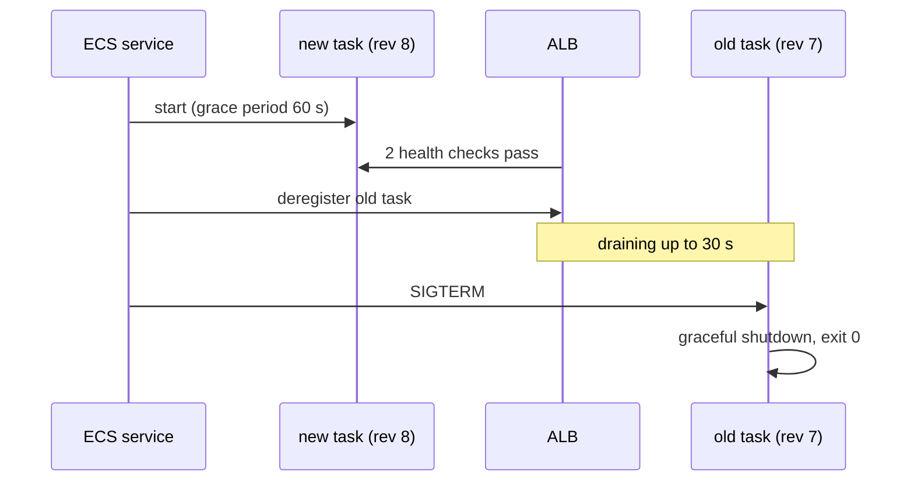
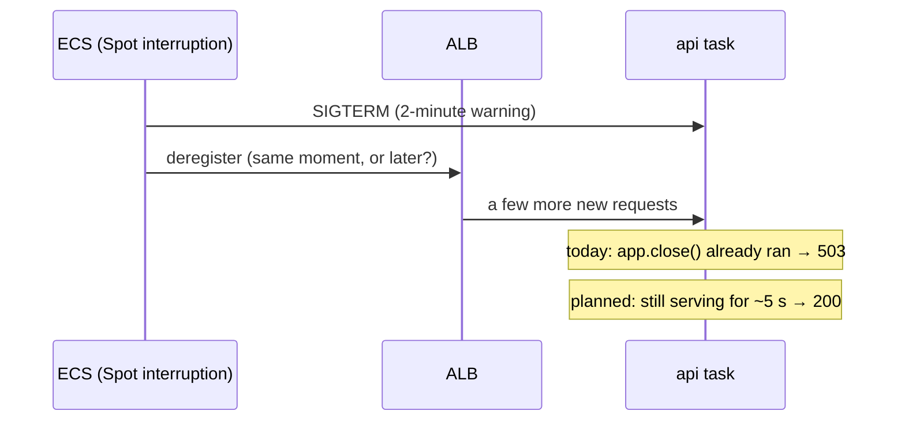

# Zero-downtime deploys: rolling update + draining

History: see [CHANGELOG.md](../CHANGELOG.md) or run `pnpm docs:history`

Area: Reliability · Status: 🟡 partial · Step doc: [18 ALB + web](../../18-infra-alb-web.md) (sections 3.6, 3.7)

## 1. In one line

A **zero-downtime deploy** replaces old tasks with new ones so users never see errors: start the new
task, wait until it is healthy, stop sending it new requests to the old one (**draining**), then stop
the old one gracefully.

## 2. Real-life comparison

A shop changing staff at the till. The new cashier opens a second till first; the sign over the old
till flips to "closed"; the customers already in that queue are served; only then does the old
cashier leave.

## 3. Picture it



## 4. Where in our code

- Anchor: `infra/src/compute/service.ts` · `loadBalancers`, `healthCheckGracePeriodSeconds: 60`: the api's ALB registration and grace period; ECS rolling defaults.
- Anchor: `infra/src/compute/web-service.ts` · `healthCheckGracePeriodSeconds: 60`: the same for web.
- Anchor: `infra/src/entry/target-groups.ts` · `deregistrationDelay: 30`: draining time.

Step by step:

1. We set no deployment percentages, so ECS's rolling-update defaults apply (minimum healthy 100%,
   maximum 200%): with `desiredCount: 1`, ECS starts the new task **before** stopping the old one.
2. The ALB sends traffic to the new task only after 2 passed health checks; the 60 s grace period
   stops ECS from killing it while Node starts.
3. ECS deregisters the old task; the ALB stops new requests to it and waits up to 30 s for in-flight
   ones.
   **Verified from AWS docs** ([task lifecycle](https://docs.aws.amazon.com/AmazonECS/latest/developerguide/task-lifecycle-explanation.html)):
   target group deregistration happens in the `DEACTIVATING` state, and the stop signal (SIGTERM)
   is sent later, in `STOPPING`. So on a normal deploy draining comes **first**.
4. ECS sends SIGTERM; `shutdown` in `apps/api/src/server.ts` closes the server, then the pool and
   Redis (Phase 3 `graceful-shutdown` card). The Dockerfile's exec-form `CMD` makes node PID 1 so it
   receives the signal.
5. The [circuit breaker](circuit-breaker.md) rolls back if the new task never gets healthy.
6. If the app has not exited 30 s after SIGTERM (`stopTimeout`, which we do not set, so the default
   applies), ECS sends SIGKILL. **Verified from AWS docs:** "The default `stopTimeout` value is 30
   seconds" ([Fargate capacity providers](https://docs.aws.amazon.com/AmazonECS/latest/developerguide/fargate-capacity-providers.html)).

### Planned improvement: wait a few seconds after SIGTERM before closing

**Not in our app yet (planned).** Today `shutdown` in `apps/api/src/server.ts` calls `app.close()`
the moment SIGTERM arrives. The improvement: on SIGTERM, first wait a few seconds (for example 5),
still serving requests normally, and only then call `app.close()`.

**Why:** SIGTERM does not always come after draining.



1. On a **normal deploy**, ECS deregisters first and sends SIGTERM after draining (verified above),
   so the delay changes nothing there; it only adds a few seconds to the stop.
2. On a **Spot interruption**, AWS's docs say the two-minute warning is sent "as a SIGTERM signal to
   the running task" ([Fargate Spot termination notices](https://docs.aws.amazon.com/AmazonECS/latest/developerguide/fargate-capacity-providers.html)).
   They do **not** say the task is deregistered from the target group first. So SIGTERM can arrive
   while the ALB is still sending this task new requests. (The exact order on Spot is not
   documented; I have not measured it.)
3. What `app.close()` does then: **verified in Fastify's docs** (installed 5.12.5,
   `return503OnClosing` and `forceCloseConnections`): every request that arrives after `close()` is
   called gets **503 Service Unavailable**, and idle keep-alive connections (the ones the ALB reuses)
   are closed. A user would see those 503s, or the ALB's own 502 for a closed connection.
4. Waiting a few seconds gives the ALB time to stop routing to us **before** we start refusing. The
   same pattern is common on Kubernetes (a "preStop sleep") for the same reason.

**The budget:** wait + finishing in-flight requests + closing the pools must fit inside
`stopTimeout` (30 s by default), or ECS sends SIGKILL. A 5-second wait leaves plenty of room.

**Where it would go:** step 3 of `shutdown` in `apps/api/src/server.ts` (a `setTimeout` promise
before `app.close()`), with the delay read from an env var validated in `apps/api/src/config/env.ts`
so it can be 0 locally (Ctrl+C should stay instant). Optionally `/ready` would start answering 503
during the wait.

## 5. See it yourself

Start a new deployment and watch two tasks overlap:

```bash
aws ecs update-service --profile ticketlite --cluster minitickets-dev --service minitickets-dev-api --force-new-deployment
watch -n 5 "aws ecs describe-services --profile ticketlite --cluster minitickets-dev --services minitickets-dev-api --query 'services[0].deployments[].[status,runningCount]'"
```

While it runs, `curl -s $APP/trpc/auth.me` in a loop should keep answering. (I expect no errors;
not measured.)

**Break it on purpose (thought experiment):** set `deregistrationDelay: 0` and remove the SIGTERM
handler. Requests in flight during a deploy are cut off.

## 6. How it connects

- **Uses ←** [ecs-service](ecs-service.md), [target-groups](target-groups.md), the api's graceful
  shutdown, health checks.
- **Gives →** safe releases; same flow on Spot interruptions ([fargate-spot](fargate-spot.md)).

## 7. Our settings and WHY

| Setting | Value | Why |
| ------- | ----- | --- |
| Rolling defaults | 100% / 200% | New task first, then old one stops. |
| Grace period | 60 s | Node needs a few seconds before `/health` answers. |
| Deregistration delay | 30 s | Default 300 s would slow every deploy; our requests take milliseconds. |

## 8. Trade-offs

- **Pros:** no user-visible errors on a normal deploy, with no extra tooling.
- **Cons:** with one task, a Spot interruption or an AZ failure is still downtime; old and new versions
  run side by side for a while, so changes (api, database) must be backward compatible; migrations run
  separately and are not yet expand-and-contract.

## 9. Alternatives and when to choose them

- **Blue/green (CodeDeploy):** instant switch and instant rollback; costs double capacity during the
  switch.
- **Canary:** a small share of traffic first; needs good metrics.
- **Expand-and-contract migrations:** required for any schema change in a zero-downtime world
  (explain-only card, Phase 5).

## 10. What breaks, and how we'd notice

- No grace period: new tasks killed before ready; endless restarts.
- Long-running requests longer than 30 s: cut off at deploy.
- A breaking database migration: old tasks error during the overlap.

## 11. Reach / Allowed / Password

Not a connection.

## 12. Cost

During a deploy two tasks run for a minute or two; a fraction of a cent.

## 13. Interview answers at 3 levels

- **Simple:** New version starts, old one finishes its work, then stops: users see nothing.
- **Senior:** ECS rolling defaults start the new task first; ALB health checks gate traffic; a 60 s
  grace period protects start-up; deregistration drains for 30 s; then SIGTERM triggers our graceful
  shutdown in `server.ts`, and node is PID 1 thanks to the exec-form `CMD`.
- **Lead:** Rolling deploys only stay zero-downtime if every change is backward compatible for the
  overlap window, so the real work is in migration discipline (expand/contract) and API compatibility,
  plus two or more tasks so a single failure is not an outage.

## 14. Follow-up questions interviewers ask

- *Why is SIGTERM handling needed if the ALB drains?* Draining stops new requests; the app must still
  finish in-flight work and close connections cleanly.
- *Why would you wait after SIGTERM before closing?* Because SIGTERM can arrive while the load
  balancer still routes to you (on Fargate Spot, the warning IS the SIGTERM). Closing at once turns
  those requests into 503s. A short wait (planned for us) lets routing stop first.
- *What are minimum healthy / maximum percent?* How far below and above the desired count ECS may go
  during a deployment.

## 15. Say it in 30 seconds

"ECS starts the new task first, the ALB only sends it traffic after two healthy checks, the old task
drains for 30 seconds, then gets SIGTERM and our server shuts down gracefully. With one task that's
zero-downtime for deploys, but not for failures."

## 16. Status

🟡 partial. **To make it production-grade:** 2+ tasks, expand-and-contract migrations, migrations in
the deploy pipeline, and the planned **wait-after-SIGTERM** delay in `shutdown` (section 4) so a Spot
interruption does not turn the last few requests into 503s.
