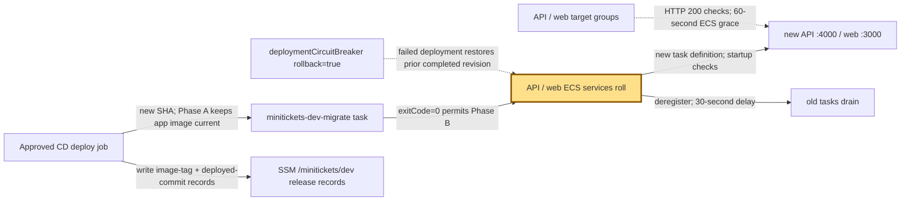
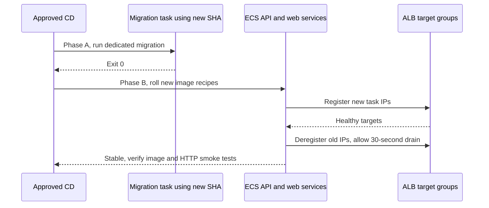

# Rolling deploy and rollback: change the city shift safely

History: see [CHANGELOG.md](../CHANGELOG.md) or run `pnpm docs:history`
Area: Reliability · Status: 🟡 partial
<!-- interview-card: v1 -->

## 1. In one line

MiniTickets overlaps old and new workers during a [rolling deployment](../glossary.md#rolling-update); both versions must understand the same data.

## 2. Where it sits

[Open this piece in the city explorer](../guides/infra-explorer.html?concept=zero-downtime-deploys#chapter=13&piece=ssm).

## 3. How it works

## 4. What happens in MiniTickets

1. Publish saves immutable images first; approved deploy checks that its infrastructure run is current.
2. Phase A updates the migration recipe to the new SHA while apps retain current images.
3. A successful migration permits Phase B: update release record and roll API/web/Lambda versions.
4. New targets must pass checks; old targets drain for 30 seconds before normal retirement.
5. Startup failure can trigger ECS rollback. An application rollback selects an existing image tag using current infrastructure code.

## 5. Reach / Allowed / Password

**Reach:** unchanged task/load-balancer/store paths must work for both versions.

**Allowed:** approved deploy role, constrained PassRole and runtime roles.

**Password:** each new task resolves current secrets; compatibility still matters.

## 6. In our code

`.github/workflows/cd.yml` → deploy Phase A / Phase B.

`infra/src/compute/migration-task.ts` → `createMigrationTask`.

`infra/src/entry/target-groups.ts` → `createTargetGroups`.

## 7. In the AWS console

GitHub → Actions → CD → run → deploy. `us-east-1` → ECS → Clusters → `minitickets-dev` → service → Deployments / Events. EC2 → Target groups → target → Targets shows healthy/draining. ALB Resource map pictures routing. Live rollout was not demonstrated.

## 8. Good / Bad

**Good:** New-image migration runs once before rollout. Circuit breaker limits repeated failed starts.

**Bad:** One Spot task cannot promise no outage. Incompatible SQL cannot be undone by an image tag.

## 9. Other choices

- Blue/green: pick it when a fleet switch and fast traffic reversal justify overlap cost.
- Expand/contract: pick it when schema changes must support old and new workers.

## 10. Connected to

| Neighbor | Direction | What allows it | Console check |
| --- | --- | --- | --- |
| [ECR](ecr.md) | In ← | Existing immutable release tag | ECR → Images |
| [Service](ecs-service.md) | Out → | New taskDefinition; circuit breaker | ECS → service → Deployments |
| [RDS](rds-postgres.md) | In/out ↔ | Migration task minitickets-dev-api-sg + DB secret | RDS → Monitoring; CloudWatch → migrate stream |

## 11. When it breaks

Migration fails → migrate log stream → fix schema/code; app rollout stops.

New tasks never healthy → stopped reason/target checks → repair or let circuit breaker restore prior revision.

Rollback breaks SQL → schema compatibility → prefer a forward fix.

## 12. Say it in 30 seconds

“We publish once, migrate from the new image, then roll compatible app tasks. Healthy new targets replace old ones, with 30-second draining and a startup circuit breaker. Manual image rollback keeps current infrastructure code. This reduces release risk, but one Spot copy and destructive schema changes prevent a zero-downtime guarantee.”

## 13. Likely follow-ups

- Why not migrate on API startup? Multiple workers could race migrations.
- Does stable mean correct? No; CD also checks expected versions and HTTP behavior.

## 14. Remember it

The new shift must read yesterday’s ledger before the old shift leaves.

## 15. More detail

Settings, limits and deeper interview notes

- Anchor: `infra/src/compute/service.ts` — `module configuration`; follow the numbered comments at this boundary.
- Anchor: `infra/src/compute/web-service.ts` — `module configuration`; follow the numbered comments at this boundary.
- Anchor: `infra/src/entry/target-groups.ts` — `shared`; follow the numbered comments at this boundary.

Status stays 🟡 partial: rolling delivery is built; a zero-downtime service-level guarantee and full expand/contract backfill orchestration are not demonstrated. Old/new workers can overlap, so DB schema, queue messages, secrets and cache keys need compatibility windows.

Both services enable a deployment circuit breaker with rollback. No explicit deployment minimum/maximum percentages are set; ECS rolling defaults apply. ALB target groups use IP targets, API `/health:4000`, web `/:3000`, 15-second intervals, 5-second timeout, healthy threshold 2 and unhealthy threshold 3. Newly registered target behavior follows AWS rules; “two checks” is not a universal initial-registration delay. ECS ignores failed ALB health during the first 60 seconds. A 30-second deregistration delay lets in-flight work drain; normal task retirement and Spot interruption must not be assumed to have identical signal order.

The migration uses its own recipe and new API image, regular Fargate, DB secret and API guard, before API/web switch tags. A failure prevents Phase B; any partial SQL effects still depend on migration transaction behavior. Large resumable backfills belong in bounded, checkpointed jobs, not each API startup. `CREATE INDEX CONCURRENTLY` cannot run inside a normal transaction block; long table/schema locks can stall traffic.

Committed `infra/Pulumi.dev.yaml` defines shape. SSM `/minitickets/dev/image-tag` records release image; `/minitickets/dev/deployed-commit` guards infrastructure history. Manual `image_tag` chooses already-published bytes; current main infrastructure code remains. `allow_older_infra` is a distinct deliberate infrastructure rollback, not a normal app rollback. The deployed-commit record can be written after a started apply even when later acceptance fails: it is a safety boundary, not proof all smoke tests passed.

CD verifies stable services, actual task/image versions, worker/tickets Lambda image and queue mappings, then HTTP checks. Stronger practice would rehearse rollback/restore, inspect locks and automate compatibility/backfill checks. Application rollback never promises destructive migrations are reversible.

## Where it appears in the story

- [app-story: 16b. Publish, approval and stale-run safety](../app-story.md#16b-publish-approval-and-stale-run-safety)
