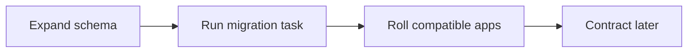

# Zero-downtime deploys: rolling update + draining

History: see [CHANGELOG.md](../CHANGELOG.md) or run `pnpm docs:history`

Area: Reliability · Status: 🟡 partial

## 1. In one line

The built path migrates once using the new SHA then rolls compatible ECS tasks. Expand/contract and resumable large backfills are design guidance; a complete zero-downtime SLA has not been demonstrated.

## 2. Real-life comparison

A sealed package is built once, then checked at a gate before the manager installs that exact version.

## 3. Picture it

## 4. Where in our code

- Anchor: `infra/src/compute/service.ts` — `module configuration`; follow the numbered comments at this boundary.
- Anchor: `infra/src/compute/web-service.ts` — `module configuration`; follow the numbered comments at this boundary.
- Anchor: `infra/src/entry/target-groups.ts` — `shared`; follow the numbered comments at this boundary.

`infra/src/compute/migration-task.ts` defines the one-off task; `.github/workflows/cd.yml` invokes it before app rollout. `docs/20-deploy-day.md` explains tag rollback and migration limits. Proposed large backfills belong in explicit resumable scripts with bounded batches and progress, not API startup.

## 5. See it yourself

Use the linked scenario and tour to trace the existing integration point. This proposed extension has no runnable feature demo.

Failure thought experiment: Can rollback remove a column safely? Only if no running version uses it and recovery is planned. Do not change a live stack to demonstrate it.

## 6. How it connects

Uses the [current system](../00-big-picture.md); gives a concrete decision to the [scenario](../guides/interview-scenarios.md#migrations) and [explorer tour](../guides/infra-explorer.html?tour=deploy).

## 7. Our settings and WHY

The built path migrates once using the new SHA then rolls compatible ECS tasks. Expand/contract and resumable large backfills are design guidance; a complete zero-downtime SLA has not been demonstrated. Old and new tasks overlap during rolling deployment.

## 8. Trade-offs

CREATE INDEX CONCURRENTLY has transaction restrictions. Long locks can stall traffic. A forward fix may be safer than rolling back code after incompatible data changes.

## 9. Alternatives and when to choose them

10x: inspect lock duration on a copy. 100x: online index/backfill tooling, compatibility windows and rehearsed restore.

## 10. What breaks and how we notice

Can rollback remove a column safely? Only if no running version uses it and recovery is planned.

## 13. Interview answers at 3 levels

- **Simple:** The built path migrates once using the new SHA then rolls compatible ECS tasks.
- **Senior:** Run migrations once from the same published SHA before rolling tasks. Prefer expand/contract: add compatible schema, deploy readers/writers, backfill, then remove old columns in a later release. Application rollback must not assume a destructive migration can be undone. MiniTickets runs a dedicated migration task; full zero-downtime backfill orchestration is explain-only.
- **Lead:** 10x: inspect lock duration on a copy. 100x: online index/backfill tooling, compatibility windows and rehearsed restore.

## 14. Follow-up questions with answers

Can rollback remove a column safely? Only if no running version uses it and recovery is planned.

Why migrate outside each API startup? **Avoid competing migration attempts.**

## 15. Say it in 30 seconds

Run migrations once from the same published SHA before rolling tasks. Prefer expand/contract: add compatible schema, deploy readers/writers, backfill, then remove old columns in a later release. Application rollback must not assume a destructive migration can be undone. MiniTickets runs a dedicated migration task; full zero-downtime backfill orchestration is explain-only.

## 16. Status and production work

Repository implementation and local evidence are described above. Live AWS/CI execution remains owner acceptance. 10x: inspect lock duration on a copy. 100x: online index/backfill tooling, compatibility windows and rehearsed restore.

## Where it appears in the story

- [app-story: 16b. Publish, approval and stale-run safety](../app-story.md#16b-publish-approval-and-stale-run-safety)
