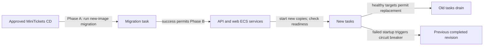

# Rolling deploy and rollback: change the city shift safely

History: see [CHANGELOG.md](../CHANGELOG.md) or run `pnpm docs:history`
Area: Reliability · Status: 🟡 partial
<!-- interview-card: v2 -->

## 1. What is it?

A rolling deployment replaces old application copies gradually while new ones start. Old and new versions overlap, so both must understand the shared data.

## 2. Why do we need it?

A MiniTickets release should avoid dropping every visitor’s request at once. Starting replacements before retiring old copies reduces that risk, but cannot guarantee uninterrupted service.

## 3. How does it work?

1. Publish images, then run the dedicated migration before changing application versions.
2. Start new tasks and check them before retiring old ones.
3. Drain old requests; verify the actual versions and application responses.

## 4. How do we use it in MiniTickets?

CD separates migration and rollout into two phases. ECS has startup rollback protection; application rollback selects an existing image while keeping current infrastructure code. Status remains partial: a single interruptible task and incompatible database changes prevent a zero-downtime promise. Live rollout acceptance remains pending.

## 5. Interview-ready answer

“MiniTickets publishes images, runs the new-image migration, then rolls compatible application copies. New targets must become healthy before old ones drain, and an ECS circuit breaker can restore the previous completed revision after failed startup. This reduces release risk, but image rollback cannot undo destructive database changes. Compatibility windows and enough reliable capacity are necessary for stronger availability guarantees.”

## 6. Important follow-up questions

- **Why not migrate on every API startup?** Multiple copies could race migrations; one dedicated task orders that work.
- **What if migration fails?** Application rollout stops, but any partial SQL effects still need investigation.
- **Does healthy mean correct?** No. CD also checks expected versions and HTTP behavior.
- **How do schemas stay compatible?** Expand first, migrate data, then remove old fields after old versions retire.

## 7. Advanced details

Technical reference

### Scope, deployment controls and health

[Rolling updates](../glossary.md#rolling-update) are built; zero-downtime service-level guarantees and complete expand/contract backfill orchestration are not demonstrated. Status remains **🟡 partial**. Old/new versions need compatible database schemas, queue messages, secrets and cache keys. One Spot task cannot guarantee uninterrupted capacity.

`.github/workflows/cd.yml` publishes immutable images before approved deployment. Its newest-run guard prevents old/superseded infrastructure application. Phase A changes `infra/src/compute/migration-task.ts` → `createMigrationTask` to the new API SHA while application images retain their current tag. The dedicated migration uses regular Fargate, API guard and database secret. Only exit code 0 permits Phase B: update release record and roll API/web/Lambda versions. Runtime routes, security rules and secrets must work for overlapping versions; approved deploy role/PassRole and runtime roles supply permissions.

`infra/src/compute/service.ts` and `web-service.ts` enable `deploymentCircuitBreaker` with rollback. No explicit deployment minimum/maximum percentages are set; ECS defaults apply. `infra/src/entry/target-groups.ts` → `createTargetGroups` uses IP targets:

- API `/health` on 4000; web `/` on 3000.
- Check interval **15 s**, timeout **5 s**, healthy threshold **2**, unhealthy **3**.
- ECS health grace **60 s**; deregistration delay **30 s**.

New target registration follows AWS health rules; “two checks” is not a universal initial-registration delay. Draining allows in-flight work to finish; normal retirement and Spot interruption need not have identical signal order.

### State, rollback and verification

Committed `infra/Pulumi.dev.yaml` defines environment shape. SSM `/minitickets/dev/image-tag` records the release; `/minitickets/dev/deployed-commit` guards infrastructure history. Manual `image_tag` chooses already-published bytes while current main infrastructure remains. `allow_older_infra` deliberately permits infrastructure rollback; it is separate from application rollback. The deployed-commit record may be written after a started apply even when later acceptance fails, so it is not proof of passed smoke tests.

CD checks stable services, actual task/image versions, worker/tickets Lambda images and queue mappings, then HTTP behavior. New tasks resolve current secrets. Startup failure can restore the prior completed ECS revision, but image rollback cannot reverse destructive SQL. Prefer a forward fix when schema compatibility is broken.

### Operations and alternatives

GitHub → Actions → CD → run → deploy. `us-east-1` → ECS → Clusters → `minitickets-dev` → service → Deployments / Events. EC2 → Target groups → Targets shows healthy/draining; ALB Resource map shows routing. Migration failures call for the migrate log stream; unhealthy startup calls for stopped reasons/target checks. Live rollout has not been demonstrated here.

Large resumable backfills belong in bounded checkpointed jobs, not API startup. Migration partial effects depend on transaction behavior; `CREATE INDEX CONCURRENTLY` cannot run in a normal transaction block, and long schema locks can stall traffic. Blue/green supports fleet switching/traffic reversal at overlap cost. Stronger practice would rehearse rollback/restore, inspect locks and automate compatibility/backfill checks.

[ECR](ecr.md) supplies immutable tags; [ECS service](ecs-service.md) runs replacements; [RDS](rds-postgres.md) hosts migrations through API guard/secret. Check ECR Images, ECS Deployments, RDS Monitoring and CloudWatch migrate streams respectively.

### Code anchors

- Anchor: `infra/src/compute/service.ts` — `module configuration`; follow the numbered comments at this boundary.
- Anchor: `infra/src/compute/web-service.ts` — `module configuration`; follow the numbered comments at this boundary.
- Anchor: `infra/src/entry/target-groups.ts` — `shared`; follow the numbered comments at this boundary.

[Open this piece in the city explorer](../guides/infra-explorer.html?concept=zero-downtime-deploys#chapter=13&piece=ssm).

## Where it appears in the story

- [app-story: 16b. Publish, approval and stale-run safety](../app-story.md#16b-publish-approval-and-stale-run-safety)

