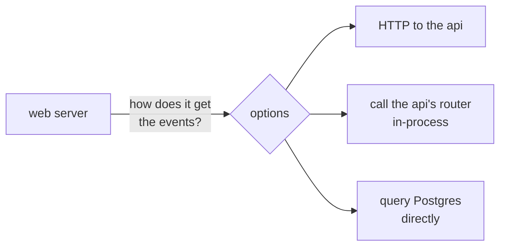

# ADR 0001: Server rendering calls the API over HTTP, and falls back to the browser

History: see [CHANGELOG.md](../CHANGELOG.md) or run `pnpm docs:history`

Status: accepted (Step 22). On AWS: waiting for the web → api network path ([service-connect](../concepts/service-connect.md)).

## Context

`/events` was client-side rendered (Step 21). Step 22 renders it on the server so the events are in
the first HTML. The web server therefore needs the events while it renders. Our rules: the web
imports only `type AppRouter` from the api, never runtime code; all server logic lives in the api.

## Options considered

1. **HTTP to the api** with a server-side tRPC client and a new `API_INTERNAL_URL`.
2. **Call the api's router in-process** (`createTRPCOptionsProxy({ router, ctx })`): no network hop,
   but the web would import and run api code, and need the database and Redis settings.
3. **Query Postgres from the web**: fastest, but skips the api's validation and layers entirely.

And for failures:

- **a. Fail the page** (`fetchQuery`, which throws) and show `error.tsx`.
- **b. Degrade to client-side rendering** (`prefetchQuery`, which never throws): the browser fetches.

And for the setting:

- **i. Required, validated at request time** (the page errors if it is missing).
- **ii. Default to `http://localhost:4000`.**

## Decision

Option **1** (HTTP), failure handling **b** (degrade to CSR, and log it), setting **i** (required,
Zod-checked lazily in `getServerEnv`).

## Consequences

- Web and api stay separate services that deploy and scale apart; every server call goes through
  the api's validation, output schema and logs.
- A new network path (web → api) must exist in every environment: docker compose (`http://api:4000`)
  and CI are configured; **AWS is not** (the ALB accepts only CloudFront, the api group only the ALB).
  Deploying this web image before the infra step would show the error page on `/events`.
- An api outage no longer breaks the page outright; it becomes slower (CSR) and the web log says so.
- One HTTP hop more than option 2 (about 2 ms locally for `events.list`, measured in Step 21).

## When we'd revisit

- If the web → api hop becomes a measurable part of render time under load.
- If many pages need private data on the server (cookie forwarding and per-user caching rules get
  complex), or if web and api ever merge into one deployable.
- If a page must never show stale or missing data (then fail with `error.tsx`, option a).
