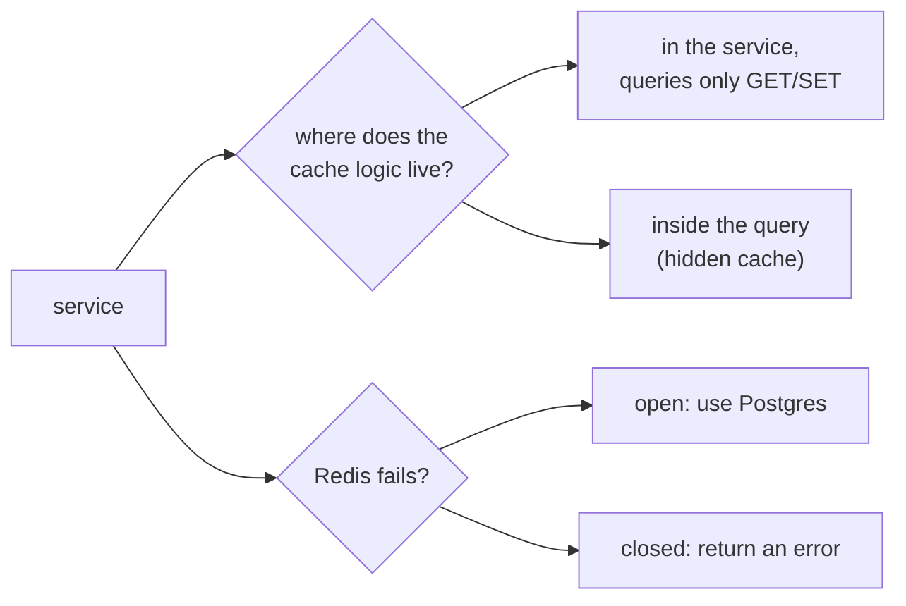

# ADR 0002: `events.list` is cache-aside in the service, and the cache fails open

History: see [CHANGELOG.md](../CHANGELOG.md) or run `pnpm docs:history`

Status: accepted (Feature 1, step 4).

**Evolution:** the fail-open public-cache decision remains. Details below record the original step-24 implementation; current v3 generation/filter keys, SWR/hard age and stampede coordination are in [ADR 0004](0004-generation-swr-keys.md). Current events.search bypasses list caches and P10 HTML is no-store.

## Context

Every `/events` visit ran the same Postgres query for the same answer. We want to read Postgres less,
using the Redis we already run. Our rules: only `queries/` touches a data store; services hold the
logic ([layered-api](../concepts/layered-api.md)).

## Options considered

1. **Cache logic in the service**; `queries/events-cache.ts` only does `GET` and `SET ... EX` on text.
2. **Hide the cache inside `queries/events.ts`**: callers never know; but a query file would then hold
   rules (TTL, validation, fallback) that belong in a service.
3. And for failure: **fail open** (read Postgres, warn) or **fail closed** (500).
4. And for a Redis error on read: **still write the cache** or **skip the write**.

## Decision

Option **1**, **fail open**, and **skip the write** after a read error.

- The service decides: TTL (30 s + 0-3 s jitter), validation of what was read (the shared Zod schema),
  and the fallback. The query file stays a thin Redis wrapper with a 100 ms deadline per call.
- The cache is an optimisation, not the source of truth, so its failure must not fail a public page.
- The write is skipped after a read error because Redis is probably sick and a second call would add
  another wait.

## Consequences

- Redis outages are invisible to users, but they move the full load to Postgres and are invisible to us
  unless we watch `cache=error` in the logs (no alarm yet).
- The list can be ~33 s stale. Booking must read the database, never this cache.
- The service takes a small `{ warn }` logger and returns `{ events, cache }`, so the procedure can add the
  cache status to the request log.
- A key version (`events:upcoming:v1`) plus Zod validation keep shape changes safe across deploys.

## When we'd revisit

- When the list must be fresher: invalidate on write (next step).
- When one hot key expires under load: stampede protection.
- If a Redis brown-out hurts Postgres: a circuit breaker, so we stop calling Redis for a while.
