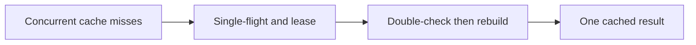

# ADR 0003: Coalesce public cache rebuilds, never seat writes

History: see [CHANGELOG.md](../CHANGELOG.md) or run `pnpm docs:history`

Status: accepted for repository implementation; live AWS acceptance remains separate.

## Context

A fast cache can amplify database load when many entries expire together. Use single-flight inside one process and a short distributed rebuild lock across processes. Recheck the cache after taking the lock: another holder may have filled it while this request waited. Release only with the owner token. Bound waiting and fall back to Postgres so a broken cache does not hang the request.

## Picture the boundary

## Options considered

Single-flight only; Redis owner lease plus double-check; no coalescing.

## Decision

Use both levels with bounded waiting/fallback. Generation/filter keys scope work. TTL expiry can duplicate harmless reads, so this lock is never inventory authority.

## Consequences

The 5 s lease and bounded wait permit duplicate rebuilds if slow or evicted. That is acceptable for public reads, never scarce-seat correctness.

## When we would revisit

10x: TTL jitter and refresh metrics. 100x: hot-key partitioning, stale serving and bounded rebuild queues.

## Evidence and connections

`apps/api/src/services/single-flight.ts` shares a promise with cleanup on both success/error. `queries/events-cache.ts` uses SET NX PX and Lua compare/delete. `pnpm demo:stampede` previously measured 100 concurrent requests as 1 DB query, including two instances after the double-check fix.

[Scenario](../guides/interview-scenarios.md#cache-stampede) · [Tour](../guides/infra-explorer.html?tour=search)
