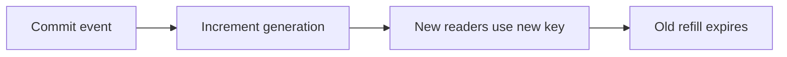

# ADR 0004: Generation/filter keys and bounded stale public lists

History: see [CHANGELOG.md](../CHANGELOG.md) or run `pnpm docs:history`

Status: accepted for repository implementation; live AWS acceptance remains separate.

## Context

DEL alone allows an in-flight old reader to repopulate the same key. Commit the write, then increment a cache generation. A reader captures the generation before its database read and stores only under that generation. A slow pre-write reader can fill its old key, but new readers use the new generation. TTL bounds stale data if invalidation fails; errors are logged instead of undoing a committed event.

## Picture the boundary

## Options considered

DEL-only invalidation; generation keys; TTL-only freshness.

## Decision

Commit then INCR; read generation before SQL. Canonical filter hash and v3 shape key isolate answers. Soft jittered refresh and hard 300 s age limit balance availability/freshness. Invalidate Next only after Redis completes.

## Consequences

Generation keys increase transient cardinality. Redis and Next/browser caches have separate stale windows; one invalidation does not instantly refresh every tab.

## When we would revisit

10x: watch invalidation failures/key churn. 100x: outbox-driven invalidation and explicit freshness SLOs.

## Evidence and connections

`apps/api/src/services/events.ts` → `invalidateUpcomingList` runs after event creation. `queries/events-cache.ts` builds generation/filter keys. `queries/web-cache.ts` calls signed Next revalidation. Run `pnpm demo:stampede`; inspect cache invalidation unit tests for late refill and failure.

[Scenario](../guides/interview-scenarios.md#cache-invalidation) · [Tour](../guides/infra-explorer.html?tour=search)
