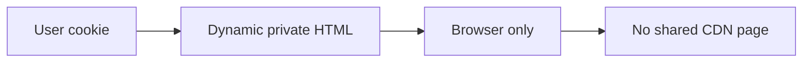

# ADR 0005: Dynamic nonce HTML supersedes shared catalogue HTML caching

History: see [CHANGELOG.md](../CHANGELOG.md) or run `pnpm docs:history`

Status: accepted for repository implementation; live AWS acceptance remains separate.

## Context

A cross-user cache leak exposes private data, and cached nonce HTML breaks CSP assumptions. Cache public data, never a shared personalized page. P10 generates a nonce for every HTML/RSC request and explicitly sends private,no-store for those responses. Keep user-bound queries out of shared server caches. A CDN must honor no-store; a positive CloudFront minimum TTL can override origin privacy directives.

## Picture the boundary

## Options considered

Public HTML CDN caching; static hash CSP; fresh nonce with no-store HTML.

## Decision

Fresh nonces and private,no-store HTML/RSC across the web. Keep explicit public data and static asset caches. Search SSR bypasses the old list helper to bound key explosion. CloudFront remains implemented/inactive.

## Consequences

Per-user edge keys are difficult to audit and multiply cache entries. No-store simplifies privacy at server cost. Static JS/images can still be cached.

## When we would revisit

10x: inspect headers on HTML and RSC. 100x: centralize cache policy tests and keep any public HTML strategy separate.

## Evidence and connections

`apps/web/src/proxy.ts` and `apps/web/next.config.ts` guard HTML caching. `apps/web/src/features/events/server/cached-events.ts` only stores public catalogue data. `infra/src/entry/cdn.ts` has zero minimum/default TTL on the events policy. CloudFront is inactive: `cdnEnabled=false`. Run `pnpm demo:security`.

[Scenario](../guides/interview-scenarios.md#private-page-cache) · [Tour](../guides/infra-explorer.html?tour=security-layers)
