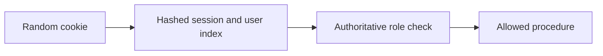

# ADR 0006: Lazy authoritative roles and bounded indexed session revocation

History: see [CHANGELOG.md](../CHANGELOG.md) or run `pnpm docs:history`

Status: accepted for repository implementation; live AWS acceptance remains separate.

## Context

A role embedded forever in a session becomes stale after a privilege change. Opaque session cookies keep revocation server-side; JWTs reduce lookup dependence but revocation/role changes need expiry or another authoritative version. MiniTickets hashes random tokens in Redis, rotates login sessions, indexes at most 20 devices and checks membership on every read. Admin authorization reads Postgres; role changes revoke sessions before and after the update.

## Picture the boundary

## Options considered

Role in Redis/JWT for session lifetime; role lookup on every request; lazy admin lookup.

## Decision

Read role from Postgres only for admin authorization. Hash opaque session tokens, require indexed membership, cap 20 devices, rotate login and revoke all devices on demand. Role CLI revokes before/after the DB update; in-flight and two-store races remain explicit limits.

## Consequences

Redis/index eviction fails closed and forces login. The 20-device bound makes revoke work bounded. Session-versioning/transactional role changes are proposed improvements for larger deployments.

## When we would revisit

10x: monitor auth-store failures and session churn. 100x: coordinated auth versioning, device management and key/credential rotation.

## Evidence and connections

`apps/api/src/queries/sessions.ts` implements indexed creation/read/revokeAll; `services/users.ts` revokes around makeAdmin. `pnpm demo:security` checks old-cookie, all-device and role revocation. Cookies are HttpOnly/SameSite with Secure in production. An in-flight authorized request cannot be recalled; two-store role/revocation is not a global transaction.

[Scenario](../guides/interview-scenarios.md#sessions-roles) · [Tour](../guides/infra-explorer.html?tour=security-layers)
