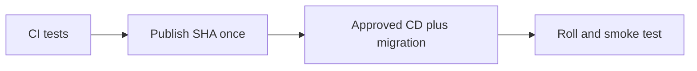

# ADR 0007: OIDC publish-once and approved current-infrastructure deployment

History: see [CHANGELOG.md](../CHANGELOG.md) or run `pnpm docs:history`

Status: accepted for repository implementation; live AWS acceptance remains separate.

## Context

Rebuilding on deploy can ship bytes that were never reviewed or tested. Publish API/web/worker images once with the git SHA after CI, then deploy that immutable release. The environment switches live in committed Pulumi YAML; deployed image tag lives in SSM and is written by CD. Migration runs before rollout. Roll back app images to a known tag while respecting current schema and current infrastructure.

## Picture the boundary

## Options considered

Stored AWS keys; rebuild on deploy; short-lived OIDC with immutable SHA images.

## Decision

Use immutable repository subjects for publish and environment dev subject for deploy. Build api/web/worker once per SHA. Commit environment shape; only CD writes SSM release tag. Dedicated migration task uses the new image before app rollout.

## Consequences

Rolling deployment overlaps versions. Blue/green gives a switchable target but costs overlap and still needs compatible migrations. Secrets/config are part of release compatibility.

## When we would revisit

10x: expired approvals and automated rollback criteria. 100x: canary analysis, immutable manifests and cross-service compatibility.

## Evidence and connections

The publish job in `.github/workflows/cd.yml` builds/pushes; its deploy job resolves release and runs two-phase deploy/migrate/smoke checks. `infra/src/image-tag.ts` reads the tag; `release.ts` tracks last deployed commit. See runbook §3.11–3.18. No publish, AWS write or live rollback was performed by this documentation work.

[Scenario](../guides/interview-scenarios.md#delivery-rollback) · [Tour](../guides/infra-explorer.html?tour=deploy)
