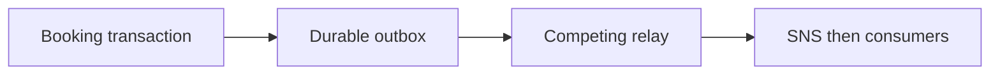

# ADR 0010: Transactional outbox with competing locked relays

History: see [CHANGELOG.md](../CHANGELOG.md) or run `pnpm docs:history`

Status: accepted for repository implementation; live AWS acceptance remains separate.

## Context

Commit-then-send has a gap; send-then-commit can announce a rolled-back purchase. Store the booking, seat decrement and confirmation payload in one Postgres transaction. A relay publishes committed outbox rows and marks them sent. A crash after publish but before marking sent produces a duplicate, so consumers stay idempotent. This closes message loss, not exactly-once delivery.

## Picture the boundary

## Options considered

Send before commit; commit then best-effort send; database outbox; CDC.

## Decision

Persist the versioned event with booking/seats. Relays lock due batches with SKIP LOCKED, publish and mark sent. Keep network deadlines short. Accept at-least-once duplicates and retain stable business identity; separate relay/CDC can follow measured pressure.

## Consequences

Holding row locks while sending is simple but occupies a pool connection. Leases/CDC decouple IO at greater complexity. Sent rows need retention planning.

## When we would revisit

10x: batch sends/backlog age. 100x: separate relay or CDC, retention and publish throughput budgets.

## Evidence and connections

`apps/api/src/queries/bookings.ts` inserts the outbox row. `queries/outbox.ts` uses FOR UPDATE SKIP LOCKED batches of 10; `services/outbox.ts` retries persisted rows. `pnpm demo:outbox` measured 24/24 recovered after queue restoration and atomic rollback on injected outbox failure.

[Scenario](../guides/interview-scenarios.md#outbox) · [Tour](../guides/infra-explorer.html?tour=booking)
