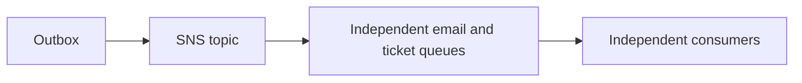

# ADR 0011: SNS plus independent SQS consumers outside the VPC

History: see [CHANGELOG.md](../CHANGELOG.md) or run `pnpm docs:history`

Status: accepted for repository implementation; live AWS acceptance remains separate.

## Context

Two consumers must each receive the event; competing on one queue would divide work. A topic fans one event out to multiple subscriptions. A queue buffers work for competing consumers. MiniTickets publishes to SNS, then separate email/ticket SQS queues; each can retry independently. EventBridge adds richer routing/integrations; Kafka adds retained partitioned replay. Choose those only when the product needs those semantics.

## Picture the boundary

## Options considered

One competing queue for both effects; SNS to separate queues; EventBridge; Kafka.

## Decision

Use SNS raw fan-out and independent email/ticket queues/DLQs. Carry required event state so Lambdas need no RDS connection/VPC. One arm64 worker image contains both handlers. Partial-batch reports, backoff and processed-job TTL support recovery; email remains send-before-record with a duplicate window.

## Consequences

SNS/SQS are operationally small but standard delivery is unordered/duplicated. A bus is routing, not a replacement for all consumer backpressure.

## When we would revisit

10x: per-consumer backlog/concurrency. 100x: partition ordering domains and retention/replay requirements.

## Evidence and connections

`infra/src/jobs/booking-events.ts` configures raw SNS deliveries and queue source restrictions. `apps/api/src/queues/jobs.ts` publishes one stable message. Run `pnpm demo:tickets` and `pnpm demo:outbox` separately; P4 local emulators exercise the same SDK boundaries. AWS fan-out acceptance is still manual.

[Scenario](../guides/interview-scenarios.md#fanout) · [Tour](../guides/infra-explorer.html?tour=booking)
