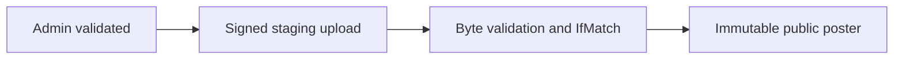

# ADR 0012: Canonical recoverable tickets and immutable poster publication

History: see [CHANGELOG.md](../CHANGELOG.md) or run `pnpm docs:history`

Status: accepted for repository implementation; live AWS acceptance remains separate.

## Context

Direct uploads avoid buffering large files through the API while retaining controlled publication. A presigned URL is a short-lived bearer capability with exactly the signer’s allowed action. CORS controls browser cross-origin use, not authorization. Validate the owner/admin before signing, constrain type/size, inspect actual image bytes and publish to an immutable key with conditional version identity. Never treat a declared Content-Type as malware scanning.

## Picture the boundary

## Options considered

Random ticket on every delivery; canonical creating/ready record; public QR bucket; short-lived owner-signed URLs.

## Decision

Reserve bookingId:seat and canonical QR/object key, write PNG then mark ready. Owner-scope reads and issue 120 s capabilities. Admin staging PUT constrains headers; verify bounded bytes/ETag and copy to immutable poster before DB attach. No scanner/malware pipeline or key-ring rotation is claimed.

## Consequences

A leaked URL works until expiry. Exact PUT length differs from POST length ranges. Proposed scanning worker belongs before publication and must quarantine failures.

## When we would revisit

10x: upload quotas and cleanup. 100x: scan/re-encode queues, retention and abuse response.

## Evidence and connections

`apps/api/src/services/posters.ts` validates admin workflow; `queries/posters.ts` signs staging/publish operations; `services/poster-image.ts` checks bounded bytes; `queries/assets.ts` signs private reads for 120 s. `pnpm demo:p4-assets` tests owner isolation and constrained upload/publication. No antivirus/re-encoding pipeline is built.

[Scenario](../guides/interview-scenarios.md#presigned-uploads) · [Tour](../guides/infra-explorer.html?tour=booking)
