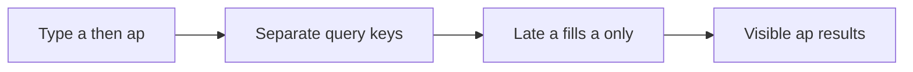

# ADR 0013: Indexed literal search, input identity and bounded DOM

History: see [CHANGELOG.md](../CHANGELOG.md) or run `pnpm docs:history`

Status: accepted for repository implementation; live AWS acceptance remains separate.

## Context

A shared results variable with no request identity allows stale completion to win. An old request may finish last. Give each search input its own query key so it can only fill its own cache entry. Cancellation saves work, but identity provides correctness even when a server ignores cancellation. Keep previous results visibly marked while the next input is loading.

## Picture the boundary

## Options considered

OFFSET plus full render; keyset plus window; external search service immediately.

## Decision

Use trigram GIN for literal contains and starts_at/id keyset traversal preserving timestamp precision. A stable cutoff is not a snapshot. Separate input query keys prevent stale overwrite even if abort is ignored; 250 ms debounce and fixed-height virtualization bound request/DOM work.

## Consequences

A monotonically increasing request id also works for manual fetch. Abort alone does not prove the server stopped; debounce does not order responses.

## When we would revisit

10x: measure input-to-result latency and cap retained pages. 100x: add relevance/search infrastructure only after query plans and traffic justify it.

## Evidence and connections

`apps/web/src/features/events/hooks/use-event-search.ts` → `useEventSearch` debounces 250 ms, uses tRPC infinite-query options keyed by all input, consumes cancellation and keeps previous data. The component labels typing/loading. Run `pnpm demo:search`; the related browser spec deliberately delays an older response.

[Scenario](../guides/interview-scenarios.md#search-races) · [Tour](../guides/infra-explorer.html?tour=search)
