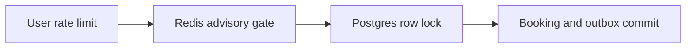

# ADR 0014: Shared token buckets and advisory inventory admission

History: see [CHANGELOG.md](../CHANGELOG.md) or run `pnpm docs:history`

Status: accepted for repository implementation; live AWS acceptance remains separate.

## Context

Fewer doomed buyers enter the hot-row queue. One event row serializes buyers even with many API tasks. Rate limits bound callers; an advisory Redis inventory gate rejects obvious sold-out work before the database. All admitted buyers still run the same Postgres transaction. Redis failure, expiry or wrong counts must never create a confirmed seat by itself.

## Picture the boundary

## Options considered

Database only; authoritative Redis stock; advisory Redis gate plus database truth.

## Decision

Rate-limit trusted IP/user identities atomically. Redis intent-owned debits/refunds reject obvious failures, but every confirmation uses the same Postgres transaction. Versioned reconciliation repairs hints. Timed customer holds, waiting rooms and autoscaling are explain-only.

## Consequences

Unknown DB commit/refund and worker crashes can skew the hint; reconciliation repairs admission, not correctness. This is not a customer-visible timed seat hold.

## When we would revisit

10x: compare p95/p99 and lock waits. 100x: durable queue admission or partitioned seat rows, keeping DB constraints.

## Evidence and connections

`apps/api/src/services/booking-inventory.ts` debits an intent-owned reservation and falls back to Postgres on Redis failure. `services/inventory-reconciliation.ts` compares versions before correction so it does not overwrite in-flight work. `pnpm demo:sale` compares gated/ungated short loads and verifies replay at zero stock.

[Scenario](../guides/interview-scenarios.md#sale-day) · [Tour](../guides/infra-explorer.html?tour=sale-day)
