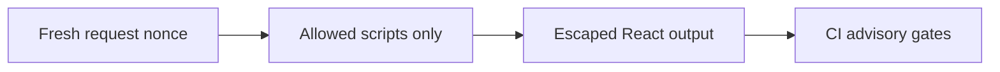

# ADR 0015: Bounded security controls, field logs and explicit acceptance

History: see [CHANGELOG.md](../CHANGELOG.md) or run `pnpm docs:history`

Status: accepted for repository implementation; live AWS acceptance remains separate.

## Context

Defense in depth reduces damage from accidental injection and known dependency flaws. XSS executes unwanted code in a trusted page. Validate input, render escaped text and use a per-request nonce CSP to limit script execution. Production does not allow unsafe-eval. CI dependency and image scanners catch known advisories, not every vulnerability or malicious business rule. Gates need a clear severity policy and honest residual findings.

## Picture the boundary

## Options considered

CORS/SameSite alone; exact Origin/metadata plus CSP; unbounded telemetry; critical supply-chain gates.

## Decision

Guard mutations, enforce production nonce CSP without unsafe-eval, bound pool/statement waits and anonymous vital payloads. Retain correlated JSON and four symptom alarms. CI audit/Trivy gates critical findings; high/moderate advisories, live scanner execution and AWS acceptance are recorded, not hidden.

## Consequences

Nonce pages require dynamic/no-store HTML. Style attributes remain allowed for current UI. Scanners cannot prove safety and unfixed findings need tracked decisions.

## When we would revisit

10x: report CSP violations with bounded sampling. 100x: dependency provenance, policies and attack-surface reviews.

## Evidence and connections

`apps/web/src/proxy.ts` generates/overwrites nonce headers; `lib/security-policy.ts` defines script policy; `lib/trpc/client.ts` disables Zod JIT to avoid eval probes. CI audits critical dependencies and scans three images with Trivy CRITICAL. `pnpm demo:security` asserts no CSP violations. Audit: 0 critical, one high braces and one moderate esbuild remain; image scan execution is unverified locally.

[Scenario](../guides/interview-scenarios.md#csp-xss) · [Tour](../guides/infra-explorer.html?tour=security-layers)
