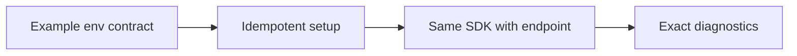

# ADR 0016: Idempotent local setup and explicit emulator limits

History: see [CHANGELOG.md](../CHANGELOG.md) or run `pnpm docs:history`

Status: accepted for repository implementation; live AWS acceptance remains separate.

## Context

Reproducible setup prevents environment guessing and accidental data loss. Use one idempotent setup command, env examples as the contract and a checker that prints exact fixes without secrets. Use the same AWS SDK operations locally against emulators, while naming their limits: no real IAM, SES delivery, AWS quotas or managed failover. Keep destructive reset separate and local-only.

## Picture the boundary

## Options considered

Manual setup; destructive reset on every start; idempotent setup/check with separate local reset.

## Decision

Use env examples as contracts and exact no-secret diagnostics. Same SDK code targets local emulators. Reset is separate/local-only. Emulator green does not prove IAM, SES, quotas, managed TLS/CDN or live alarm delivery.

## Consequences

Shared emulators are fast for humans; isolated tests avoid cross-test state. Testcontainers/devcontainers are possible later, not installed merely for documentation.

## When we would revisit

10x developers: consistent toolchain/devcontainer. 100x: image checks and documented emulator differences in CI.

## Evidence and connections

`scripts/stack-up.ts` and `scripts/stack-check.ts` check containers, migrations, queues/table and ports. Run `pnpm stack:check`; owner starts with `pnpm dev`. Local apps use Postgres/Redis, ElasticMQ, DynamoDB Local and Moto for SNS/S3. Existing owner ports/processes are never restarted by agent checks.

[Scenario](../guides/interview-scenarios.md#dev-parity) · [Tour](../guides/infra-explorer.html?tour=build-order)
