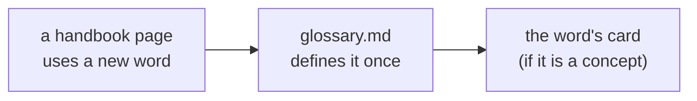

# Glossary

Every technical word used in the handbook, in plain English. When a word has a special meaning in
MiniTickets, the entry says where it lives ("Ours: …", "In our app: …") or that we don't use it.
New words are added in the same commit as the page that first uses them.

## A

- **AccessDenied** – the error AWS returns when IAM says no. It names the action and the resource.
- **ACID** – four promises a database makes about a transaction: Atomic (all or nothing),
  Consistent (rules hold), Isolated (transactions don't see each other's half-done work), Durable
  (saved data survives a crash).
- **ACM (AWS Certificate Manager)** – the AWS service that issues and renews TLS certificates for
  domains you own. Not used by us yet.
- **ADR (Architecture Decision Record)** – a short document that records one design decision:
  context, options, decision, consequences.
- **ALB (Application Load Balancer)** – an AWS load balancer that understands HTTP and can route by
  path or header. In our app: `infra/src/entry/alb.ts`.
- **Alerting** – sending a person a message when a measurement crosses a limit. Ours: only the budget email.
- **Allowed** – the second of our three connection questions: does IAM permit this call? See
  [aws-foundations, chapter 3](aws-foundations.md#3-the-three-questions-reach-allowed-password).
- **Anchor (code anchor)** – a comment `@concept: <slug>` at the exact place a concept lives in the
  code. Checked by `pnpm docs:check`.
- **API gateway** – a front door service that routes, authenticates and rate-limits API calls for many backends. Not used by us.
- **App Router** – Next.js's routing system: the folders under `apps/web/src/app/` become URLs.
- **argon2id** – a password-hashing algorithm that is slow and memory-hungry on purpose, so
  guessing passwords from a stolen database is expensive.
- **ARM64** – a CPU architecture. AWS's Graviton machines use it. Our images are built for
  `linux/arm64`.
- **ARN (Amazon Resource Name)** – the full, unique address of one AWS resource, e.g.
  `arn:aws:iam::123456789012:role/minitickets-dev-api-task-role`.
- **AssumeRole** – the STS call that "puts on" a role and returns temporary credentials.
- **Auth token (Valkey)** – the password of our cache. It sits inside the `rediss://` URL.
- **Authentication (authN)** – proving who you are (login).
- **Authorization (authZ)** – deciding what you may do once we know who you are.
- **Auto scaling** – adding or removing copies (tasks, machines) automatically based on load. Not built.
- **Availability zone (AZ)** – one isolated part of an AWS region, made of one or more data
  centres. We use two.
- **AWS-managed policy** – an IAM policy written and updated by AWS, e.g.
  `AmazonECSTaskExecutionRolePolicy`.
- **awslogs driver** – the ECS setting that copies everything a container prints to CloudWatch Logs.
- **awsvpc** – the ECS network mode that gives every task its own network card and IP address in
  our VPC. Fargate requires it.

## B

- **B-tree index** – the default kind of database index: a sorted tree that makes lookups by a
  column fast.
- **Backpressure** – a way for a busy part of a system to tell callers to slow down instead of
  collapsing.
- **Backup / snapshot** – a saved copy of a database at a point in time. RDS keeps ours for 1 day.
- **BASE** – "Basically Available, Soft state, Eventually consistent": the looser promises many
  NoSQL systems make instead of ACID.
- **Batching (request batching)** – sending several calls in one HTTP request. tRPC's
  `httpBatchLink` does it for calls made at the same moment.
- **Blast radius** – how much damage one failure or one stolen credential can do.
- **Blue/green deploy** – run the new version next to the old one, then switch all traffic at once.
- **Brotli, gzip** – compression formats. CloudFront compresses responses with them.
- **Budget (AWS Budgets)** – an AWS feature that emails when spending passes a limit. Ours: $20 a month.
- **Bulkhead** – walls inside a system so one overloaded part cannot sink the others.

## C

- **Cache behavior (CloudFront)** – a rule for one URL path pattern: cache or not, which methods,
  what to forward. We have three.
- **Cache hit / cache miss** – the answer was / was not already stored in the cache.
- **Cache policy (CloudFront)** – how long to keep a copy and what makes two requests "the same".
  We use AWS's `Managed-CachingOptimized` and `Managed-CachingDisabled`.
- **Cache stampede (thundering herd)** – many requests miss the cache at the same moment and all hit the database together.
- **Cache-aside** – the app checks the cache first, and on a miss reads the database and fills the cache. Not used by us.
- **Canary deploy** – send a small share of traffic to the new version first, then more if it is healthy.
- **CAP theorem** – a distributed data store that is split by a network failure must choose between
  answering (availability) and always giving the latest data (consistency).
- **Capacity provider (ECS)** – the kind of machine tasks run on: `FARGATE` or `FARGATE_SPOT`.
- **Card** – one handbook page about one concept, in `docs/handbook/concepts/<slug>.md`.
- **CD (continuous deployment)** – automatically deploying every change that passes CI. Planned.
- **CDN (content delivery network)** – servers around the world that serve content close to the
  visitor. Ours is CloudFront.
- **Certificate authority (CA)** – an organisation whose signature on a TLS certificate we trust.
- **CI (continuous integration)** – running the checks (types, lint, tests, builds) on every push.
  Ours: `.github/workflows/ci.yml`.
- **CIDR block** – a range of IP addresses written like `10.0.0.0/16`. The number after the slash
  says how many leading bits are fixed.
- **Circuit breaker** – stops calling something that keeps failing, for a while, instead of
  retrying forever. ECS has one for deployments.
- **Client Component** – a React component that also runs in the browser (it starts with
  `"use client"`), so it can have state and click handlers.
- **CloudFront** – AWS's CDN. In our app: HTTPS in front of the ALB, `infra/src/entry/cdn.ts`.
- **CloudTrail** – AWS's audit log of API calls made in an account.
- **CloudWatch Logs** – AWS's log storage. A **log group** is one book (`/minitickets/dev/api`);
  each task writes its own **log stream** (a chapter) in it.
- **Cluster (ECS)** – a named group that ECS services and tasks belong to. Ours: `minitickets-dev`.
- **Concept map** – [concept-map.md](concept-map.md): the hub table of every concept.
- **Condition (IAM)** – an extra "only if" in a policy statement, e.g. only when
  `aws:SourceAccount` is our account.
- **Confused deputy** – a trusted service tricked into using its power for the wrong customer.
- **Connection pool** – a small set of open database connections that are reused, because opening
  one is slow. Ours: `pool` in `apps/api/src/db/client.ts`, at most 10.
- **Container** – a packaged program with everything it needs, started from an image.
- **Container Insights** – extra, paid CloudWatch metrics per ECS task. Off in our cluster.
- **Content-Security-Policy (CSP)** – a response header that tells the browser which scripts may run. Not set by us yet.
- **Context (tRPC)** – the `ctx` object built once per request by `createContext`; every procedure receives it.
- **Contract testing** – checking that a provider and a consumer still agree on the shape of their API.
- **Cookie** – a small value the browser stores and sends back with each request to the same site.
  Our session cookie is called `sid`.
- **Core Web Vitals** – Google's page-experience measurements: loading speed, responsiveness, layout stability.
- **Correlation ID** – one id passed along every service a request touches, so their logs can be joined.
- **CORS (Cross-Origin Resource Sharing)** – browser rules that block a page from calling another
  origin unless that origin allows it.
- **CQRS** – using separate models for writing data and for reading it.
- **CSRF (cross-site request forgery)** – another website tricking your browser into sending a
  request to ours, with your cookie.
- **Customer-managed policy** – a reusable IAM policy that we write and own.

## D

- **Data layer** – our RDS database, Valkey cache and redis-url secret, switched on and off together
  with `dataEnabled`.
- **Dead-letter queue (DLQ)** – where messages go after failing too many times, so they can be
  inspected instead of lost.
- **Default deny (implicit deny)** – IAM's starting answer: anything not allowed is denied.
- **Defense in depth** – several independent protections, so one mistake does not expose everything.
- **Deregistration delay (draining)** – the time the ALB keeps a stopping task in its list so
  requests already in flight can finish. Ours: 30 seconds.
- **Disaster recovery (DR)** – how we get the system and its data back after a big failure.
- **Distributed tracing** – following one request across several services, with timings for each step.
- **DNS** – the internet's phone book: turns a name like `example.com` into an IP address.
- **Docker** – the tool that builds images and runs containers.
- **Drizzle** – the TypeScript ORM (database library) we use to define tables and write queries.
- **DynamoDB** – AWS's managed NoSQL key-value and document database. Not used by us.

## E

- **EC2** – AWS's virtual machines. We use Fargate instead, so we manage no EC2 machines.
- **ECR (Elastic Container Registry)** – AWS's private store for Docker images.
- **ECS (Elastic Container Service)** – AWS's service that runs containers.
- **ECS Exec** – opens a shell or runs a command inside a running ECS task
  (`aws ecs execute-command`).
- **Edge location** – one of CloudFront's buildings close to visitors.
- **EKS** – AWS's managed Kubernetes. Not used by us.
- **ElastiCache** – AWS's managed Redis / Valkey / Memcached service.
- **Encryption at rest** – data is encrypted on disk and in backups.
- **Encryption in transit** – data is encrypted while it travels over the network (TLS).
- **End-to-end (e2e) test** – a test that drives the real app in a real browser. Ours use Playwright.
- **End-to-end types** – the web app gets the API's TypeScript types (`type AppRouter`), so a wrong call is a compile error.
- **Endpoint (AWS)** – the address of an AWS service's API, e.g. Secrets Manager in us-east-1.
- **Env var (environment variable)** – a named setting given to a process when it starts, like
  `PORT=4000`.
- **errorMapper** – our tRPC middleware that turns business errors into HTTP-style errors
  (`apps/api/src/trpc/init.ts`).
- **Event sourcing** – storing every change as an event and rebuilding the current state from them.
- **Event-driven architecture** – parts of a system react to events ("user signed up") instead of calling each other directly.
- **Eventual consistency** – copies of data may disagree for a short time but will agree in the end.
- **Eviction** – a cache deleting entries when it is full. **LRU** (least recently used) deletes the oldest-used first.
- **Execution role** – the IAM role ECS wears to **start** a task: pull the image, read secrets,
  write logs.
- **Expand and contract** – changing a database schema in safe steps: add the new shape, move the code, then remove the old shape.
- **Explain-only (📖)** – a handbook status: not in our app and not planned; explained only.
- **Explicit deny** – a `"Effect": "Deny"` statement. It beats every allow.

## F

- **Fargate** – ECS without servers to manage: AWS finds a machine for each task.
- **Fargate Spot** – Fargate on spare AWS capacity, much cheaper, but AWS can take it back with a
  2-minute warning.
- **Fastify** – the Node.js web framework our api uses.
- **Feature flag** – a switch that turns a feature on or off without a new deploy.
- **Feature folder** – `apps/web/src/features/<feature>/`: the components and hooks of one feature
  together.

## G

- **Global service** – an AWS service that exists once per account, not per region (IAM,
  CloudFront, Budgets).
- **Graceful shutdown** – on a stop signal, stop taking new requests, finish the running ones,
  close connections, then exit.
- **GraphQL** – an API style where the client asks for exactly the fields it needs in one query.
- **Graviton** – AWS's ARM64 processors. Usually cheaper than x86 for the same work.
- **gRPC** – a fast binary RPC protocol over HTTP/2, mostly used between servers.

## H

- **Hash** – a one-way fingerprint of data. It cannot be turned back into the data.
- **Health check** – a regular "are you OK?" call. **Liveness** = is the process up (`/health`).
  **Readiness** = can it do real work right now (`/ready`).
- **High availability (HA)** – the system keeps working when one part (a task, an AZ) fails.
- **Horizontal scaling** – more copies of a server. **Vertical scaling** – a bigger server.
- **HTTP status code** – the 3-digit result of an HTTP request: 200 OK, 400 bad input, 401 not logged in, 403 forbidden, 404 not found, 409 conflict, 500 server error, 503 unavailable.
- **HTTP/2, HTTP/3** – newer HTTP versions that are faster over one connection. CloudFront speaks
  them to browsers.
- **HttpOnly** – a cookie flag: page JavaScript cannot read the cookie.
- **HTTPS** – HTTP inside TLS: encrypted, and the server proves who it is.

## I

- **IaC (Infrastructure as Code)** – describing cloud resources in code. Ours: Pulumi in `infra/`.
- **IAM (Identity and Access Management)** – AWS's system of who may do what.
- **IAM database authentication** – logging in to RDS with a short-lived IAM token instead of a
  stored password. Not used by us.
- **Idempotency key** – a unique id a client sends with a write, so the server can recognise and ignore a repeat. Not used by us.
- **Idempotent** – doing it twice has the same effect as doing it once. Our logout is idempotent.
- **Identity-based policy** – an IAM policy attached to a principal (role, user, group). It has no
  `Principal` field.
- **Image (Docker)** – the packaged, read-only file system and start command a container is started from.
- **Image scanning** – checking an image's packages for known vulnerabilities. ECR scans ours on push.
- **In-process test** – a test that calls the API's code directly (no real network), e.g. with `createCallerFactory` or Fastify's `inject`.
- **Inline policy** – an IAM policy that belongs to exactly one role and is deleted with it.
  Ours: `read-secrets`, `ecs-exec`.
- **Internet gateway (IGW)** – the VPC's door to the public internet.
- **Isolation level** – how much concurrent database transactions may see of each other's changes.

## J

- **JSON** – a text format for data, e.g. `{"userId": "…"}`.
- **JWT (JSON Web Token)** – a signed token that carries user data itself, so the server does not
  look up a session. We use server-side sessions instead.

## K

- **Kafka** – a distributed log for event streams; consumers read at their own pace and can replay.
- **Key-value store** – a database that stores a value under a key and finds it by that key only.
  Redis and Valkey are key-value stores.
- **KMS (Key Management Service)** – AWS's service for encryption keys. We use AWS-managed keys.

## L

- **Lambda** – AWS's functions-as-a-service: code runs per event, no server or container to keep running. Not used by us.
- **Layer (Docker)** – one cached step of an image build. Unchanged layers are reused.
- **Layered architecture** – our api's split: procedures (HTTP edge) → services (business logic) → queries (data stores).
- **Least privilege** – give every role, user or rule only the permissions it needs.
- **Lint** – automatic checks for suspicious code patterns. Ours: ESLint (`pnpm lint`).
- **Listener (ALB)** – the ALB's "ear" on one port (ours: HTTP 80). Its **rules** decide where each
  request goes; the **default action** applies when no rule matches (ours: 403).
- **Load balancing algorithm** – how a load balancer picks a target: round robin (in turn), least connections, IP hash.
- **Load testing** – sending lots of fake traffic to find the limits of a system.
- **Local route** – the built-in route in every VPC route table that connects all subnets of the VPC.
- **Locking** – stopping two writers from changing the same data at once. **Pessimistic** locks first; **optimistic** checks a version when saving.
- **Long polling** – the client asks, and the server holds the answer back until something new happens.

## M

- **Managed prefix list** – a named list of IP ranges that a security group rule can point at. We
  use AWS's list of CloudFront's origin-facing addresses.
- **Mermaid** – a text format for diagrams that GitHub renders. All handbook diagrams use it.
- **Message queue** – a buffer where one part leaves work and another picks it up later (e.g. AWS SQS).
- **Metrics** – numbers measured over time, like CPU use or requests per second.
- **MFA (multi-factor authentication)** – a second proof besides the password, like a code from an app.
- **Middleware** – code that wraps a request handler and runs before and/or after it.
- **Migration** – a versioned SQL file that changes the database schema.
- **Mock** – a fake stand-in for a real dependency in a test.
- **Monolith vs microservices** – one deployable app vs many small services that call each other over the network.
- **Monorepo** – one git repository with several packages. Ours: `apps/web`, `apps/api`,
  `packages/shared`, `infra`.
- **Multi-AZ (RDS)** – a standby copy of the database in a second AZ that takes over if the first
  fails. Off in our dev setup.
- **Multi-stage build** – a Dockerfile with several `FROM` stages; only the last one becomes the image.
- **Mutation (tRPC)** – a procedure that changes something, like `auth.login`. Sent as `POST`.

## N

- **N+1 queries** – one query for a list, then one more query per item: slow as the list grows.
- **NAT gateway** – lets things in a private subnet start connections to the internet. We chose not
  to build one (cost).
- **Network ACL (NACL)** – a stateless firewall on a whole subnet. We keep AWS's default, which allows everything.
- **Network interface (ENI)** – a virtual network card with an IP address. Each Fargate task gets one.
- **Next.js** – the React framework our web app uses.
- **NLB (Network Load Balancer)** – a layer-4 AWS load balancer: forwards TCP connections without
  reading HTTP.
- **Normalization** – storing each fact once and linking tables by keys. **Denormalization** copies data on purpose for faster reads.

## O

- **OAuth 2.0** – a standard for letting an app act for a user at another service. **PKCE** protects the authorization-code flow against stolen codes.
- **OIDC federation** – letting an outside system (like GitHub Actions) get AWS role credentials
  without stored keys.
- **Open redirect** – a bug where a link like `/login?next=https://evil.com` sends a user to
  another site after login. Blocked by `getSafeNext`.
- **OpenTelemetry (OTel)** – an open standard and toolkit for traces, metrics and logs.
- **Optimistic update** – the UI shows the result before the server confirms it, and undoes it on failure.
- **Origin (browser)** – scheme + host + port of a page, e.g. `http://localhost:3000`.
- **Origin (CloudFront)** – where CloudFront fetches from when it has no cached copy. Ours: the ALB.
- **Origin request policy (CloudFront)** – what CloudFront forwards to the origin. We use
  `Managed-AllViewer` (all headers, cookies and query strings).
- **Origin secret** – the random `X-Origin-Verify` header value that only our CloudFront
  distribution sends, and our ALB listener checks.
- **ORM** – a library that maps database tables to code objects. Ours: Drizzle.
- **Outbox (transactional outbox)** – writing an event into the database in the same transaction as the change, and publishing it later.

## P

- **Pagination** – returning a long list page by page: by offset ("skip 40") or by cursor ("after this id").
- **Parameterized query** – SQL with placeholders (`$1`); the values travel separately, so they can never be read as SQL.
- **Partial (🟡)** – a handbook status: part of the concept is in our code.
- **Partition (ARN)** – the first part of an ARN: which AWS (`aws`, `aws-cn`, `aws-us-gov`).
- **Partitioning** – splitting one big table into parts inside one database. **Sharding** splits data across several databases.
- **Password (the question)** – the third of our connection questions: does the target accept the
  credentials? See [aws-foundations, chapter 3](aws-foundations.md#3-the-three-questions-reach-allowed-password).
- **Permission boundary** – an IAM limit on the most a role may ever do. Not used by us.
- **Permission policy** – the policy that says what a role may do.
- **PID 1** – the first process in a container. Docker sends stop signals to it.
- **pino** – the JSON logger built into Fastify.
- **Planned (📋)** – a handbook status: not built yet, but a step doc says we will build it.
- **Playwright** – the tool our end-to-end tests use to drive a real browser.
- **Policy (IAM)** – a JSON document of Allow/Deny statements.
- **Postgres (PostgreSQL)** – the SQL database we use. On AWS: RDS Postgres 17.
- **Preflight** – an `OPTIONS` request a browser sends before some cross-origin requests, to ask
  CORS permission.
- **Principal** – who makes an AWS request: a user, a role, or an AWS service.
- **Private subnet** – a subnet with no route to the internet gateway.
- **Procedure (tRPC)** – one API function, like `auth.login`. Lives in `apps/api/src/procedures/`.
- **protectedProcedure** – our tRPC procedure builder that rejects callers without a valid session.
- **Proxy (network)** – a server that stands between the visitor and us and passes requests on.
  CloudFront and the ALB are proxies.
- **Proxy (Next.js `proxy.ts`)** – code that runs on the web server before a page renders (older
  Next.js called it "middleware"). Ours redirects to `/login` when there is no `sid` cookie.
- **Public subnet** – a subnet whose route table sends `0.0.0.0/0` to the internet gateway.
- **Pulumi** – our Infrastructure as Code tool. A **stack** is one copy of the infrastructure
  (ours: `dev`); **config** holds its settings (`Pulumi.dev.yaml`); **outputs** are values it
  prints for others to use (`pulumi stack output`).

## Q

- **Query (our api layer)** – `apps/api/src/queries/`: the only code that touches Postgres or Redis.
- **Query (tRPC)** – a procedure that only reads, like `auth.me`. Sent as `GET`.

## R

- **RabbitMQ** – a message broker that routes messages to queues; messages are usually gone once consumed.
- **Rate limiting** – limiting how many requests one caller may make per time window. Planned.
- **Rate-limiting algorithms** – **token bucket** (tokens refill at a fixed rate, each request spends one), **leaky bucket** (requests drain at a fixed rate), **fixed window** (count per minute), **sliding window** (count over the last minute).
- **RBAC / ABAC** – role-based access control (permissions by role, like "admin") / attribute-based (rules on attributes, like tags or department).
- **RDS (Relational Database Service)** – AWS's managed SQL databases. Ours runs Postgres 17.
- **RDS Proxy** – an AWS connection pooler in front of RDS. Not used by us.
- **Reach** – the first of our connection questions: can packets get there at all? See
  [aws-foundations, chapter 3](aws-foundations.md#3-the-three-questions-reach-allowed-password).
- **Read replica** – a read-only copy of a database that follows the primary.
- **Read-through / write-through / write-behind** – cache patterns: the cache loads misses itself / every write goes to cache and database together / writes go to the cache and reach the database later.
- **Redis** – an in-memory key-value store. We keep sessions in it (locally Redis 7.4, on AWS Valkey).
- **Region** – a geographic area of AWS with several AZs. Ours: `us-east-1`.
- **Regional service** – lives in one region (VPC, ECS, RDS, ECR, Secrets Manager).
- **Rendering strategies** – **SSR** (render HTML per request), **SSG** (render at build time), **ISR** (static, re-rendered in the background), **streaming** (send HTML in pieces).
- **Replication** – keeping copies of data on several machines.
- **Replication group (ElastiCache)** – a primary cache node plus optional replicas. Ours has 1 node.
- **Request ID** – an id for one request inside one service. Fastify gives every request one (`request.id`).
- **Resource (IAM)** – the thing an action acts on, named by its ARN.
- **Resource-based policy** – a policy attached to a resource; it names who may use it. A role's
  trust policy is one.
- **Reverse proxy** – a proxy on the server side that receives requests for one or more backends. CloudFront and the ALB are ours.
- **Revision (task definition)** – each change to a task definition creates a new numbered version
  (`minitickets-dev-api:7`).
- **Role (IAM)** – a set of permissions with no password, assumed for a while by a trusted principal.
- **Rolling update** – replacing old tasks with new ones a few at a time, so some are always serving.
- **Rotation** – replacing a password with a new one on a schedule. RDS rotates its managed
  password every 7 days by default.
- **Route 53** – AWS's DNS service. Not used by us yet.
- **Route table** – the list that says where traffic leaving a subnet goes.

## S

- **S3** – AWS's object storage for files. Not used by us.
- **Saga** – a long business process split into steps, each with an "undo" step if a later one fails.
- **SameSite** – a cookie flag. `Lax` (ours) means the browser does not send the cookie on
  cross-site `POST` requests.
- **SCP (Service Control Policy)** – an AWS Organizations guardrail that can only take permissions
  away from accounts. Not used by us.
- **Secrets Manager** – AWS's locked safe for passwords and tokens. Every read is checked by IAM.
- **Secure (cookie flag)** – the browser sends the cookie only over HTTPS. On in production.
- **Security group** – a stateful firewall attached to a resource; it lists what is allowed in
  and out. We have five: alb, web, api, db, redis.
- **Server Component** – a React component rendered only on the server; it sends HTML and no
  component JavaScript to the browser.
- **Server state vs client state** – data owned by the server and cached in the browser (TanStack Query) vs data that exists only in the browser (form fields, `useState`).
- **Service (ECS)** – keeps the wanted number of tasks running and replaces failed ones.
- **Service-linked role** – a role AWS creates and owns so a service can act in our account.
- **Session** – the server's memory that a browser is logged in. Ours: a Valkey/Redis key
  `session:<sha256 of the id>` with a 7-day TTL.
- **Session token** – the third part of temporary AWS credentials, next to the access key id and
  secret.
- **SHA-256** – a hash function. We store the SHA-256 of the session id, never the id itself.
- **Shield / WAF** – AWS Shield protects against DDoS floods; WAF (web application firewall) blocks bad requests by rules. Not used by us.
- **SIGTERM** – the polite "please stop" signal. Docker and ECS send it before killing a process.
- **SigV4 (Signature Version 4)** – how every AWS API request is signed with the caller's
  credentials.
- **SLI / SLO / error budget** – a measured indicator (e.g. % successful requests), the target for it (e.g. 99.9%), and how much failure the target still allows.
- **Slug** – a short, lowercase, dash-separated name, e.g. `graceful-shutdown`. Card files and
  anchors use it.
- **SQL injection** – an attacker's text being run as SQL. Prevented by parameterized queries.
- **SQS** – AWS's managed message queue. Not used by us.
- **SSE (Server-Sent Events)** – the server pushes a stream of messages to the browser over one HTTP response.
- **ssmmessages** – the AWS Systems Manager channels that ECS Exec uses.
- **Standalone output (Next.js)** – a build mode that copies only the files the app needs into one small server folder.
- **Stateful firewall** – remembers allowed connections, so replies are allowed automatically.
- **Stateless server** – keeps no user data in its own memory between requests, so any copy can
  answer any request.
- **Static checks** – checks that read code without running it: TypeScript's typecheck and lint.
- **STS (Security Token Service)** – the AWS service that hands out temporary credentials for roles.
- **Subnet** – a slice of the VPC's address range that lives in one AZ.
- **Switch (Pulumi config switch)** – our on/off settings `dataEnabled`, `computeEnabled`,
  `entryEnabled` in `infra/index.ts`, used to save money.
- **Symmetric / asymmetric encryption** – one shared key for both directions / a public key to encrypt and a private key to decrypt. TLS uses both.

## T

- **Tailwind CSS** – a CSS framework of small utility classes like `p-4` and `text-sm`.
- **TanStack Query** – the React library that fetches, caches and refetches server data in the browser.
- **Target group** – the ALB's list of task IPs for one kind of request, plus a health check.
- **Task (ECS)** – one running copy of a task definition: our container.
- **Task definition** – the recipe for a task: image, CPU and memory, env vars, secrets, logs,
  health check.
- **Task role** – the IAM role that the **running** container's code uses. Ours allows only ECS Exec.
- **Testing pyramid** – many fast unit tests, fewer integration tests, few slow end-to-end tests.
- **Timeout** – the longest we wait for an answer before giving up.
- **TLS (Transport Layer Security)** – the encryption under HTTPS, `rediss://` and Postgres SSL.
- **TLS termination** – the place where the encrypted connection ends and is decrypted. For
  browsers that is CloudFront.
- **tRPC** – a library for calling server functions from the browser with shared TypeScript types.
- **Trust policy** – the resource-based policy on a role that says who may assume it.
- **trustProxy** – the Fastify setting that reads the real visitor IP from `X-Forwarded-For`.
  Ours trusts 2 hops on AWS.
- **TTL (time to live)** – how long a stored value lives before it is deleted automatically.
- **Twelve-factor config** – keep configuration in environment variables, not in the code or the image.
- **Typecheck** – TypeScript checking the types without running the code (`tsc --noEmit`).

## U

- **Unique constraint** – a database rule that no two rows may share a value. Ours: `users.email`.
- **Unit test** – a small, fast test of one function. Ours use Vitest.
- **User enumeration** – an attacker finding out which emails have accounts, from different answers
  or different response times.
- **UUID** – a 128-bit random id, hard to guess. Our `users.id`.

## V

- **Valkey** – an open-source fork of Redis that speaks the same protocol. Our AWS session store.
- **Vitest** – our unit test runner.
- **VPC (Virtual Private Cloud)** – our own private network inside AWS. Ours: `10.0.0.0/16`.
- **VPC endpoint** – a private door from the VPC to an AWS service, without the internet. Not built.

## W

- **WebSockets** – a two-way connection between browser and server that stays open.

## X

- **X-Forwarded-For (XFF)** – a header each proxy adds, listing who it got the request from.
- **X-Forwarded-Proto** – a header saying which protocol (http or https) the visitor used.
- **X-Origin-Verify** – our secret header from CloudFront to the ALB. See **Origin secret**.
- **XSS (cross-site scripting)** – an attacker's JavaScript running inside our page.

## Z

- **Zero-downtime deploy** – releasing a new version without users seeing errors.
- **Zod** – the library that describes and checks the shape of data (inputs, env vars). Shared
  schemas live in `packages/shared`.
- **Zonal resource** – lives in one AZ (a subnet, an RDS instance, a running task).
