# Interview scenarios

History: see [CHANGELOG.md](../CHANGELOG.md) or run `pnpm docs:history`

Use [the offline practice reader](scenarios.html) for filters, flashcards and quizzes. Start with the 30-second answer, trace the named code, then defend the trade-off. **Built** means implemented and locally checked; it never means AWS acceptance was completed. **Partly** separates the implementation from an explicitly proposed extension. **Explain-only** has no deployed feature or runnable demo.

Each diagram shows one path, not every dependency. Commands that mutate AWS are owner-only runbook tasks. Local demos create isolated test data and use non-owner ports. For live checks use [the deploy runbook](../../20-deploy-day.md). The [infra explorer](infra-explorer.html), [generated source reader](code-tours.html) and [concept map](../concept-map.md) give deeper context. Proposed paths are deliberately written as prose; they do not imply existing files.

## Scenario index

| Question | Area | Status |
| --- | --- | --- |
| [typing "a" then "ap" in search: can the old response override the new one?](#search-races) | Frontend | built |
| [When do you debounce, throttle or cancel?](#debounce-throttle) | Frontend | built |
| [rendering 10k events](#virtual-lists) | Frontend | built |
| [SSR, CSR or static rendering for an event catalogue?](#rendering-models) | Frontend | partly |
| [Why do hydration mismatches happen?](#hydration) | Frontend | built |
| [caching Next pages that must not be shared (Next server, CloudFront)](#private-page-cache) | Frontend | built |
| [how to check LCP and other vitals](#web-vitals) | Frontend | built |
| [How do you keep JavaScript bundles small?](#bundle-size) | Frontend | partly |
| [Should buying the last seat use optimistic UI?](#optimistic-ui) | Frontend | partly |
| [What do axe checks prove, and what do they miss?](#accessibility) | Frontend | built |
| [P9: how would live seats work with SSE, WebSockets or polling?](#live-seats) | Frontend | explain-only |
| [P11: where would Lighthouse CI fit?](#lighthouse) | Frontend | explain-only |
| [many requests at the same time: how does the DB handle it?](#database-concurrency) | Backend | built |
| [no cache and many requests: how to lock and get the latest?](#locking-latest) | Backend | built |
| [idempotency](#idempotency) | Backend | built |
| [How do retries avoid amplifying an outage?](#retry-backoff) | Backend | built |
| [Pool exhaustion, timeouts and circuit breakers: where are the boundaries?](#timeouts-pools) | Backend | partly |
| [Why token buckets, and which identity do you limit?](#rate-limits) | Backend | built |
| [API design, N+1 and graceful shutdown](#api-n-plus-one) | Backend | built |
| [how Postgres caches](#postgres-cache) | Database | partly |
| [GIN, B-tree, EXPLAIN and keyset versus OFFSET](#indexes-pagination) | Database | built |
| [How do migrations and rollback avoid downtime?](#migrations) | Database | partly |
| [Read replicas, multi-AZ and backups/PITR: which problem does each solve?](#replicas-backups) | Database | explain-only |
| [How do you stop a cache miss stampede across instances?](#cache-stampede) | Caching | built |
| [How do you prevent a stale refill after a write?](#cache-invalidation) | Caching | built |
| [SWR, stale-if-error and stacked caches: how stale can a user see?](#swr-caches) | Caching | built |
| [How do hot keys, cache keys and privacy interact?](#hot-keys-privacy) | Caching | partly |
| [What if booking commits but publishing fails?](#outbox) | Async | built |
| [Queue, topic, event bus or Kafka for booking events?](#fanout) | Async | built |
| [Can an idempotent email consumer guarantee exactly one email?](#consumer-idempotency) | Async | built |
| [A customer has no confirmation: retry, DLQ or redrive?](#dlq-failure) | Async | built |
| [What if ordering matters or a multi-step purchase needs compensation?](#ordering-sagas) | Async | explain-only |
| [sale day with row locks.](#sale-day) | Sale day | built |
| [Where would a waiting room, booking queue and expiring seat holds go?](#waiting-room) | Sale day | explain-only |
| [P8: how would ECS autoscaling help, and what would it cost?](#autoscaling) | Sale day | explain-only |
| [ECS, Lambda or EKS? Cold starts, VPC and NAT?](#compute-choices) | AWS | partly |
| [IAM roles and OIDC: who can wear which badge?](#iam-oidc) | AWS | built |
| [Routes, SGs, NACLs, ENIs and private DNS: what actually connects?](#network-boundaries) | AWS | built |
| [How do access patterns choose DynamoDB keys?](#dynamodb) | AWS | built |
| [SES deliverability, quotas and duplicate emails](#ses-email) | AWS | partly |
| [Presigned URLs, CORS and untrusted uploads](#presigned-uploads) | Security | built |
| [P5: where would scheduled reminders go in MiniTickets?](#reminders) | Async | explain-only |
| [P6: where would door check-in go in MiniTickets?](#door-checkin) | Security | explain-only |
| [Multi-AZ, multi-region and cost: how far should this project go?](#regions-cost) | AWS | explain-only |
| [Sessions versus JWTs, rotation, revocation and roles](#sessions-roles) | Security | built |
| [CSRF, CORS, SameSite and trusted headers](#csrf-cors) | Security | built |
| [Nonce CSP, XSS and supply-chain gates](#csp-xss) | Security | built |
| [Secrets, ticket forgery, rotation and OWASP checks](#secrets-forgery) | Security | partly |
| [How does build-once delivery and rollback work?](#delivery-rollback) | Delivery | built |
| [An old approved pipeline would delete new resources: how do you prevent it?](#old-deploy) | Delivery | built |
| [How do you debug one booking and avoid alert fatigue?](#observability) | Delivery | built |
| [Where would tracing, SLOs and error budgets fit?](#tracing-slos) | Delivery | explain-only |
| [How do you onboard a developer and keep local/cloud parity?](#dev-parity) | Delivery | built |
| [Which tests prove correctness, and which need real infrastructure?](#testing-strategy) | Delivery | built |
| [Feature flags, rolling versus blue/green and incident rollback](#feature-flags) | Delivery | partly |

## search-races

Question: typing "a" then "ap" in search: can the old response override the new one?

Area: Frontend · Status: built · Tour: search

### 30-second answer

An old request may finish last. Give each search input its own query key so it can only fill its own cache entry. Cancellation saves work, but identity provides correctness even when a server ignores cancellation. Keep previous results visibly marked while the next input is loading.

### How MiniTickets does it / where it would go

`apps/web/src/features/events/hooks/use-event-search.ts` → `useEventSearch` debounces 250 ms, uses tRPC infinite-query options keyed by all input, consumes cancellation and keeps previous data. The component labels typing/loading. Run `pnpm demo:search`; the related browser spec deliberately delays an older response.

### Diagram

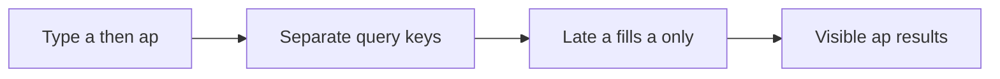

### Why

A shared results variable with no request identity allows stale completion to win.

### Trade-offs and alternatives

A monotonically increasing request id also works for manual fetch. Abort alone does not prove the server stopped; debounce does not order responses.

### At 10x / 100x

10x: measure input-to-result latency and cap retained pages. 100x: add relevance/search infrastructure only after query plans and traffic justify it.

### Counter-question and answer

Could filters race too? Yes: venue/date/cursor must be in the input key. Should previous rows be bookable? Recheck authoritative availability on booking.

### Practice

Quiz: What prevents a late a response from overwriting ap?

Correct: Separate query keys

Alternatives: Debounce alone / Assuming abort always stops the server

[Explorer tour](infra-explorer.html?tour=search) · [Code search](code-tours.html?q=apps%2Fweb%2Fsrc%2Ffeatures%2Fevents%2Fhooks%2Fuse-event-search.ts)

## debounce-throttle

Question: When do you debounce, throttle or cancel?

Area: Frontend · Status: built · Tour: search

### 30-second answer

Debounce waits until input is quiet; throttle bounds how often work runs during a continuous stream. Search uses debounce. Scrolling uses a bounded rendering window. Cancellation removes obsolete work but does not replace response identity or database correctness.

### How MiniTickets does it / where it would go

`apps/web/src/features/events/hooks/use-event-search.ts` clears each pending timer on input change. `apps/web/src/features/events/components/virtual-event-list.tsx` updates the visible fixed-height window. Run `pnpm demo:search` and inspect the number of search requests while typing.

### Diagram

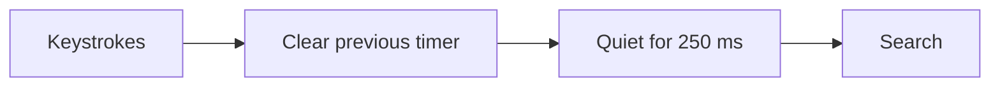

### Why

Sending every intermediate prefix wastes work.

### Trade-offs and alternatives

Short delay feels responsive but sends more queries; long delay feels sticky. A leading-edge throttle needs a trailing update to avoid losing final input.

### At 10x / 100x

10x: tune from actual latency and request counts. 100x: server admission limits still protect the backend; browser debounce is bypassable.

### Counter-question and answer

Can a malicious client skip it? Yes. Server validation and limits remain necessary.

### Practice

Quiz: Which strategy waits for typing to pause?

Correct: Debounce

Alternatives: Throttle / Database row lock

[Explorer tour](infra-explorer.html?tour=search) · [Code search](code-tours.html?q=apps%2Fweb%2Fsrc%2Ffeatures%2Fevents%2Fhooks%2Fuse-event-search.ts)

## virtual-lists

Question: rendering 10k events

Area: Frontend · Status: built · Tour: search

### 30-second answer

Pagination bounds transfer and database work; virtualization bounds mounted DOM nodes. They solve different problems. Keep stable event ids, a fixed-height window and overscan. Fetch the next keyset page before the user reaches the end. The full dataset should never become 10,000 React rows.

### How MiniTickets does it / where it would go

`apps/web/src/features/events/components/virtual-event-list.tsx` renders a bounded window. Search returns pages of 50. `pnpm demo:search` seeds an isolated 10k dataset, checks ordering/plans and runs related headless assertions. The virtual-list browser check bounds rendered rows.

### Diagram

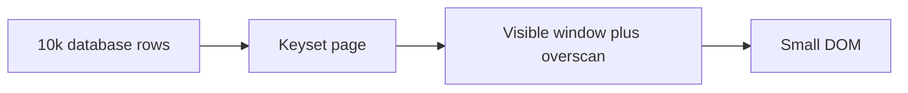

### Why

Large DOM trees hurt layout, paint, memory and interaction.

### Trade-offs and alternatives

Fixed heights are simple but constrain content. Variable-height libraries add measurement. Virtual lists need accessible list position and keyboard testing; pagination is a valid alternative.

### At 10x / 100x

10x: bound retained pages as well as DOM. 100x: server-side ranking, narrower payloads and a search engine may matter more than another UI optimization.

### Counter-question and answer

Does virtualization reduce SQL rows scanned? No; indexes and pagination do that.

### Practice

Quiz: What does virtualization primarily bound?

Correct: Mounted DOM nodes

Alternatives: Total database size / Concurrent booking locks

[Explorer tour](infra-explorer.html?tour=search) · [Code search](code-tours.html?q=apps%2Fweb%2Fsrc%2Ffeatures%2Fevents%2Fcomponents%2Fvirtual-event-list.tsx)

## rendering-models

Question: SSR, CSR or static rendering for an event catalogue?

Area: Frontend · Status: partly · Tour: search

### 30-second answer

SSR sends useful initial HTML, CSR handles interactive changes and static output suits public content that tolerates rebuilds. MiniTickets combines server-prefetched catalogue data with client queries. P10 nonce security makes HTML dynamic and no-store; explicit public data caching remains a separate choice.

### How MiniTickets does it / where it would go

`apps/web/src/app/layout.tsx` waits for a request; `apps/web/src/features/events/server/prefetch-events.ts` hydrates public data. `apps/web/src/features/events/server/cached-events.ts` provides an explicit public-data cache; the current search-prefetch path bypasses that helper to avoid unbounded cursor/text keys. Run `pnpm demo:security` for production HTML/cache acceptance; there is no static-site export.

### Diagram

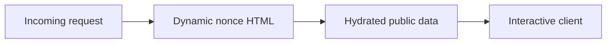

### Why

Initial content and interactivity have different latency and security constraints.

### Trade-offs and alternatives

Static HTML has cheap delivery but cannot reuse a fresh per-request nonce. CSR adds client work. Dynamic HTML costs server work even when data is cached.

### At 10x / 100x

10x: measure TTFB/cache hit rate. 100x: evaluate hash-based static CSP or separating public/static routes as a deliberate redesign.

### Counter-question and answer

Does dynamic HTML forbid cached data? No. Cache only public results with complete keys.

### Practice

Quiz: Can public data still be cached inside dynamic HTML rendering?

Correct: Yes with correct data keys

Alternatives: No caches are possible / Only if sessions are cached too

[Explorer tour](infra-explorer.html?tour=search) · [Code search](code-tours.html?q=apps%2Fweb%2Fsrc%2Fapp%2Flayout.tsx)

## hydration

Question: Why do hydration mismatches happen?

Area: Frontend · Status: built · Tour: search

### 30-second answer

Hydration attaches React behavior to the HTML already sent. The first browser render must agree with the server. Time zones, random values, local storage and different initial data can disagree. Put browser-only changes after mount and seed queries with the same canonical inputs used for SSR.

### How MiniTickets does it / where it would go

`apps/web/src/features/events/components/event-date.tsx` handles date presentation; server prefetch and `apps/web/src/features/events/lib/canonical-input.ts` keep input identity stable. Run `pnpm demo:search` and check the browser console as well as visible rows.

### Diagram

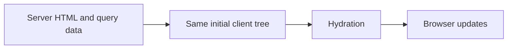

### Why

A mismatch can discard work and hide a real state bug.

### Trade-offs and alternatives

Suppressing a warning is appropriate only for an understood leaf difference, not a general repair. Client-only rendering avoids mismatches but delays content.

### At 10x / 100x

10x: test locale/time-zone boundaries. 100x: monitor console/recoverable errors and bundle cost across devices.

### Counter-question and answer

Why not generate a random id during render? Server and client may generate different values.

### Practice

Quiz: Which pair must agree during hydration?

Correct: Server HTML and initial client tree

Alternatives: Two random ids / All later client states forever

[Explorer tour](infra-explorer.html?tour=search) · [Code search](code-tours.html?q=apps%2Fweb%2Fsrc%2Ffeatures%2Fevents%2Fcomponents%2Fevent-date.tsx)

## private-page-cache

Question: caching Next pages that must not be shared (Next server, CloudFront)

Area: Frontend · Status: built · Tour: security-layers

### 30-second answer

Cache public data, never a shared personalized page. P10 generates a nonce for every HTML/RSC request and explicitly sends private,no-store for those responses. Keep user-bound queries out of shared server caches. A CDN must honor no-store; a positive CloudFront minimum TTL can override origin privacy directives.

### How MiniTickets does it / where it would go

`apps/web/src/proxy.ts` and `apps/web/next.config.ts` guard HTML caching. `apps/web/src/features/events/server/cached-events.ts` only stores public catalogue data. `infra/src/entry/cdn.ts` has zero minimum/default TTL on the events policy. CloudFront is inactive: `cdnEnabled=false`. Run `pnpm demo:security`.

### Diagram

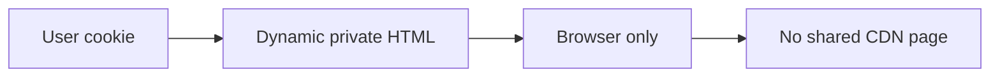

### Why

A cross-user cache leak exposes private data, and cached nonce HTML breaks CSP assumptions.

### Trade-offs and alternatives

Per-user edge keys are difficult to audit and multiply cache entries. No-store simplifies privacy at server cost. Static JS/images can still be cached.

### At 10x / 100x

10x: inspect headers on HTML and RSC. 100x: centralize cache policy tests and keep any public HTML strategy separate.

### Counter-question and answer

Does Vary: Cookie make every policy safe? No; the CDN cache key and minimum TTL must also agree.

### Practice

Quiz: Which CloudFront setting can override no-store?

Correct: A positive minimum TTL

Alternatives: An ETag alone / A zero minimum TTL

[Explorer tour](infra-explorer.html?tour=security-layers) · [Code search](code-tours.html?q=apps%2Fweb%2Fsrc%2Fproxy.ts)

Primary reference: [official documentation](https://docs.aws.amazon.com/AmazonCloudFront/latest/DeveloperGuide/Expiration.html).

## web-vitals

Question: how to check LCP and other vitals

Area: Frontend · Status: built · Tour: security-layers

### 30-second answer

LCP measures the main content appearing, INP interaction responsiveness and CLS unexpected layout shifts. Use field measurements grouped by route/device and percentile, then reproduce slow cases in lab tools. A single fast laptop run is not a user population. Good Core Web Vitals target the 75th percentile: LCP ≤2.5 s, INP ≤200 ms and CLS ≤0.1.

### How MiniTickets does it / where it would go

`apps/web/src/features/telemetry/hooks/use-web-vitals.ts` reports bounded values and normalized routes to telemetry.report; `apps/api/src/services/telemetry.ts` logs webVital without query strings or user ids. Run `pnpm demo:security`; the browser test interacts to produce INP and checks request validation. No reporting dashboard or sampling service is built.

### Diagram

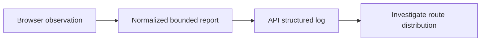

### Why

Field data catches slow devices, real network conditions and long interactions.

### Trade-offs and alternatives

Logs are simple but not a percentile analytics product. Client reports are untrusted. Lighthouse is repeatable lab evidence, not field truth.

### At 10x / 100x

10x: sample ingestion and group by device/network. 100x: dedicated metrics pipeline, retention and privacy budgets.

### Counter-question and answer

Why no INP on a page never touched? It needs qualifying interactions.

### Practice

Quiz: Which metric measures interaction responsiveness?

Correct: INP

Alternatives: LCP / CLS

[Explorer tour](infra-explorer.html?tour=security-layers) · [Code search](code-tours.html?q=apps%2Fweb%2Fsrc%2Ffeatures%2Ftelemetry%2Fhooks%2Fuse-web-vitals.ts)

Primary reference: [official documentation](https://web.dev/articles/vitals).

## bundle-size

Question: How do you keep JavaScript bundles small?

Area: Frontend · Status: partly · Tour: search

### 30-second answer

Keep server-only work on the server, make client boundaries narrow and inspect what is actually shipped. Tree-shaking cannot remove a runtime import that is needed. MiniTickets imports the API router as a type, so database and AWS dependencies do not enter the browser graph.

### How MiniTickets does it / where it would go

`apps/web/src/lib/trpc/client.ts` uses type AppRouter. Heavy QR issuance runs in `apps/worker/src/tickets/assets.ts`. Run `pnpm --filter @minitickets/web build` and inspect route output. A bundle-analysis package and enforced size budget are explain-only, proposed in CI alongside the web build.

### Diagram

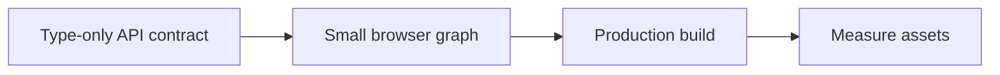

### Why

Download, parse and execution time all affect slower devices.

### Trade-offs and alternatives

Lazy loading trades first-load size for later waterfalls. A client boundary pulls its runtime imports along. Measure before adding an analyzer dependency.

### At 10x / 100x

10x: budget route chunks. 100x: track field transfer and long tasks, then split heavy interactions.

### Counter-question and answer

Does importing a type run API initialization? No; TypeScript erases that import.

### Practice

Quiz: Which import avoids shipping API runtime code?

Correct: import type AppRouter

Alternatives: A runtime database import / A browser AWS SDK import

[Explorer tour](infra-explorer.html?tour=search) · [Code search](code-tours.html?q=apps%2Fweb%2Fsrc%2Flib%2Ftrpc%2Fclient.ts)

## optimistic-ui

Question: Should buying the last seat use optimistic UI?

Area: Frontend · Status: partly · Tour: booking

### 30-second answer

Show pending feedback immediately, but only confirm a ticket after the authoritative transaction commits. An optimistic seat count may improve perceived speed but must roll back and reconcile. MiniTickets keeps the booking intent key through ambiguous retries and shows pending ticket issuance separately.

### How MiniTickets does it / where it would go

`apps/web/src/features/bookings/hooks/use-book-ticket.ts` owns mutation/retry state; `apps/web/src/features/bookings/components/my-tickets-list.tsx` distinguishes confirmed booking from pending QR issuance. Run `pnpm demo:idempotency`. Optimistic seat decrement is explain-only and would live in this hook with TanStack cache rollback.

### Diagram

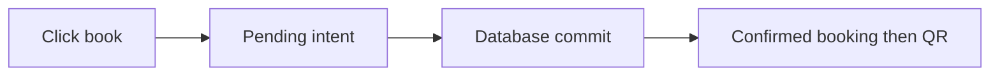

### Why

A false success on scarce inventory is worse than a short pending state.

### Trade-offs and alternatives

Optimistic likes are easy to undo; paid scarce inventory is different. Do not replace a lost-response retry with a new idempotency key.

### At 10x / 100x

10x: make pending states resilient to reload. 100x: async admission needs a durable intent/status resource.

### Counter-question and answer

Can pending QR trigger rebooking? No; poll ticket readiness for the existing booking.

### Practice

Quiz: When should a ticket booking be called confirmed?

Correct: After authoritative commit

Alternatives: On first click / After a speculative cache decrement

[Explorer tour](infra-explorer.html?tour=booking) · [Code search](code-tours.html?q=apps%2Fweb%2Fsrc%2Ffeatures%2Fbookings%2Fhooks%2Fuse-book-ticket.ts)

## accessibility

Question: What do axe checks prove, and what do they miss?

Area: Frontend · Status: built · Tour: security-layers

### 30-second answer

Automated checks catch many structural accessibility errors such as missing names and invalid contrast relationships. They cannot prove the whole experience works with a keyboard, screen reader or cognitive needs. Keep semantic controls and visible focus; test loading/error states and long lists manually too.

### How MiniTickets does it / where it would go

`apps/web/e2e/security.spec.ts` runs axe WCAG 2A/AA/2.1AA on events, login and signup. `pnpm demo:security` passed these three scans. The offline learning pages also use native buttons, labels and keyboard navigation. Comprehensive assistive-technology review remains manual.

### Diagram

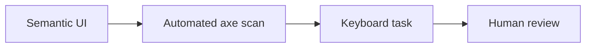

### Why

An accessible control must convey name, role and state, and remain usable under change.

### Trade-offs and alternatives

Automated gates are fast but incomplete. Virtualized lists need careful position/context; infinite scroll can make navigation harder.

### At 10x / 100x

10x: component-level semantic conventions. 100x: representative assistive-technology testing across critical journeys.

### Counter-question and answer

Does zero axe violations certify accessibility? No.

### Practice

Quiz: What remains necessary after a clean axe scan?

Correct: Human keyboard and assistive-technology review

Alternatives: Nothing / Only a Lighthouse score

[Explorer tour](infra-explorer.html?tour=security-layers) · [Code search](code-tours.html?q=apps%2Fweb%2Fe2e%2Fsecurity.spec.ts)

## live-seats

Question: P9: how would live seats work with SSE, WebSockets or polling?

Area: Frontend · Status: explain-only · Tour: live-seats

### 30-second answer

Use polling for simplicity, SSE for one-way seat notifications and WebSockets for bidirectional interaction. Seat messages are hints, not a purchase guarantee. Every booking still reaches Postgres. Across API instances, publish committed changes through Redis pub/sub or an outbox-driven channel; Redis pub/sub loses messages while a subscriber is disconnected.

### How MiniTickets does it / where it would go

WHERE IN MINITICKETS: proposed API procedure/service stream in apps/api/src/services/live-seats.ts, Redis adapter in queries/live-seats.ts and browser hook features/events/hooks/use-live-seats.ts. Publish only after commit, include event id and version, snapshot on connect/reconnect, heartbeats and bounded buffers. Backoff with jitter; close idle slow clients. No SSE/WebSocket endpoint or pub/sub deployment exists. Walk the Live seats explain-only explorer tour.


Existing integration point: `apps/api/src/services/bookings.ts`.
### Diagram

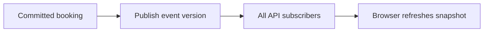

### Why

A catalogue benefits from fresher hints without weakening booking correctness.

### Trade-offs and alternatives

SSE supports one-way HTTP streaming; proxy buffering/timeouts need checks. WebSockets add connection protocol/state. Polling costs repeated reads but survives missed notifications.

### At 10x / 100x

10x: cap connections and reconnect storms. 100x: partition events, fan-out gateways, snapshot/version catch-up and regional ownership.

### Counter-question and answer

How recover a missed pub/sub message? Reload an authoritative snapshot; do not infer availability from a gap.

### Practice

Quiz: Can an SSE seat count authorize a purchase?

Correct: No; Postgres decides

Alternatives: Yes if it arrived recently / Yes if Redis published it

[Explorer tour](infra-explorer.html?tour=live-seats) · [Code search](code-tours.html?q=live-seats)

## lighthouse

Question: P11: where would Lighthouse CI fit?

Area: Frontend · Status: explain-only · Tour: security-layers

### 30-second answer

Run repeatable audits against a production build with fixed data and explicit budgets. Track trends and regressions, not a perfect score. Lab metrics help diagnose reproducible work; field vitals reveal real user distributions. Axe remains a separate P10 gate already built.

### How MiniTickets does it / where it would go

WHERE IN MINITICKETS: proposed Lighthouse CI config at repo root and a job after web build in .github/workflows/ci.yml, serving isolated API/web ports with seeded public events. Set budgets for LCP/CLS, JS bytes and accessibility; collect several runs and retain reports. No Lighthouse dependency, config or CI job is installed. P10 field telemetry is built separately.


Existing integration point: `.github/workflows/ci.yml`.
### Diagram

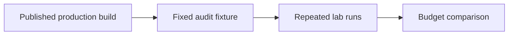

### Why

A lab gate catches a large regression before release.

### Trade-offs and alternatives

Shared CI runners are noisy; hard score thresholds can be flaky. Use calibrated metric/asset budgets and compare medians with a baseline.

### At 10x / 100x

10x: representative routes/devices. 100x: controlled runners, trend storage and field/lab correlation.

### Counter-question and answer

Can a good lab score prove p75 field INP? No; real interactions and device populations differ.

### Practice

Quiz: Which build should an audit measure?

Correct: Production build

Alternatives: Next dev with HMR / An empty mocked page only

[Explorer tour](infra-explorer.html?tour=security-layers) · [Code search](code-tours.html?q=lighthouse)

Primary reference: [official documentation](https://web.dev/articles/vitals).

## database-concurrency

Question: many requests at the same time: how does the DB handle it?

Area: Backend · Status: built · Tour: sale-day

### 30-second answer

A connection pool limits concurrent database sessions. Postgres uses row versions for ordinary reads and locks for competing writes. Different event rows can progress together; buyers for one hot event wait on its row. A transaction makes seats, booking and outbox atomic. More connections cannot remove contention on one row.

### How MiniTickets does it / where it would go

`apps/api/src/db/client.ts` caps the pool at 10 with 2 s connection acquisition and 5 s statement timeouts. `apps/api/src/queries/bookings.ts` → `createBookingTx` takes FOR UPDATE. Run `pnpm demo:booking-race` to measure the invariant under concurrent buyers.

### Diagram

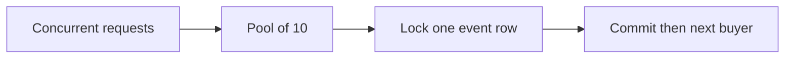

### Why

Read-then-write without locking loses updates.

### Trade-offs and alternatives

MVCC keeps ordinary reads from waiting on row writers, but reads can still wait on schema locks. Serializable adds anomaly detection and transaction retries.

### At 10x / 100x

10x: observe pool wait and lock wait separately. 100x: partition inventory or queue admissions; do not just multiply pools.

### Counter-question and answer

Can two different events run together? Yes, unless another shared resource bottlenecks.

### Practice

Quiz: Does adding connections remove a hot-row queue?

Correct: No

Alternatives: Yes always / Only with a larger HTTP timeout

[Explorer tour](infra-explorer.html?tour=sale-day) · [Code search](code-tours.html?q=apps%2Fapi%2Fsrc%2Fdb%2Fclient.ts)

Primary reference: [official documentation](https://www.postgresql.org/docs/current/transaction-iso.html).

## locking-latest

Question: no cache and many requests: how to lock and get the latest?

Area: Backend · Status: built · Tour: sale-day

### 30-second answer

Begin a short transaction, select the event FOR UPDATE, wait for the previous writer, then validate the row returned and update it before commit. At READ COMMITTED the locking read returns the updated row after waiting. An ordinary SELECT snapshot is not a reservation. A conditional atomic UPDATE is another safe design.

### How MiniTickets does it / where it would go

`apps/api/src/queries/bookings.ts` → `createBookingTx` rechecks duplicate intent under the lock before availability checks; it decrements using SQL arithmetic and inserts booking/outbox in the same transaction. `pnpm demo:booking-race` verifies no negative inventory. Cache locks are never used as seat locks.

### Diagram

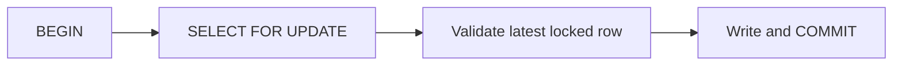

### Why

The read and decision must remain protected until the write.

### Trade-offs and alternatives

Conditional UPDATE WHERE seats_left >= quantity RETURNING is shorter but needs separate error classification. Optimistic version columns retry conflicts and can starve under high contention.

### At 10x / 100x

10x: shorten transaction work. 100x: admission control and inventory partitioning; retain a database constraint.

### Counter-question and answer

Is Redis SET NX sufficient? No; lease expiry/restart can allow multiple holders.

### Practice

Quiz: Where must the seat check run?

Correct: Inside the transaction on the locked row

Alternatives: Before taking the lock / Only in Redis

[Explorer tour](infra-explorer.html?tour=sale-day) · [Code search](code-tours.html?q=apps%2Fapi%2Fsrc%2Fqueries%2Fbookings.ts)

Primary reference: [official documentation](https://www.postgresql.org/docs/current/transaction-iso.html).

## idempotency

Question: idempotency

Area: Backend · Status: built · Tour: booking

### 30-second answer

A retry repeats one intent rather than making another purchase. The browser creates one UUID per intent and keeps it for ambiguous retries. A unique user/key constraint stores identity with the booking transaction. Same input replays the booking; different input with the same key conflicts. Failed transactions store no success.

### How MiniTickets does it / where it would go

`apps/api/src/db/schema/bookings.ts` enforces unique user/idempotency key. `apps/api/src/services/bookings.ts` compares event and quantity on replay; `queries/bookings.ts` handles races across different event rows. `pnpm demo:idempotency` exercises lost responses and concurrent duplicates.

### Diagram

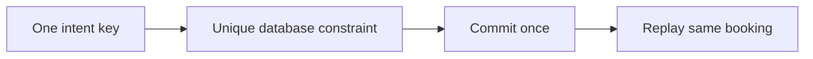

### Why

A network failure cannot tell a caller whether commit happened.

### Trade-offs and alternatives

Redis TTL keys add a cross-store gap and can expire/evict. A generic response store can replay exact response bodies but adds retention rules. This app reconstructs successful responses and keeps keys with bookings.

### At 10x / 100x

10x: index/storage retention policy. 100x: explicit idempotency contract for payment providers and async intents.

### Counter-question and answer

Why scope by user? Two users may coincidentally submit the same client key without sharing a booking.

### Practice

Quiz: What should an ambiguous retry keep?

Correct: The same idempotency key

Alternatives: A new UUID every retry / A shared key for every purchase

[Explorer tour](infra-explorer.html?tour=booking) · [Code search](code-tours.html?q=apps%2Fapi%2Fsrc%2Fdb%2Fschema%2Fbookings.ts)

## retry-backoff

Question: How do retries avoid amplifying an outage?

Area: Backend · Status: built · Tour: failing-email

### 30-second answer

Retry only failures likely to be temporary, bound attempts/time and retain operation identity. Exponential backoff reduces pressure; jitter prevents synchronized clients. MiniTickets retries ambiguous booking network failures with the same key, caps worker retries into a DLQ and keeps outbox retries durable. Jitter is a proposed improvement, not a claim about current fixed schedules.

### How MiniTickets does it / where it would go

`apps/web/src/features/bookings/lib/booking-retry.ts`, `apps/worker/src/backoff.ts` and `apps/api/src/services/outbox.ts` implement separate policies. Run `pnpm demo:outbox`. Outbox retries cap at 60 s without a maximum attempt count; worker failures use 10/40/120 s and a DLQ after 3 receives.

### Diagram

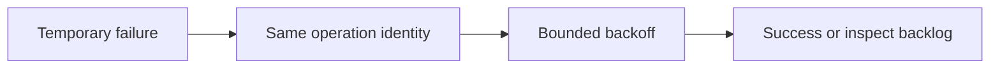

### Why

Immediate retries turn a partial failure into more load.

### Trade-offs and alternatives

Do not retry validation/authorization failures. Layered retries multiply attempts; choose one responsible layer. Proposed jitter belongs in retryInMs/backoff with bounded randomized tests.

### At 10x / 100x

10x: retry budgets and attempt metrics. 100x: per-destination admission and circuit breakers with durable backlog.

### Counter-question and answer

What if the response is lost after send? A retry may duplicate delivery; the consumer must be idempotent.

### Practice

Quiz: Which error should normally not be retried?

Correct: Invalid input

Alternatives: Transient network reset / Retryable service outage

[Explorer tour](infra-explorer.html?tour=failing-email) · [Code search](code-tours.html?q=apps%2Fweb%2Fsrc%2Ffeatures%2Fbookings%2Flib%2Fbooking-retry.ts)

## timeouts-pools

Question: Pool exhaustion, timeouts and circuit breakers: where are the boundaries?

Area: Backend · Status: partly · Tour: sale-day

### 30-second answer

An acquisition timeout bounds waiting for a connection; a statement timeout bounds SQL execution including lock wait. Network timeouts bound downstream calls. None proves an operation did not commit. A circuit breaker can stop repeated calls to an unhealthy dependency, but critical durable work still needs an eventual retry path.

### How MiniTickets does it / where it would go

`apps/api/src/db/client.ts` sets 2 s connect/acquisition and 5 s statements. `apps/api/src/queues/jobs.ts` bounds SDK connection/request time; Redis adapters bound operations. Run `pnpm demo:outbox` for a silent queue timeout. A breaker is explain-only: proposed state in services/outbox.ts around delivery, with half-open probes and durable rows left pending.

### Diagram

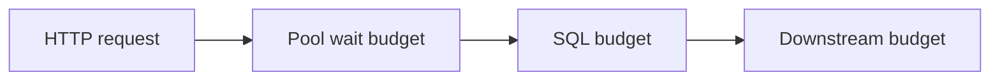

### Why

Unbounded waits keep scarce connections and shutdowns occupied.

### Trade-offs and alternatives

Timeouts need an overall deadline, not independent budgets longer than the request. Circuit breakers can reject useful probes or hide recovery if poorly tuned.

### At 10x / 100x

10x: pool occupancy/queue metrics. 100x: per-dependency bulkheads, adaptive limits and end-to-end deadlines.

### Counter-question and answer

Does a timeout prove rollback? No; retry with idempotency and reconcile ambiguous results.

### Practice

Quiz: Does a statement timeout limit pool wait?

Correct: No; acquisition has a separate timeout

Alternatives: Yes automatically / Only when Redis is up

[Explorer tour](infra-explorer.html?tour=sale-day) · [Code search](code-tours.html?q=apps%2Fapi%2Fsrc%2Fdb%2Fclient.ts)

## rate-limits

Question: Why token buckets, and which identity do you limit?

Area: Backend · Status: built · Tour: sale-day

### 30-second answer

Token buckets permit a burst then refill at a steady rate. Login limits a trustworthy client IP; booking limits an authenticated user. Redis Lua makes refill and debit atomic across instances. Return 429 and Retry-After. A spoofable forwarded header must not choose someone else’s bucket.

### How MiniTickets does it / where it would go

`apps/api/src/queries/rate-limits.ts` stores buckets; `services/rate-limits.ts` chooses policy. `config/trust-proxy.ts` only trusts configured hops/CIDRs. `pnpm demo:sale` verifies shared quotas, spoof resistance and the inventory gate. Redis failure is an explicit failure policy, not a durable quota guarantee.

### Diagram

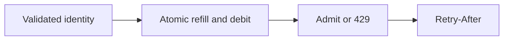

### Why

One instance’s memory cannot enforce a shared quota.

### Trade-offs and alternatives

Fixed windows permit boundary bursts; sliding windows cost more state. IP limits affect NAT users. Redis allkeys-lru can evict quotas; strict financial quotas need durable accounting.

### At 10x / 100x

10x: key cardinality/TTL and fairness. 100x: gateway protections, per-tenant budgets and hot-key partitioning.

### Counter-question and answer

Should auth failures all share one user key? No; unauthenticated identity needs a trusted edge/IP policy.

### Practice

Quiz: What makes a bucket update atomic across API tasks?

Correct: Redis Lua operation

Alternatives: Browser debounce / Per-process counter

[Explorer tour](infra-explorer.html?tour=sale-day) · [Code search](code-tours.html?q=apps%2Fapi%2Fsrc%2Fqueries%2Frate-limits.ts)

## api-n-plus-one

Question: API design, N+1 and graceful shutdown

Area: Backend · Status: built · Tour: booking

### 30-second answer

Keep input validation in procedures, business rules in services and storage in queries. Fetch related records in one intentional query rather than looping through requests. On shutdown stop accepting new work, finish bounded in-flight work, stop the relay and close clients. Health checks must distinguish liveness from dependency readiness.

### How MiniTickets does it / where it would go

`apps/api/src/queries/bookings.ts` → `listByUser` joins bookings/events once. `apps/api/src/trpc/init.ts` handles auth/error translation. `apps/api/src/server.ts` closes relay/Fastify/Redis/Postgres. Run `pnpm test` for API/service and relay lifecycle coverage; live ALB drain timing remains acceptance.

### Diagram

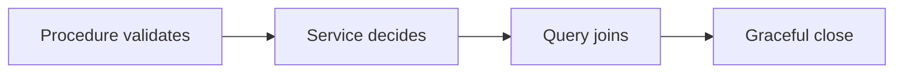

### Why

Layer boundaries make code understandable; bounded work makes deployment safer.

### Trade-offs and alternatives

Joining everything can overfetch; pagination and projection still matter. GraphQL/tRPC do not automatically prevent N+1. Liveness that depends on every store can cause restart storms.

### At 10x / 100x

10x: paginate My tickets/bookings and inspect plans. 100x: per-dependency deadlines, connection budgets and task drain experiments.

### Counter-question and answer

Can the web import the API database module? No; only its router type crosses that boundary.

### Practice

Quiz: Where does SQL belong?

Correct: Queries

Alternatives: React components / Procedure validation schemas

[Explorer tour](infra-explorer.html?tour=booking) · [Code search](code-tours.html?q=apps%2Fapi%2Fsrc%2Fqueries%2Fbookings.ts)

## postgres-cache

Question: how Postgres caches

Area: Database · Status: partly · Tour: database-reach

### 30-second answer

Postgres keeps table/index pages in shared buffers, and the operating system can cache file pages too. A cache hit avoids a storage read, but the query still executes: visibility checks, joins, filtering and sorting cost CPU. This is different from Redis storing the finished public events result. There is no general automatic result cache for arbitrary SELECTs.

### How MiniTickets does it / where it would go

`apps/api/src/queries/events.ts` still executes SQL on a Redis miss. `pnpm demo:search` reports EXPLAIN plans on its isolated data. Inspect EXPLAIN (ANALYZE, BUFFERS) in a controlled read-only session; warm and cold runs answer different questions. Production cache sizing has not been benchmarked.

### Diagram

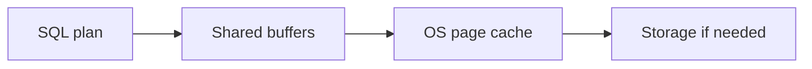

### Why

A warm database can be fast without a separate application cache.

### Trade-offs and alternatives

Larger shared buffers are not unlimited free memory; sorts/work_mem multiply with operations and sessions. Evicting caches just to benchmark can disrupt other workloads.

### At 10x / 100x

10x: inspect hit/read counts and CPU. 100x: tune working set, queries and IO before assuming Redis solves all load.

### Counter-question and answer

Does a shared-buffer hit skip SQL execution? No.

### Practice

Quiz: What is stored in shared buffers?

Correct: Database pages

Alternatives: Every completed SELECT response / Browser HTML

[Explorer tour](infra-explorer.html?tour=database-reach) · [Code search](code-tours.html?q=apps%2Fapi%2Fsrc%2Fqueries%2Fevents.ts)

Primary reference: [official documentation](https://www.postgresql.org/docs/current/runtime-config-resource.html).

## indexes-pagination

Question: GIN, B-tree, EXPLAIN and keyset versus OFFSET

Area: Database · Status: built · Tour: search

### 30-second answer

Choose an index for the predicate and order. Trigram GIN helps contains search; B-tree on starts_at/id supports stable traversal. Keyset asks for rows after the last pair, avoiding a growing OFFSET scan. A stable cutoff prevents time drift but is not a database snapshot: inserts and edits can still change later pages.

### How MiniTickets does it / where it would go

`apps/api/src/queries/event-search.ts` escapes LIKE metacharacters and uses composite cursor boundaries. Migration `apps/api/drizzle/0008_lethal_amazoness.sql` adds search indexes. `pnpm demo:search` measures 10k rows, index plans and page boundaries including timestamp ties.

### Diagram

```mermaid
flowchart LR
    n0["Contains predicate"] --> n1
    n1["Matching index"] --> n2
    n2["Ordered cursor pair"] --> n3
    n3["Next bounded page"]
```

### Why

Deep OFFSET discards earlier rows repeatedly.

### Trade-offs and alternatives

GIN adds write/storage cost and short/unselective terms can favor a scan. Keyset cannot jump to arbitrary page 200; snapshot semantics need more design.

### At 10x / 100x

10x: inspect real selectivity and buffers. 100x: retention/partitioning or full-text relevance when product needs it.

### Counter-question and answer

Why carry id with time? It breaks ties so rows sharing a timestamp are not skipped.

### Practice

Quiz: Which cursor is stable for timestamp ties?

Correct: starts_at plus id

Alternatives: Timestamp alone / Row count alone

[Explorer tour](infra-explorer.html?tour=search) · [Code search](code-tours.html?q=apps%2Fapi%2Fsrc%2Fqueries%2Fevent-search.ts)

## migrations

Question: How do migrations and rollback avoid downtime?

Area: Database · Status: partly · Tour: deploy

### 30-second answer

Run migrations once from the same published SHA before rolling tasks. Prefer expand/contract: add compatible schema, deploy readers/writers, backfill, then remove old columns in a later release. Application rollback must not assume a destructive migration can be undone. MiniTickets runs a dedicated migration task; full zero-downtime backfill orchestration is explain-only.

### How MiniTickets does it / where it would go

`infra/src/compute/migration-task.ts` defines the one-off task; `.github/workflows/cd.yml` invokes it before app rollout. `docs/20-deploy-day.md` explains tag rollback and migration limits. Proposed large backfills belong in explicit resumable scripts with bounded batches and progress, not API startup.

### Diagram

```mermaid
flowchart LR
    n0["Expand schema"] --> n1
    n1["Run migration task"] --> n2
    n2["Roll compatible apps"] --> n3
    n3["Contract later"]
```

### Why

Old and new tasks overlap during rolling deployment.

### Trade-offs and alternatives

CREATE INDEX CONCURRENTLY has transaction restrictions. Long locks can stall traffic. A forward fix may be safer than rolling back code after incompatible data changes.

### At 10x / 100x

10x: inspect lock duration on a copy. 100x: online index/backfill tooling, compatibility windows and rehearsed restore.

### Counter-question and answer

Can rollback remove a column safely? Only if no running version uses it and recovery is planned.

### Practice

Quiz: Why migrate outside each API startup?

Correct: Avoid competing migration attempts

Alternatives: To bypass tests / To make schema unrelated to image SHA

[Explorer tour](infra-explorer.html?tour=deploy) · [Code search](code-tours.html?q=infra%2Fsrc%2Fcompute%2Fmigration-task.ts)

## replicas-backups

Question: Read replicas, multi-AZ and backups/PITR: which problem does each solve?

Area: Database · Status: explain-only · Tour: database-reach

### 30-second answer

Replicas scale eligible reads but may lag; multi-AZ improves availability; backups and point-in-time recovery restore past data after deletion/corruption. None replaces another. Booking decisions must use the authoritative writer. A successful booking followed by a lagging replica read can appear missing.

### How MiniTickets does it / where it would go

WHERE IN MINITICKETS: proposed read-only client in queries for public catalogue only, infrastructure options in infra/src/data/postgres.ts, and an owner restore drill in the deploy runbook. Current dev is intentionally small; no read replica, cross-region database or tested PITR recovery SLA is claimed. Inspect RDS configuration read-only before assuming retention or multi-AZ.


Existing integration point: `infra/src/data/postgres.ts`.
### Diagram

```mermaid
flowchart LR
    n0["Writer commit"] --> n1
    n1["Lagging read replica"] --> n2
    n2["Read routing policy"] --> n3
    n3["Backup restore drill"]
```

### Why

Availability, read scale and historical recovery are distinct requirements.

### Trade-offs and alternatives

Read-your-writes can route a user to the writer temporarily. Replicas and multi-AZ cost money. A backup without a tested restore is incomplete evidence.

### At 10x / 100x

10x: define RPO/RTO and test restore. 100x: failover rehearsals, lag-aware routing and regional data ownership.

### Counter-question and answer

Can a replica stop accidental deletion? No; deletion replicates.

### Practice

Quiz: Which protects historical recovery?

Correct: Backups with tested restore/PITR

Alternatives: Only a read replica / Only another API task

[Explorer tour](infra-explorer.html?tour=database-reach) · [Code search](code-tours.html?q=replicas-backups)

## cache-stampede

Question: How do you stop a cache miss stampede across instances?

Area: Caching · Status: built · Tour: search

### 30-second answer

Use single-flight inside one process and a short distributed rebuild lock across processes. Recheck the cache after taking the lock: another holder may have filled it while this request waited. Release only with the owner token. Bound waiting and fall back to Postgres so a broken cache does not hang the request.

### How MiniTickets does it / where it would go

`apps/api/src/services/single-flight.ts` shares a promise with cleanup on both success/error. `queries/events-cache.ts` uses SET NX PX and Lua compare/delete. `pnpm demo:stampede` previously measured 100 concurrent requests as 1 DB query, including two instances after the double-check fix.

### Diagram

```mermaid
flowchart LR
    n0["Concurrent cache misses"] --> n1
    n1["Single-flight and lease"] --> n2
    n2["Double-check then rebuild"] --> n3
    n3["One cached result"]
```

### Why

A fast cache can amplify database load when many entries expire together.

### Trade-offs and alternatives

The 5 s lease and bounded wait permit duplicate rebuilds if slow or evicted. That is acceptable for public reads, never scarce-seat correctness.

### At 10x / 100x

10x: TTL jitter and refresh metrics. 100x: hot-key partitioning, stale serving and bounded rebuild queues.

### Counter-question and answer

Why random owner token? A late old holder must not delete a newer lease.

### Practice

Quiz: What must happen after acquiring a rebuild lock?

Correct: Recheck the cache

Alternatives: Always query immediately / Delete every cache key

[Explorer tour](infra-explorer.html?tour=search) · [Code search](code-tours.html?q=apps%2Fapi%2Fsrc%2Fservices%2Fsingle-flight.ts)

## cache-invalidation

Question: How do you prevent a stale refill after a write?

Area: Caching · Status: built · Tour: search

### 30-second answer

Commit the write, then increment a cache generation. A reader captures the generation before its database read and stores only under that generation. A slow pre-write reader can fill its old key, but new readers use the new generation. TTL bounds stale data if invalidation fails; errors are logged instead of undoing a committed event.

### How MiniTickets does it / where it would go

`apps/api/src/services/events.ts` → `invalidateUpcomingList` runs after event creation. `queries/events-cache.ts` builds generation/filter keys. `queries/web-cache.ts` calls signed Next revalidation. Run `pnpm demo:stampede`; inspect cache invalidation unit tests for late refill and failure.

### Diagram

```mermaid
flowchart LR
    n0["Commit event"] --> n1
    n1["Increment generation"] --> n2
    n2["New readers use new key"] --> n3
    n3["Old refill expires"]
```

### Why

DEL alone allows an in-flight old reader to repopulate the same key.

### Trade-offs and alternatives

Generation keys increase transient cardinality. Redis and Next/browser caches have separate stale windows; one invalidation does not instantly refresh every tab.

### At 10x / 100x

10x: watch invalidation failures/key churn. 100x: outbox-driven invalidation and explicit freshness SLOs.

### Counter-question and answer

Why read generation before SQL? Reading after SQL could place old rows in the new generation.

### Practice

Quiz: Which order protects against stale refill?

Correct: Read generation before database

Alternatives: Read generation after database / Only delete after reading

[Explorer tour](infra-explorer.html?tour=search) · [Code search](code-tours.html?q=apps%2Fapi%2Fsrc%2Fservices%2Fevents.ts)

## swr-caches

Question: SWR, stale-if-error and stacked caches: how stale can a user see?

Area: Caching · Status: built · Tour: search

### 30-second answer

SWR serves a bounded stale value while one background refresh runs; stale-if-error serves a previous good value during a bounded outage. Each cache layer has its own clock: Redis, Next public data and browser queries. Fresh at one layer does not force another layer to refetch. Seat purchase always checks the writer.

### How MiniTickets does it / where it would go

`apps/api/src/services/events.ts` applies fresh/stale/error windows and tracks in-flight refreshes. `apps/web/src/features/events/server/cached-events.ts` and `hooks/use-events.ts` add separate caches. Run `pnpm test` for fake-clock SWR/error cases. P10 disables shared HTML caching while retaining explicit public data caching.

### Diagram

```mermaid
flowchart LR
    n0["Browser query"] --> n1
    n1["Next public data"] --> n2
    n2["Redis envelope"] --> n3
    n3["Postgres"]
```

### Why

Bounded stale public listings trade freshness for latency/availability.

### Trade-offs and alternatives

Never use stale data for authorization or seats. Long independent TTLs can compound staleness. A failing refresh must not reset old data to fresh.

### At 10x / 100x

10x: expose age/hit telemetry. 100x: consolidate overlapping caches and define end-to-end freshness budgets.

### Counter-question and answer

Does a successful admin write refresh all open tabs? No; they refetch on their own query policy.

### Practice

Quiz: Can stale listings authorize booking?

Correct: No

Alternatives: Yes inside TTL / Yes after SWR refresh starts

[Explorer tour](infra-explorer.html?tour=search) · [Code search](code-tours.html?q=apps%2Fapi%2Fsrc%2Fservices%2Fevents.ts)

## hot-keys-privacy

Question: How do hot keys, cache keys and privacy interact?

Area: Caching · Status: partly · Tour: search

### 30-second answer

A cache key must include every input that changes the result. Canonicalize dates/venue so equivalent filters share a key; keep authenticated data out of public keys. A very hot event or generation key still concentrates load. Redis eviction is acceptable for reconstructible public data, but sessions should fail closed and quotas are only advisory under eviction.

### How MiniTickets does it / where it would go

`apps/api/src/services/event-filters.ts` normalizes filters; `queries/events-cache.ts` hashes complete inputs. `queries/sessions.ts` requires session-index membership and never caches private pages. Run `pnpm test` for canonical filter/key and session eviction cases. Dedicated Redis isolation is explain-only.

### Diagram

```mermaid
flowchart LR
    n0["Validated canonical input"] --> n1
    n1["Complete public key"] --> n2
    n2["Shared result"] --> n3
    n3["TTL or eviction"]
```

### Why

Missing a venue/date/user dimension can return wrong or private data.

### Trade-offs and alternatives

Hashing bounds key size but does not fix omitted input. One cache used for sessions/results/quotas shares failure and eviction behavior.

### At 10x / 100x

10x: hot-key and eviction metrics. 100x: separate security-critical stores/policies and shard only measured bottlenecks.

### Counter-question and answer

Is hashing a key encryption? No; do not put secrets into it assuming privacy.

### Practice

Quiz: What must a result cache key include?

Correct: All result-changing inputs

Alternatives: Only the route name / Only a user-visible label

[Explorer tour](infra-explorer.html?tour=search) · [Code search](code-tours.html?q=apps%2Fapi%2Fsrc%2Fservices%2Fevent-filters.ts)

## outbox

Question: What if booking commits but publishing fails?

Area: Async · Status: built · Tour: booking

### 30-second answer

Store the booking, seat decrement and confirmation payload in one Postgres transaction. A relay publishes committed outbox rows and marks them sent. A crash after publish but before marking sent produces a duplicate, so consumers stay idempotent. This closes message loss, not exactly-once delivery.

### How MiniTickets does it / where it would go

`apps/api/src/queries/bookings.ts` inserts the outbox row. `queries/outbox.ts` uses FOR UPDATE SKIP LOCKED batches of 10; `services/outbox.ts` retries persisted rows. `pnpm demo:outbox` measured 24/24 recovered after queue restoration and atomic rollback on injected outbox failure.

### Diagram

```mermaid
flowchart LR
    n0["Booking transaction"] --> n1
    n1["Durable outbox"] --> n2
    n2["Competing relay"] --> n3
    n3["SNS then consumers"]
```

### Why

Commit-then-send has a gap; send-then-commit can announce a rolled-back purchase.

### Trade-offs and alternatives

Holding row locks while sending is simple but occupies a pool connection. Leases/CDC decouple IO at greater complexity. Sent rows need retention planning.

### At 10x / 100x

10x: batch sends/backlog age. 100x: separate relay or CDC, retention and publish throughput budgets.

### Counter-question and answer

What if SNS accepted before relay crash? Publish again with stable message identity; consumers deduplicate.

### Practice

Quiz: Does an outbox guarantee exactly-once delivery?

Correct: No; at-least-once with idempotent consumers

Alternatives: Yes always / Only if a Redis lock exists

[Explorer tour](infra-explorer.html?tour=booking) · [Code search](code-tours.html?q=apps%2Fapi%2Fsrc%2Fqueries%2Fbookings.ts)

## fanout

Question: Queue, topic, event bus or Kafka for booking events?

Area: Async · Status: built · Tour: booking

### 30-second answer

A topic fans one event out to multiple subscriptions. A queue buffers work for competing consumers. MiniTickets publishes to SNS, then separate email/ticket SQS queues; each can retry independently. EventBridge adds richer routing/integrations; Kafka adds retained partitioned replay. Choose those only when the product needs those semantics.

### How MiniTickets does it / where it would go

`infra/src/jobs/booking-events.ts` configures raw SNS deliveries and queue source restrictions. `apps/api/src/queues/jobs.ts` publishes one stable message. Run `pnpm demo:tickets` and `pnpm demo:outbox` separately; P4 local emulators exercise the same SDK boundaries. AWS fan-out acceptance is still manual.

### Diagram

```mermaid
flowchart LR
    n0["Outbox"] --> n1
    n1["SNS topic"] --> n2
    n2["Independent email and ticket queues"] --> n3
    n3["Independent consumers"]
```

### Why

Two consumers must each receive the event; competing on one queue would divide work.

### Trade-offs and alternatives

SNS/SQS are operationally small but standard delivery is unordered/duplicated. A bus is routing, not a replacement for all consumer backpressure.

### At 10x / 100x

10x: per-consumer backlog/concurrency. 100x: partition ordering domains and retention/replay requirements.

### Counter-question and answer

Why not two Lambdas on one SQS queue? They compete; each message is not promised to both.

### Practice

Quiz: What does a topic add?

Correct: Fan-out to separate consumers

Alternatives: A shared SQL transaction / Guaranteed global ordering

[Explorer tour](infra-explorer.html?tour=booking) · [Code search](code-tours.html?q=infra%2Fsrc%2Fjobs%2Fbooking-events.ts)

## consumer-idempotency

Question: Can an idempotent email consumer guarantee exactly one email?

Area: Async · Status: built · Tour: booking

### 30-second answer

It can skip known completed message ids, but a crash after SES accepts and before marking complete can still send twice on retry. Marking complete before sending risks loss. Ticket issuance converges more strongly using a canonical booking/seat id, a creating reservation, a deterministic S3 key and a final ready state.

### How MiniTickets does it / where it would go

`apps/worker/src/handlers/booking-confirmed.ts` and `processed-jobs.ts` mark successful mail after send. `handlers/tickets.ts` reserves a canonical ticket and resumes partial work; `tickets/store.ts` uses conditional writes. `pnpm demo:tickets` checks duplicates and crash-resume behavior.

### Diagram

```mermaid
flowchart LR
    n0["Receive at least once"] --> n1
    n1["Check canonical identity"] --> n2
    n2["Perform or resume work"] --> n3
    n3["Record completion"]
```

### Why

At-least-once queues force every side effect to define its duplicate behavior.

### Trade-offs and alternatives

No distributed transaction spans SES/S3/DynamoDB. TTL cleanup bounds dedup history; an expired old message may run again. External provider idempotency is valuable where supported.

### At 10x / 100x

10x: bound dedup retention against redrive age. 100x: durable state machines and provider-specific idempotency contracts.

### Counter-question and answer

Why not use queue message id for tickets? Republishing the same booking can create a different queue id.

### Practice

Quiz: What defines ticket identity?

Correct: Booking id plus seat number

Alternatives: Queue receive attempt / Random UUID on every retry

[Explorer tour](infra-explorer.html?tour=booking) · [Code search](code-tours.html?q=apps%2Fworker%2Fsrc%2Fhandlers%2Fbooking-confirmed.ts)

## dlq-failure

Question: A customer has no confirmation: retry, DLQ or redrive?

Area: Async · Status: built · Tour: failing-email

### 30-second answer

Find the booking/correlation id, follow structured logs, inspect queue age and failed attempts, then DLQ and alarm. Fix the root cause before redrive. Visibility timeout hides an in-flight message; it is not deletion. Partial-batch reporting retries only failed records. A poison message should not block all useful work.

### How MiniTickets does it / where it would go

`apps/worker/src/batch.ts` returns batchItemFailures; `backoff.ts` sets delay; `infra/src/jobs/queue-trigger.ts` sets worker mapping. `pnpm jobs:dlq` lists local failures; redrive is an explicit owner operation after a fix. Runbook §3.12 has AWS diagnostics; no live alarm drill has been claimed.

### Diagram

```mermaid
flowchart LR
    n0["Failed consumer"] --> n1
    n1["Visibility delay"] --> n2
    n2["Retry limit"] --> n3
    n3["DLQ and alarm"]
```

### Why

Durable failure evidence is better than silently dropping work.

### Trade-offs and alternatives

Too-short visibility can overlap work; too-large visibility delays recovery. Reserved Lambda concurrency and mapping maximumConcurrency must agree or throttling can consume receives.

### At 10x / 100x

10x: oldest-message age and redrive rate limits. 100x: separate poison-message classes, sampling and SLO-driven alarms.

### Counter-question and answer

Does an empty queue mean email was delivered? No; inspect completion/provider outcomes too.

### Practice

Quiz: What should happen before redrive?

Correct: Fix the failure cause

Alternatives: Delete all evidence / Increase retries forever

[Explorer tour](infra-explorer.html?tour=failing-email) · [Code search](code-tours.html?q=apps%2Fworker%2Fsrc%2Fbatch.ts)

Primary reference: [official documentation](https://docs.aws.amazon.com/lambda/latest/dg/services-sqs-errorhandling.html).

## ordering-sagas

Question: What if ordering matters or a multi-step purchase needs compensation?

Area: Async · Status: explain-only · Tour: booking

### 30-second answer

Standard SNS/SQS may duplicate and reorder events. A per-aggregate version can reject stale updates; FIFO groups can serialize a chosen key. For payments plus booking across services, use an explicit saga/state machine with timeouts and compensating actions. Compensation is a business action, not a database rollback across the internet.

### How MiniTickets does it / where it would go

WHERE IN MINITICKETS: proposed purchase-state service in apps/api/src/services/purchases.ts, transaction/outbox queries below it, and workers for payment/refund outcomes. Use bookingId as correlation/ordering scope. No payment workflow, FIFO queue or saga is built. Existing booking transaction remains local atomicity.


Existing integration point: `apps/api/src/queries/outbox.ts`.
### Diagram

```mermaid
flowchart LR
    n0["Purchase intent"] --> n1
    n1["Reserve or pay"] --> n2
    n2["Outcome event"] --> n3
    n3["Confirm or compensate"]
```

### Why

Independent systems can partially succeed and recover at different times.

### Trade-offs and alternatives

FIFO ordering reduces parallelism per group and does not eliminate every duplicate side effect. A workflow engine adds operational/cost overhead.

### At 10x / 100x

10x: define compensation deadlines and reconciliation. 100x: partition by aggregate, version messages and audit state transitions.

### Counter-question and answer

Is refund identical to undoing history? No; it is a new durable transaction.

### Practice

Quiz: What is compensation?

Correct: A new business action that addresses partial success

Alternatives: A universal SQL rollback / Deleting all events

[Explorer tour](infra-explorer.html?tour=booking) · [Code search](code-tours.html?q=ordering-sagas)

## sale-day

Question: sale day with row locks.

Area: Sale day · Status: built · Tour: sale-day

### 30-second answer

One event row serializes buyers even with many API tasks. Rate limits bound callers; an advisory Redis inventory gate rejects obvious sold-out work before the database. All admitted buyers still run the same Postgres transaction. Redis failure, expiry or wrong counts must never create a confirmed seat by itself.

### How MiniTickets does it / where it would go

`apps/api/src/services/booking-inventory.ts` debits an intent-owned reservation and falls back to Postgres on Redis failure. `services/inventory-reconciliation.ts` compares versions before correction so it does not overwrite in-flight work. `pnpm demo:sale` compares gated/ungated short loads and verifies replay at zero stock.

### Diagram

```mermaid
flowchart LR
    n0["User rate limit"] --> n1
    n1["Redis advisory gate"] --> n2
    n2["Postgres row lock"] --> n3
    n3["Booking and outbox commit"]
```

### Why

Fewer doomed buyers enter the hot-row queue.

### Trade-offs and alternatives

Unknown DB commit/refund and worker crashes can skew the hint; reconciliation repairs admission, not correctness. This is not a customer-visible timed seat hold.

### At 10x / 100x

10x: compare p95/p99 and lock waits. 100x: durable queue admission or partitioned seat rows, keeping DB constraints.

### Counter-question and answer

Can reconciliation blindly SET database stock? No; compare-and-set against an observed version to avoid clobbering in-flight debits.

### Practice

Quiz: Who is final seat authority?

Correct: Postgres transaction

Alternatives: Redis hint / Browser count

[Explorer tour](infra-explorer.html?tour=sale-day) · [Code search](code-tours.html?q=apps%2Fapi%2Fsrc%2Fservices%2Fbooking-inventory.ts)

## waiting-room

Question: Where would a waiting room, booking queue and expiring seat holds go?

Area: Sale day · Status: explain-only · Tour: sale-day

### 30-second answer

A waiting room controls admission before the hot API. A durable booking queue changes the contract to accepted intent plus later status. A customer seat hold needs an owner, expiry and atomic transition to booking; it is not the Redis inventory hint. State the fairness and abandonment policy before choosing technology.

### How MiniTickets does it / where it would go

WHERE IN MINITICKETS: proposed admission middleware before bookings procedure, durable booking_intents/seat_holds queries in Postgres and a service/worker processing one event shard. Browser hook polls its intent; an expiry job releases only still-held rows by conditional transition. No waiting-room token issuer, booking queue or timed customer hold exists.


Existing integration point: `apps/api/src/procedures/bookings.ts`.
### Diagram

```mermaid
flowchart LR
    n0["Waiting admission"] --> n1
    n1["Durable intent"] --> n2
    n2["Owned expiring hold"] --> n3
    n3["Confirm or release"]
```

### Why

An unbounded request queue consumes connections and gives poor user feedback.

### Trade-offs and alternatives

FIFO fairness, bots, token replay and expiry races need explicit rules. An async response cannot claim success until final booking commits.

### At 10x / 100x

10x: bounded queue depth and abandonment metrics. 100x: sharded processors, capacity tokens and abuse protection.

### Counter-question and answer

What if expiry races payment? One conditional state transition wins; reconcile external payment/refund.

### Practice

Quiz: Is the P8 Redis gate a timed customer hold?

Correct: No

Alternatives: Yes always / Only when a user is logged in

[Explorer tour](infra-explorer.html?tour=sale-day) · [Code search](code-tours.html?q=waiting-room)

## autoscaling

Question: P8: how would ECS autoscaling help, and what would it cost?

Area: Sale day · Status: explain-only · Tour: sale-day

### 30-second answer

Target tracking can add tasks on CPU or ALB requests per target, with min/max bounds and scale-in/out cooldowns. It helps independent request work; it cannot parallelize a single locked event row. More API tasks also create more database pools. Pick bounds from latency, DB connection budget and cost.

### How MiniTickets does it / where it would go

WHERE IN MINITICKETS: proposed Pulumi module infra/src/compute/autoscaling.ts after ECS service creation, using Application Auto Scaling target/policy for desiredCount. Start with explicit min 1/max 3 for a controlled exercise, account for API and web separately and set cooldowns/alarms. No scaling resource/IAM policy is built. Inspect existing service desiredCount; load test only under an owner budget.


Existing integration point: `infra/src/compute/service.ts`.
### Diagram

```mermaid
flowchart LR
    n0["CPU or ALB demand"] --> n1
    n1["Target tracking policy"] --> n2
    n2["Bounded ECS tasks"] --> n3
    n3["Shared DB bottleneck"]
```

### Why

Elastic compute reduces overprovisioning for variable independent load.

### Trade-offs and alternatives

Scale-out is delayed by metrics, image start and health checks. Min tasks cost while idle; max tasks bound but do not fully cap AWS spend. Never blindly scale past RDS pool capacity.

### At 10x / 100x

10x: load-test cooldowns and connection totals. 100x: scheduled on-sale capacity plus downstream quotas and event sharding.

### Counter-question and answer

Why not just set max 100? Cost, DB connection limits and downstream saturation.

### Practice

Quiz: Can task scaling remove one row lock bottleneck?

Correct: No

Alternatives: Yes by itself / Only with more CPU targets

[Explorer tour](infra-explorer.html?tour=sale-day) · [Code search](code-tours.html?q=autoscaling)

## compute-choices

Question: ECS, Lambda or EKS? Cold starts, VPC and NAT?

Area: AWS · Status: partly · Tour: booking

### 30-second answer

ECS fits long-running API/web processes and predictable pools. Lambda fits bursty queue handlers with bounded work. EKS provides Kubernetes control at substantial operational cost. Our workers run outside the VPC because they only call managed public AWS APIs; putting a worker in a public subnet does not give it a public IP or automatic internet.

### How MiniTickets does it / where it would go

`infra/src/compute/service.ts` runs Fargate; `infra/src/jobs/worker-lambda.ts` has no vpcConfig and 10 s timeout; ticket Lambda has its own larger budget. Lambdas use container images already published by CI. `pnpm demo:tickets` validates handlers locally, not AWS cold starts. EKS/NAT gateways are not built.

### Diagram

```mermaid
flowchart LR
    n0["HTTP long-lived process"] --> n1
    n1["ECS pool"] --> n2
    n2["Queue burst"] --> n3
    n3["Lambda handler"]
```

### Why

Match runtime lifecycle and network needs to workload.

### Trade-offs and alternatives

VPC Lambda for RDS requires routing/endpoints or NAT for outside services. NAT has fixed and data charges; endpoints also cost. Container image cold start differs from zip, so measure.

### At 10x / 100x

10x: concurrency/quota and SES limits. 100x: provisioned concurrency only for measured latency needs, reserved concurrency for protection.

### Counter-question and answer

Is a Lambda in a public subnet publicly addressed? No.

### Practice

Quiz: Which runtime currently owns the HTTP API?

Correct: ECS Fargate

Alternatives: EKS / The email Lambda

[Explorer tour](infra-explorer.html?tour=booking) · [Code search](code-tours.html?q=infra%2Fsrc%2Fcompute%2Fservice.ts)

## iam-oidc

Question: IAM roles and OIDC: who can wear which badge?

Area: AWS · Status: built · Tour: iam-badges

### 30-second answer

A trust policy says who can assume a role; a permission policy says which actions/resources it can access; attachment says which runtime uses it. GitHub OIDC exchanges an approved repository/environment identity for short-lived AWS credentials. Task execution retrieves images/secrets; application roles authorize runtime AWS calls.

### How MiniTickets does it / where it would go

`infra/src/cicd.ts` restricts OIDC subjects and PassRole. `infra/src/publish-policy.ts` includes ECR read/write actions needed by publish; `compute/iam.ts` separates API execution/application roles. Read the D1 Every IAM badge tour and runbook §3.11. Live deploy acceptance remains owner work.

### Diagram

```mermaid
flowchart LR
    n0["Repository OIDC subject"] --> n1
    n1["Trust policy"] --> n2
    n2["Scoped role permissions"] --> n3
    n3["Attached job or task"]
```

### Why

A reachable AWS endpoint is not permission to invoke it.

### Trade-offs and alternatives

Resource wildcards needed for APIs without resource scoping require conditions where supported. Broad deploy capability is dangerous; do not let old infrastructure runs apply.

### At 10x / 100x

10x: environment protection/expiry and policy review. 100x: separate accounts, policy-as-code and change approvals tied to exact SHA.

### Counter-question and answer

Why did worker publish need BatchGetImage? Publishing tooling reads image manifests as well as uploading layers.

### Practice

Quiz: What answers who may assume a role?

Correct: Trust policy

Alternatives: Security group / Database password

[Explorer tour](infra-explorer.html?tour=iam-badges) · [Code search](code-tours.html?q=infra%2Fsrc%2Fcicd.ts)

## network-boundaries

Question: Routes, SGs, NACLs, ENIs and private DNS: what actually connects?

Area: AWS · Status: built · Tour: database-reach

### 30-second answer

First prove reach: address, route, subnet and listener. Then prove allowed: SG source/port and IAM for service APIs. Finally prove credentials. SGs are stateful; NACLs are subnet-level/stateless. An ENI is the task’s network interface. Service Connect gives web/api private names and ports without exposing internal traffic through a public browser URL.

### How MiniTickets does it / where it would go

`infra/src/network.ts` defines routes; `security.ts` allows ALB→web/API and API→Postgres/Valkey. `compute/service-connect.ts` defines namespace aliases. API_INTERNAL_URL is for web server code; browser tRPC uses same-origin ALB routing. Read `infra/src/compute/service-connect.ts` and follow the private-name console tour.

### Diagram

```mermaid
flowchart LR
    n0["Browser HTTPS ALB"] --> n1
    n1["Target SG and task ENI"] --> n2
    n2["API private route"] --> n3
    n3["DB SG and credentials"]
```

### Why

A valid password cannot repair a missing route or blocked SG.

### Trade-offs and alternatives

Public ECS task IPs avoid NAT in this small design but require strict inbound SGs. Private subnets with NAT/endpoints change cost and reach.

### At 10x / 100x

10x: map all egress and proxy trust. 100x: segmentation, IPv6/endpoints and flow logs after a concrete need.

### Counter-question and answer

Can browser JS call the Service Connect hostname? No; it is private service discovery for tasks.

### Practice

Quiz: Which control is stateful?

Correct: Security group

Alternatives: Network ACL / DNS record

[Explorer tour](infra-explorer.html?tour=database-reach) · [Code search](code-tours.html?q=infra%2Fsrc%2Fnetwork.ts)

## dynamodb

Question: How do access patterns choose DynamoDB keys?

Area: AWS · Status: built · Tour: booking

### 30-second answer

Design from queries: an owner lists their tickets and the worker conditionally reserves a canonical ticket. Base keys userId/ticketId support owner-scoped reads; a date index supports event-date access. Conditional writes prevent duplicate reservations. A GSI is eventually consistent and a popular date can become hot.

### How MiniTickets does it / where it would go

`infra/src/tickets/storage.ts` defines the ticket table/index; `apps/worker/src/tickets/store.ts` reserves/marks ready; `apps/api/src/queries/tickets.ts` only reads the authenticated owner. `pnpm demo:tickets` tests duplicate/resume behavior. The API role is not granted arbitrary Scan.

### Diagram

```mermaid
flowchart LR
    n0["Owner id query"] --> n1
    n1["Base-table ticket keys"] --> n2
    n2["Conditional reservation"] --> n3
    n3["Ready ticket"]
```

### Why

A table key should serve actual reads rather than mimic a relational schema blindly.

### Trade-offs and alternatives

A GSI adds write/storage cost and lag. TTL deletion is asynchronous; never use it as exact authorization expiry. On-demand billing still has hot-partition limits.

### At 10x / 100x

10x: paginate owner queries. 100x: shard hot date indexes/bounded time windows and model reconciliation reads.

### Counter-question and answer

Can a caller choose another ownerId? No; take it from the verified session.

### Practice

Quiz: What is canonical ticket identity?

Correct: bookingId and seat

Alternatives: Date alone / SQS receipt handle

[Explorer tour](infra-explorer.html?tour=booking) · [Code search](code-tours.html?q=infra%2Fsrc%2Ftickets%2Fstorage.ts)

## ses-email

Question: SES deliverability, quotas and duplicate emails

Area: AWS · Status: partly · Tour: failing-email

### 30-second answer

A successful SendEmail means SES accepted the request, not that the recipient read it. Verify identity/DKIM, respect sandbox/production access and sending rate, then handle bounce/complaint outcomes. MiniTickets has a dedicated mail worker and scoped SES permission. Custom MAIL FROM/SPF/DMARC workflows and bounce processing are explain-only.

### How MiniTickets does it / where it would go

`infra/src/jobs/email.ts` configures the SES identity; `apps/worker/src/ses-mailer.ts` sends with a stable configured sender. `docs/20-deploy-day.md` §3.10 covers owner acceptance. Proposed feedback events would fan into a separate queue/service updating suppression preferences. No live inbox delivery claim.

### Diagram

```mermaid
flowchart LR
    n0["Email queue"] --> n1
    n1["SES accepted send"] --> n2
    n2["Recipient provider"] --> n3
    n3["Delivery or bounce"]
```

### Why

Offloading mail protects booking latency but delivery is still an external outcome.

### Trade-offs and alternatives

SES quotas can bottleneck a fast Lambda. Retrying permanent bad addresses wastes work. Mark-after-send leaves a duplicate window.

### At 10x / 100x

10x: production quota/rate and suppression. 100x: reputation monitoring, templates/localization and provider outcome ingestion.

### Counter-question and answer

Does more Lambda concurrency increase SES quota? No.

### Practice

Quiz: What does SendEmail success prove?

Correct: SES accepted the request

Alternatives: The user read it / Exactly one delivery forever

[Explorer tour](infra-explorer.html?tour=failing-email) · [Code search](code-tours.html?q=infra%2Fsrc%2Fjobs%2Femail.ts)

## presigned-uploads

Question: Presigned URLs, CORS and untrusted uploads

Area: Security · Status: built · Tour: booking

### 30-second answer

A presigned URL is a short-lived bearer capability with exactly the signer’s allowed action. CORS controls browser cross-origin use, not authorization. Validate the owner/admin before signing, constrain type/size, inspect actual image bytes and publish to an immutable key with conditional version identity. Never treat a declared Content-Type as malware scanning.

### How MiniTickets does it / where it would go

`apps/api/src/services/posters.ts` validates admin workflow; `queries/posters.ts` signs staging/publish operations; `services/poster-image.ts` checks bounded bytes; `queries/assets.ts` signs private reads for 120 s. `pnpm demo:p4-assets` tests owner isolation and constrained upload/publication. No antivirus/re-encoding pipeline is built.

### Diagram

```mermaid
flowchart LR
    n0["Admin validated"] --> n1
    n1["Signed staging upload"] --> n2
    n2["Byte validation and IfMatch"] --> n3
    n3["Immutable public poster"]
```

### Why

Direct uploads avoid buffering large files through the API while retaining controlled publication.

### Trade-offs and alternatives

A leaked URL works until expiry. Exact PUT length differs from POST length ranges. Proposed scanning worker belongs before publication and must quarantine failures.

### At 10x / 100x

10x: upload quotas and cleanup. 100x: scan/re-encode queues, retention and abuse response.

### Counter-question and answer

Can another origin with curl use a leaked URL? Yes; CORS does not constrain non-browser callers.

### Practice

Quiz: What is a presigned URL?

Correct: Bearer capability

Alternatives: Public bucket permission / Proof a file is harmless

[Explorer tour](infra-explorer.html?tour=booking) · [Code search](code-tours.html?q=apps%2Fapi%2Fsrc%2Fservices%2Fposters.ts)

## reminders

Question: P5: where would scheduled reminders go in MiniTickets?

Area: Async · Status: explain-only · Tour: chapter-20

### 30-second answer

Use one daily EventBridge schedule to invoke a reminder Lambda, query a bounded date range and enqueue reminder messages. Use explicit reminder identity such as ticketId plus reminder date/type to prevent duplicate sends. Time zone and missed-run semantics are product decisions. A daily schedule does not guarantee exactly one invocation.

### How MiniTickets does it / where it would go

WHERE IN MINITICKETS: proposed infra/src/jobs/reminders.ts after ticket table, proposed worker reminder handler with paginated date-index queries, and existing SNS/SQS mail boundary extended with a versioned reminder schema. Trust scheduler.amazonaws.com for invoke-only execution role; Lambda role queries only the date index and publishes only the mail destination. No Scheduler, reminder Lambda, IAM grants or reminder UI is built. Do not run a nonexistent demo.


Existing integration point: `infra/src/tickets/storage.ts`.
### Diagram

```mermaid
flowchart LR
    n0["Daily Scheduler"] --> n1
    n1["Paginated date-index Lambda"] --> n2
    n2["Idempotent reminder message"] --> n3
    n3["Existing mail queue"]
```

### Why

Scheduled work belongs outside user requests and must survive retries.

### Trade-offs and alternatives

GSI lag means use overlapping windows plus dedup; TTL is not an exact scheduler. Flexible windows spread load but affect delivery timing. Missed schedules need bounded catch-up and DLQ alarms.

### At 10x / 100x

10x: page sizes and sending rate. 100x: shard date partitions, incremental checkpoints and user-local time-zone batches.

### Counter-question and answer

What if the schedule runs twice? Dedup by stable reminder identity, not invocation id.

### Practice

Quiz: Which id should deduplicate a reminder?

Correct: Ticket plus reminder date/type

Alternatives: Lambda request id / A fresh random id per attempt

[Explorer tour](infra-explorer.html?tour=chapter-20) · [Code search](code-tours.html?q=reminders)

Primary reference: [official documentation](https://docs.aws.amazon.com/scheduler/latest/UserGuide/managing-schedule-flexible-time-windows.html).

## door-checkin

Question: P6: where would door check-in go in MiniTickets?

Area: Security · Status: explain-only · Tour: check-in

### 30-second answer

Authenticate the staff/device, verify the signed QR claims and conditionally transition a canonical ticket from unused to used. Two scanners race: exactly one conditional update wins. API Gateway REST usage plans/API keys can meter devices, but keys are not user authentication and quotas are best-effort. Reject replay, wrong event and invalid signatures.

### How MiniTickets does it / where it would go

WHERE IN MINITICKETS: proposed check-in procedure/service/queries under apps/api/src, an API Gateway REST route plus authenticated staff authorizer in infra, and a scanner UI feature. Reuse worker token verification as a deliberate shared server-only module, never browser signing. DynamoDB update condition checks unused state/event; audit actor/time and return already-used explicitly. No gateway, usage plan/key, scanner or used-state transition is built.


Existing integration point: `apps/worker/src/tickets/token.ts`.
### Diagram

```mermaid
flowchart LR
    n0["Authenticated scanner"] --> n1
    n1["Verify QR and event"] --> n2
    n2["Conditional unused-to-used"] --> n3
    n3["One accepted scan"]
```

### Why

HMAC proves issuance; it cannot stop the same valid QR being shown twice.

### Trade-offs and alternatives

Offline scanners need a reconciliation/conflict policy and cannot promise global one-time use. API keys leak and are not authorization. Rate limits supplement device/staff identity.

### At 10x / 100x

10x: per-gate quotas and burst tests. 100x: regional ownership, key revocation and offline conflict procedure.

### Counter-question and answer

Can two valid scans both succeed? Only if the storage transition is not conditional or checks different identities.

### Practice

Quiz: What prevents two simultaneous scans succeeding?

Correct: One conditional state transition

Alternatives: QR signature alone / A browser disabled button

[Explorer tour](infra-explorer.html?tour=check-in) · [Code search](code-tours.html?q=door-checkin)

Primary reference: [official documentation](https://docs.aws.amazon.com/apigateway/latest/developerguide/api-gateway-api-usage-plans.html).

## regions-cost

Question: Multi-AZ, multi-region and cost: how far should this project go?

Area: AWS · Status: explain-only · Tour: build-order

### 30-second answer

Define availability, recovery time, data loss and budget before adding regions. Two subnets/AZs alone do not make a single-task/single-database dev stack highly available. Multi-region scarce inventory requires a single write owner or a deliberate consistency protocol. Cost includes idle databases, task hours, IPs, endpoints, logs and data transfer.

### How MiniTickets does it / where it would go

WHERE IN MINITICKETS: proposed desired-count/DB availability changes in infra/src/compute/service.ts and data/postgres.ts, failover routing in entry, and a runbook with rehearsed restore/failover. Current committed switches are the environment shape; release SHA stays in SSM. No active-active booking, replicated sessions or cross-region failover is built.


Existing integration point: `infra/src/data/postgres.ts`.
### Diagram

```mermaid
flowchart LR
    n0["Requirements and budget"] --> n1
    n1["Availability domains"] --> n2
    n2["Write ownership"] --> n3
    n3["Tested recovery"]
```

### Why

Extra copies without failover semantics can create inconsistency and bills.

### Trade-offs and alternatives

RTO/RPO distinguish recovery time/data loss. Strong global consistency raises latency; regional allocation can sell out unevenly. Cost budgets alert; they do not impose a hard spend cap.

### At 10x / 100x

10x: right-size and test AZ failure. 100x: explicit regional ownership and capacity planning with measured SLOs.

### Counter-question and answer

Does a second AZ guarantee two healthy tasks? No; desired counts and dependencies matter.

### Practice

Quiz: What must be defined before active-active inventory?

Correct: Write ownership and consistency

Alternatives: Only a second DNS record / Only a larger CDN TTL

[Explorer tour](infra-explorer.html?tour=build-order) · [Code search](code-tours.html?q=regions-cost)

## sessions-roles

Question: Sessions versus JWTs, rotation, revocation and roles

Area: Security · Status: built · Tour: security-layers

### 30-second answer

Opaque session cookies keep revocation server-side; JWTs reduce lookup dependence but revocation/role changes need expiry or another authoritative version. MiniTickets hashes random tokens in Redis, rotates login sessions, indexes at most 20 devices and checks membership on every read. Admin authorization reads Postgres; role changes revoke sessions before and after the update.

### How MiniTickets does it / where it would go

`apps/api/src/queries/sessions.ts` implements indexed creation/read/revokeAll; `services/users.ts` revokes around makeAdmin. `pnpm demo:security` checks old-cookie, all-device and role revocation. Cookies are HttpOnly/SameSite with Secure in production. An in-flight authorized request cannot be recalled; two-store role/revocation is not a global transaction.

### Diagram

```mermaid
flowchart LR
    n0["Random cookie"] --> n1
    n1["Hashed session and user index"] --> n2
    n2["Authoritative role check"] --> n3
    n3["Allowed procedure"]
```

### Why

A role embedded forever in a session becomes stale after a privilege change.

### Trade-offs and alternatives

Redis/index eviction fails closed and forces login. The 20-device bound makes revoke work bounded. Session-versioning/transactional role changes are proposed improvements for larger deployments.

### At 10x / 100x

10x: monitor auth-store failures and session churn. 100x: coordinated auth versioning, device management and key/credential rotation.

### Counter-question and answer

Is the presence cookie authorization? No; it only avoids a predictable redirect flash; API verifies the real session.

### Practice

Quiz: What happens if session membership is missing?

Correct: Authentication fails closed

Alternatives: Trust the raw token anyway / Automatically grant admin

[Explorer tour](infra-explorer.html?tour=security-layers) · [Code search](code-tours.html?q=apps%2Fapi%2Fsrc%2Fqueries%2Fsessions.ts)

## csrf-cors

Question: CSRF, CORS, SameSite and trusted headers

Area: Security · Status: built · Tour: security-layers

### 30-second answer

CSRF tricks a browser into sending an authenticated action from another site. CORS controls whether browser code can read cross-origin responses; it is not a mutation authorization check. SameSite helps but is not the entire policy. MiniTickets requires the exact trusted Origin on mutations and rejects cross-site Sec-Fetch-Site.

### How MiniTickets does it / where it would go

`apps/api/src/http/security.ts` → `mutationAllowed` guards all non-safe methods, including missing-Origin refusal. CLI callers explicitly send Origin. `pnpm demo:security` exercises same/cross/missing metadata and cookie isolation; one isolated inverted-origin mutation made both relevant tests fail.

### Diagram

```mermaid
flowchart LR
    n0["Cross-site action attempt"] --> n1
    n1["Origin and Fetch Metadata guard"] --> n2
    n2["Session authentication"] --> n3
    n3["Business validation"]
```

### Why

A request can cause side effects even if its response is unreadable.

### Trade-offs and alternatives

Non-browser clients must follow the explicit Origin contract; XSS on the trusted origin bypasses CSRF defenses, so output safety/CSP still matter. Proxy headers need their own trust policy.

### At 10x / 100x

10x: centralize trusted origin/environment validation. 100x: service-to-service auth and tenant origin rules with tests.

### Counter-question and answer

Is Origin cryptographic API authentication? No; non-browser clients can set it. Sessions still authorize actions.

### Practice

Quiz: Does CORS alone stop CSRF side effects?

Correct: No

Alternatives: Yes always / Only on POST

[Explorer tour](infra-explorer.html?tour=security-layers) · [Code search](code-tours.html?q=apps%2Fapi%2Fsrc%2Fhttp%2Fsecurity.ts)

## csp-xss

Question: Nonce CSP, XSS and supply-chain gates

Area: Security · Status: built · Tour: security-layers

### 30-second answer

XSS executes unwanted code in a trusted page. Validate input, render escaped text and use a per-request nonce CSP to limit script execution. Production does not allow unsafe-eval. CI dependency and image scanners catch known advisories, not every vulnerability or malicious business rule. Gates need a clear severity policy and honest residual findings.

### How MiniTickets does it / where it would go

`apps/web/src/proxy.ts` generates/overwrites nonce headers; `lib/security-policy.ts` defines script policy; `lib/trpc/client.ts` disables Zod JIT to avoid eval probes. CI audits critical dependencies and scans three images with Trivy CRITICAL. `pnpm demo:security` asserts no CSP violations. Audit: 0 critical, one high braces and one moderate esbuild remain; image scan execution is unverified locally.

### Diagram

```mermaid
flowchart LR
    n0["Fresh request nonce"] --> n1
    n1["Allowed scripts only"] --> n2
    n2["Escaped React output"] --> n3
    n3["CI advisory gates"]
```

### Why

Defense in depth reduces damage from accidental injection and known dependency flaws.

### Trade-offs and alternatives

Nonce pages require dynamic/no-store HTML. Style attributes remain allowed for current UI. Scanners cannot prove safety and unfixed findings need tracked decisions.

### At 10x / 100x

10x: report CSP violations with bounded sampling. 100x: dependency provenance, policies and attack-surface reviews.

### Counter-question and answer

Why not enable unsafe-eval to silence Zod? Disable the optional JIT/probe instead, preserving production policy.

### Practice

Quiz: What must differ on each nonce HTML request?

Correct: The nonce

Alternatives: The database password / The static image filename

[Explorer tour](infra-explorer.html?tour=security-layers) · [Code search](code-tours.html?q=apps%2Fweb%2Fsrc%2Fproxy.ts)

## secrets-forgery

Question: Secrets, ticket forgery, rotation and OWASP checks

Area: Security · Status: partly · Tour: check-in

### 30-second answer

Store signing/database credentials in Secrets Manager, expose them only to the runtime that needs them and never log them. HMAC authenticates the original ticket bytes and constant-time comparison rejects tampering; it does not encrypt the payload or prevent reuse. Authorization still checks owner/role and uploads remain untrusted.

### How MiniTickets does it / where it would go

`apps/worker/src/tickets/token.ts` signs/verifies bounded strict claims; `infra/src/tickets/iam.ts` grants only ticket worker secret access; `services/tickets.ts` owner-scopes reads. Run `pnpm demo:tickets` and `pnpm demo:p4-assets` separately. Proposed rotation adds key id plus verification key ring, staged rollout and old-key retirement; this key-ring is not built.

### Diagram

```mermaid
flowchart LR
    n0["Secrets Manager"] --> n1
    n1["Scoped worker role"] --> n2
    n2["Signed ticket bytes"] --> n3
    n3["Verify before use"]
```

### Why

A client must never receive the signing secret or invent a valid ticket.

### Trade-offs and alternatives

Rotating a single key immediately invalidates old QR tokens unless a key ring is supported. OWASP review also needs abuse, dependency, authorization, logging and incident practices beyond code checks.

### At 10x / 100x

10x: expiry/rotation drills and audit access. 100x: per-environment/key versioning, compromise playbooks and threat modeling.

### Counter-question and answer

Are signed QR claims private? No; base64url is readable.

### Practice

Quiz: Does a valid HMAC stop ticket reuse?

Correct: No

Alternatives: Yes / Only if base64 is used

[Explorer tour](infra-explorer.html?tour=check-in) · [Code search](code-tours.html?q=apps%2Fworker%2Fsrc%2Ftickets%2Ftoken.ts)

## delivery-rollback

Question: How does build-once delivery and rollback work?

Area: Delivery · Status: built · Tour: deploy

### 30-second answer

Publish API/web/worker images once with the git SHA after CI, then deploy that immutable release. The environment switches live in committed Pulumi YAML; deployed image tag lives in SSM and is written by CD. Migration runs before rollout. Roll back app images to a known tag while respecting current schema and current infrastructure.

### How MiniTickets does it / where it would go

The publish job in `.github/workflows/cd.yml` builds/pushes; its deploy job resolves release and runs two-phase deploy/migrate/smoke checks. `infra/src/image-tag.ts` reads the tag; `release.ts` tracks last deployed commit. See runbook §3.11–3.18. No publish, AWS write or live rollback was performed by this documentation work.

### Diagram

```mermaid
flowchart LR
    n0["CI tests"] --> n1
    n1["Publish SHA once"] --> n2
    n2["Approved CD plus migration"] --> n3
    n3["Roll and smoke test"]
```

### Why

Rebuilding on deploy can ship bytes that were never reviewed or tested.

### Trade-offs and alternatives

Rolling deployment overlaps versions. Blue/green gives a switchable target but costs overlap and still needs compatible migrations. Secrets/config are part of release compatibility.

### At 10x / 100x

10x: expired approvals and automated rollback criteria. 100x: canary analysis, immutable manifests and cross-service compatibility.

### Counter-question and answer

Should rollback run old Pulumi code? No; image rollback and infrastructure rollback are different risks.

### Practice

Quiz: Where is the deployed image tag recorded?

Correct: SSM release parameter

Alternatives: Per-image tags committed into Pulumi YAML / A developer shell variable only

[Explorer tour](infra-explorer.html?tour=deploy) · [Code search](code-tours.html?q=.github%2Fworkflows%2Fcd.yml)

## old-deploy

Question: An old approved pipeline would delete new resources: how do you prevent it?

Area: Delivery · Status: built · Tour: deploy

### 30-second answer

Approvals can outlive the commit they refer to. Record the deployed commit and refuse an older ancestor before applying infrastructure. Cancel/supersede waiting runs, but keep a server-side guard: concurrency alone may still leave an old pending run. Allow app rollback explicitly without applying an old infrastructure graph.

### How MiniTickets does it / where it would go

`scripts/deploy-guard.sh` compares ancestry; `infra/src/release.ts` defines the deployed-commit parameter; `.github/workflows/cd.yml` checks it before changes. Unit tests cover stale runs and rollback conditions. Run `pnpm test` and follow runbook bootstrap; current guard permissions still need AWS acceptance.

### Diagram

```mermaid
flowchart LR
    n0["Approved run SHA"] --> n1
    n1["Read deployed commit"] --> n2
    n2["Ancestry guard"] --> n3
    n3["Apply only valid graph"]
```

### Why

A stale infrastructure program can interpret newer resources as removed.

### Trade-offs and alternatives

SSM records AWS release state without granting repo writes. Drift detection finds differences but does not itself prevent a destructive stale apply.

### At 10x / 100x

10x: approval expiry and environment rules. 100x: policy-as-code denying destructive stateful changes and separate deployment accounts.

### Counter-question and answer

Why not just cancel pending runs? Human approval and queued concurrency can still select an obsolete run.

### Practice

Quiz: What should an ancestor infrastructure run do?

Correct: Refuse before applying

Alternatives: Apply then detect deletion / Ignore the live release record

[Explorer tour](infra-explorer.html?tour=deploy) · [Code search](code-tours.html?q=scripts%2Fdeploy-guard.sh)

## observability

Question: How do you debug one booking and avoid alert fatigue?

Area: Delivery · Status: built · Tour: failing-email

### 30-second answer

Use a validated correlation id across request, outbox and worker. Logs explain events, metrics show rates and traces time causal steps. Alarm on symptoms: API errors, old queue work, DLQ messages and worker failures. Missing data semantics matter; do not page on every idle CPU wobble.

### How MiniTickets does it / where it would go

`apps/api/src/http/correlation-id.ts`, worker correlation and JSON loggers preserve identity. `infra/src/observability` defines four alarms, dashboard and saved queries. P2 measured request-to-email 115 ms and retry recovery around 10 s locally. Runbook §3.12 supplies exact Logs Insights/console steps; SNS email confirmation/live alarms remain manual.

### Diagram

```mermaid
flowchart LR
    n0["Booking correlation id"] --> n1
    n1["API and worker JSON"] --> n2
    n2["Logs Insights"] --> n3
    n3["Queue/DLQ alarm"]
```

### Why

A user symptom spans asynchronous boundaries, not one process log.

### Trade-offs and alternatives

Correlation is not a timed trace. Logging full messages leaks PII. Fixed thresholds are simple but need traffic-aware tuning and retention cost planning.

### At 10x / 100x

10x: error rates/p99 and sampling. 100x: SLO burn-rate alerting and trace sampling with explicit budgets.

### Counter-question and answer

Why validate client correlation ids? Prevent log injection and unbounded junk while preserving useful propagation.

### Practice

Quiz: Which signal explains a specific failed booking?

Correct: Correlated structured logs

Alternatives: Only average CPU / Only deployment count

[Explorer tour](infra-explorer.html?tour=failing-email) · [Code search](code-tours.html?q=apps%2Fapi%2Fsrc%2Fhttp%2Fcorrelation-id.ts)

## tracing-slos

Question: Where would tracing, SLOs and error budgets fit?

Area: Delivery · Status: explain-only · Tour: failing-email

### 30-second answer

Traces form a tree of timed spans linked by trace context. An SLI measures a user outcome; an SLO sets a target/window; an error budget is the permitted failure fraction. Alert on sustained fast budget burn, not a brief harmless blip. A dev app without real traffic cannot demonstrate a meaningful production SLO.

### How MiniTickets does it / where it would go

WHERE IN MINITICKETS: proposed apps/api/src/tracing.ts loaded before server modules, ADOT sidecar in API task, Lambda tracing config and narrowly scoped X-Ray write IAM. Propagate W3C traceparent through the message envelope. Proposed CloudWatch SLI for booking success/latency and email delay; logs remain current evidence. No OTel collector, tracing grants or SLO resource is built.


Existing integration point: `apps/api/src/http/correlation-id.ts`.
### Diagram

```mermaid
flowchart LR
    n0["User outcome SLI"] --> n1
    n1["Target over window"] --> n2
    n2["Error budget"] --> n3
    n3["Multi-window burn alert"]
```

### Why

Average latency and raw error counts can hide a failing user journey.

### Trade-offs and alternatives

Sampling loses individual traces; sidecars cost CPU/memory and collector operations. ALB errors alone do not fully describe business success. Use a business metric where needed.

### At 10x / 100x

10x: define denominator/exclusions and test alerts. 100x: sampled distributed spans, cost/PII limits and release policies tied to budget.

### Counter-question and answer

Does 99.5% mean zero failures? No; it allows 0.5% of valid events to miss the objective.

### Practice

Quiz: What is an SLI?

Correct: A measured user outcome ratio

Alternatives: A fixed monthly bill / A retry attempt id

[Explorer tour](infra-explorer.html?tour=failing-email) · [Code search](code-tours.html?q=tracing-slos)

## dev-parity

Question: How do you onboard a developer and keep local/cloud parity?

Area: Delivery · Status: built · Tour: build-order

### 30-second answer

Use one idempotent setup command, env examples as the contract and a checker that prints exact fixes without secrets. Use the same AWS SDK operations locally against emulators, while naming their limits: no real IAM, SES delivery, AWS quotas or managed failover. Keep destructive reset separate and local-only.

### How MiniTickets does it / where it would go

`scripts/stack-up.ts` and `scripts/stack-check.ts` check containers, migrations, queues/table and ports. Run `pnpm stack:check`; owner starts with `pnpm dev`. Local apps use Postgres/Redis, ElasticMQ, DynamoDB Local and Moto for SNS/S3. Existing owner ports/processes are never restarted by agent checks.

### Diagram

```mermaid
flowchart LR
    n0["Example env contract"] --> n1
    n1["Idempotent setup"] --> n2
    n2["Same SDK with endpoint"] --> n3
    n3["Exact diagnostics"]
```

### Why

Reproducible setup prevents environment guessing and accidental data loss.

### Trade-offs and alternatives

Shared emulators are fast for humans; isolated tests avoid cross-test state. Testcontainers/devcontainers are possible later, not installed merely for documentation.

### At 10x / 100x

10x developers: consistent toolchain/devcontainer. 100x: image checks and documented emulator differences in CI.

### Counter-question and answer

Why not call the script doctor? pnpm has a built-in command with that name that shadowed it.

### Practice

Quiz: Which command diagnoses without resetting?

Correct: pnpm stack:check

Alternatives: pnpm stack:reset / pnpm db:down

[Explorer tour](infra-explorer.html?tour=build-order) · [Code search](code-tours.html?q=scripts%2Fstack-up.ts)

## testing-strategy

Question: Which tests prove correctness, and which need real infrastructure?

Area: Delivery · Status: built · Tour: sale-day

### 30-second answer

Unit-test pure policy and failure decisions, integration-test real transaction/concurrency invariants and browser-test user-visible flows. A demo should print measurable counts rather than only success text. Emulators exercise SDK contracts but cannot prove IAM, ALB proxy behavior, SES delivery or CloudFront policy. Keep those as explicit live acceptance.

### How MiniTickets does it / where it would go

Vitest currently has 404 tests. `pnpm demo:security` passed 24 production e2e; `demo:search`, `demo:sale`, `demo:outbox` isolate scale/failure. Security used one isolated inverted-origin mutation to prove important tests fail. D1 tested 144 offline tour navigations without screenshots. No full-suite or AWS deployment claim is implied.

### Diagram

```mermaid
flowchart LR
    n0["Policy units"] --> n1
    n1["Real boundary demos"] --> n2
    n2["Production browser flow"] --> n3
    n3["Owner live acceptance"]
```

### Why

Different failure modes need different evidence; test count alone is not confidence.

### Trade-offs and alternatives

Overmocked SQL cannot prove row locks; broad slow suites can hide targeted failures. Avoid repeating every test after comment-only docs edits unless source behavior changes.

### At 10x / 100x

10x: stable fixtures and flake ownership. 100x: contract tests, production canaries and measured risk-based gates.

### Counter-question and answer

Does local green mean IAM correct? No; only AWS evaluates the deployed policies.

### Practice

Quiz: Which test proves real row-lock behavior?

Correct: Concurrent requests against Postgres

Alternatives: A mocked service return / A static screenshot

[Explorer tour](infra-explorer.html?tour=sale-day) · [Code search](code-tours.html?q=testing-strategy)

## feature-flags

Question: Feature flags, rolling versus blue/green and incident rollback

Area: Delivery · Status: partly · Tour: deploy

### 30-second answer

An environment switch controls infrastructure shape; a product feature flag controls behavior and needs ownership, expiry and safe defaults. MiniTickets commits data/compute/entry/CDN switches and uses a runtime inventory gate setting. It has rolling ECS deployments; blue/green and a general flag service are explain-only.

### How MiniTickets does it / where it would go

`infra/Pulumi.dev.yaml` commits the shape; `apps/api/src/config/env.ts` validates INVENTORY_GATE_ENABLED. Proposed feature flags belong in validated API config/service policy with browser-safe public values only. Incident response starts from symptom, recent release, health/queue/DB evidence and reversible app rollback, not an unreviewed infrastructure teardown.

### Diagram

```mermaid
flowchart LR
    n0["Validated flag intent"] --> n1
    n1["Compatible rolling release"] --> n2
    n2["Observe symptoms"] --> n3
    n3["Disable or roll back safely"]
```

### Why

A reversible behavior switch can reduce blast radius but stale flags create hidden paths.

### Trade-offs and alternatives

Blue/green costs overlapping capacity and still shares data migration risk. Remote flag services add availability and privacy dependencies.

### At 10x / 100x

10x: flag owner/expiry and compatibility tests. 100x: staged cohorts, audit history and automated canary criteria.

### Counter-question and answer

Is cdnEnabled a per-user product flag? No; it changes the infrastructure graph.

### Practice

Quiz: What must a temporary product flag have?

Correct: An owner and removal plan

Alternatives: An undocumented permanent branch / A secret in client code

[Explorer tour](infra-explorer.html?tour=deploy) · [Code search](code-tours.html?q=infra%2FPulumi.dev.yaml)

