# The infra story

History: see [CHANGELOG.md](CHANGELOG.md) or run `pnpm docs:history`

**In one line:** every AWS resource in MiniTickets, in the order a request meets it, then the ground
everything stands on, then four short stories: deploy, security, cost and "what we'd change for
production".

Each chapter is a guided tour: short answers under the usual 16 headings, with links to the concept
cards for depth. Read [aws-foundations.md](aws-foundations.md) first; the "Reach / Allowed /
Password" heading in every chapter comes from its chapter 3.

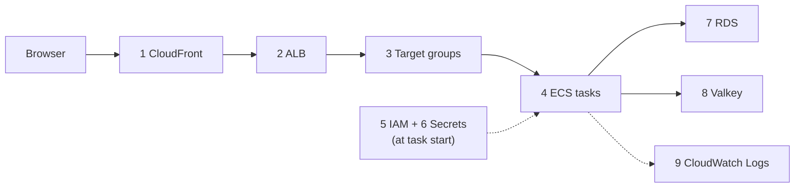

Chapters 10-14 are the ground under it: [network](#10-the-network-vpc-subnets-route-tables-internet-gateway),
[security groups](#11-security-groups), [ECR](#12-ecr), [budget](#13-the-budget),
[Pulumi and the switches](#14-pulumi-and-the-switches).

Every name below is a real name from `infra/`. Code paths are short: `infra/src/` is left out where
the folder is obvious (`entry/cdn.ts` = `infra/src/entry/cdn.ts`).

---

## 1. CloudFront

### 1. In one line

The front door for every visitor: HTTPS at a nearby edge, cached static files, and everything else
passed on to the ALB.

### 2. Real-life comparison

A local branch office: it answers what it has on the shelf and orders the rest from head office.

### 3. Picture it

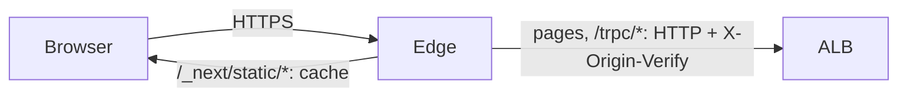

### 4. Where in our code

`entry/cdn.ts` → `createCdn`: one distribution, origin = the ALB over `http-only` with the secret
header, three cache behaviors, `redirect-to-https`, `http2and3`, `PriceClass_100`, default
`*.cloudfront.net` certificate. Gives `appUrl`. Cards: [cloudfront](concepts/cloudfront.md),
[cdn-caching](concepts/cdn-caching.md), [compression](concepts/compression.md),
[http-versions](concepts/http-versions.md), [tls-termination](concepts/tls-termination.md).

### 5. See it yourself

`curl -sI "$APP/" | grep -iE 'x-cache|x-amz-cf-pop'`; request a `/_next/static/*` file twice for
`Miss` then `Hit` ([docs/20](../20-deploy-day.md), section 3.5 e).

### 6. How it connects

Uses the ALB's DNS name and the origin secret. Gives HTTPS (so the `Secure` cookie works), `appUrl`
→ the api's `WEB_ORIGIN`, and the first of the two proxy hops `trustProxy` counts.

### 7. Our settings and WHY

Free HTTPS without a domain; cache only content-hashed files; never cache per-user answers.

### 8. Trade-offs

Free and global, but slow to create and delete, and the edge → ALB hop is plain HTTP in dev.

### 9. Alternatives and when to choose them

A custom domain + ACM certificate on the ALB without a CDN for a single-region app; CloudFront with
HTTPS to the origin for production.

### 10. What breaks, and how we'd notice

CloudFront `502` = cannot reach the ALB; CloudFront `403` page = method not allowed on that path;
logged out at once = you used `http://` or the ALB name.

### 11. Reach / Allowed / Password

Reach: public internet to the edge, prefix list to the ALB. Allowed: no IAM on requests. Password:
the `X-Origin-Verify` header.

### 12. Cost

No hourly price; free tier covers our traffic: $0.

### 13. Interview answers at 3 levels

Simple: a CDN with HTTPS. Senior: three behaviors, only hashed static files cached, the cookie
forwarded with AllViewer. Lead: the place to add WAF and a custom domain; watch hit rate and edge 5xx.

### 14. Follow-up questions interviewers ask

*Why can't api answers be cached?* They depend on the session cookie.

### 15. Say it in 30 seconds

"CloudFront gives us free HTTPS, caches the hashed JS and CSS, and forwards pages and `/trpc` uncached,
with the cookie, to the ALB over HTTP plus a secret header."

### 16. Status

✅ built.

---

## 2. The ALB: security group, listener, rules, secret header

### 1. In one line

The ALB accepts connections only from CloudFront, and its listener forwards a request only when the
secret header is present: `/trpc/*` to the api, the rest to web, otherwise 403.

### 2. Real-life comparison

A receptionist who only opens the door for one courier company and only helps couriers who know the
password.

### 3. Picture it

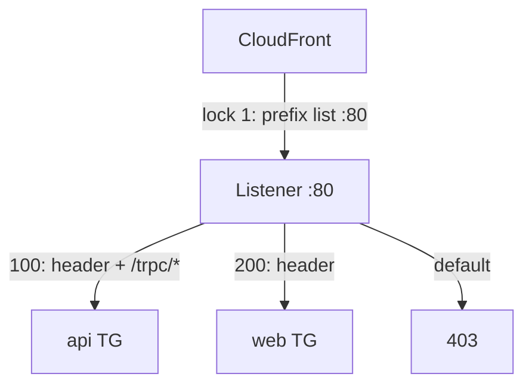

### 4. Where in our code

`security.ts` → `cloudFrontPrefixList` + rule `alb-in-80`; `entry/alb.ts` → `createAlb`
(internet-facing, public subnets, `dropInvalidHeaderFields`); `entry/origin-secret.ts` →
`createOriginSecret`; `entry/listener.ts` → `listener` (403 default), `hasSecretHeader`, `trpcRule`,
`webRule`. Cards: [alb](concepts/alb.md), [origin-protection](concepts/origin-protection.md),
[same-origin-routing](concepts/same-origin-routing.md).

### 5. See it yourself

`curl -m 10 http://$ALB/` times out (lock 1); the same path through `appUrl` works.

### 6. How it connects

Uses the public subnets, the alb security group, the target groups. Gives CloudFront its origin and
the api the same-origin `/trpc` path.

### 7. Our settings and WHY

HTTP :80 only (TLS ends at CloudFront); default 403 = deny unless a rule matches; rule priorities
100 before 200.

### 8. Trade-offs

Simple and strong enough for dev; the secret is static and visible to anyone who can read our config.

### 9. Alternatives and when to choose them

HTTPS listener + ACM; WAF on the ALB; a private origin with no public address.

### 10. What breaks, and how we'd notice

Plain-text `Forbidden` = header mismatch; ALB `503` = no registered/healthy target; `504` = target too
slow or blocked.

### 11. Reach / Allowed / Password

Reach: prefix list → 80; alb group → tasks. Allowed: none on the path. Password: the header.

### 12. Cost

~$0.0225 an hour fixed + 2 public IPs ($0.010) + a sliver of LCU ([docs/18](../18-infra-alb-web.md)).

### 13. Interview answers at 3 levels

Simple: a load balancer that routes by path. Senior: two locks plus a 403 default. Lead: deny by
default at the edge of the VPC; add HTTPS, access logs and alarms for production.

### 14. Follow-up questions interviewers ask

*Why two locks?* Every CloudFront customer shares the IPs; only ours knows the header.

### 15. Say it in 30 seconds

"Only CloudFront's IP ranges reach the ALB, and only requests with our secret header match a rule;
`/trpc/*` goes to the api, the rest to web, and everything else gets a 403."

### 16. Status

✅ built.

---

## 3. Target groups

### 1. In one line

Two lists of task IPs (api :4000, web :3000) with health checks; the ALB only sends traffic to
healthy entries and drains leaving ones for 30 s.

### 2. Real-life comparison

The rota of staffed desks, checked every 15 seconds.

### 3. Picture it

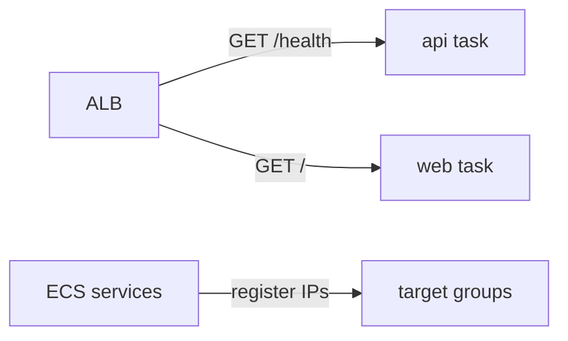

### 4. Where in our code

`entry/target-groups.ts` → `createTargetGroups`: `targetType: "ip"`, `deregistrationDelay: 30`,
checks every 15 s, 2 healthy / 3 unhealthy, `/health` for api, `/` for web. Card:
[target-groups](concepts/target-groups.md).

### 5. See it yourself

`aws elbv2 describe-target-health` for both groups: one `healthy` target each.

### 6. How it connects

Filled by the ECS services (`loadBalancers`); used by the listener rules; gives draining for
[zero-downtime deploys](concepts/zero-downtime-deploys.md).

### 7. Our settings and WHY

`ip` targets for Fargate; liveness (`/health`) not readiness, so a database blip does not empty the group.

### 8. Trade-offs

A task with a broken database connection stays in rotation.

### 9. Alternatives and when to choose them

`/ready` as the check with more tasks; slow start; least outstanding requests
([load-balancing-algorithms](concepts/load-balancing-algorithms.md)).

### 10. What breaks, and how we'd notice

`Target.Timeout` = security group or `HOSTNAME`; `Target.ResponseCodeMismatch` = path not 200.

### 11. Reach / Allowed / Password

Reach: alb group → api/web group on 4000/3000. Health checks need no header.

### 12. Cost

Free.

### 13. Interview answers at 3 levels

Simple: the servers behind the load balancer. Senior: ip targets, liveness checks, 30 s drain. Lead:
the health-check path decides your blast radius.

### 14. Follow-up questions interviewers ask

*Why `ip` and not `instance`?* `awsvpc` tasks have their own IPs.

### 15. Say it in 30 seconds

"Two ip target groups with liveness checks every 15 seconds; ECS registers each task, and leaving
tasks drain for 30 seconds."

### 16. Status

✅ built.

---

## 4. ECS: cluster, service, task definition, task, Spot

### 1. In one line

ECS runs our two containers on Fargate Spot: the cluster is the room, the task definition the recipe,
the service the manager, the task the running dish.

### 2. Real-life comparison

A kitchen (cluster), a recipe card with version numbers (task definition), a shift manager who keeps
one cook per counter (service), and the cook at work (task), hired from a cheap agency that can call
them away (Spot).

### 3. Picture it

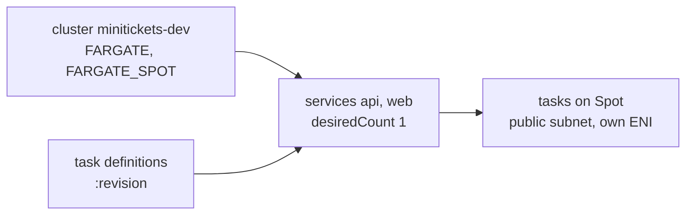

### 4. Where in our code

`compute/cluster.ts` → `createCluster`; `compute/task.ts` → `createApiTask`; `compute/web-task.ts` →
`createWebTask`; `compute/service.ts` → `createApiService`; `compute/web-service.ts` →
`createWebService`. Cards: [ecs-cluster](concepts/ecs-cluster.md),
[task-definition](concepts/task-definition.md), [ecs-service](concepts/ecs-service.md),
[fargate](concepts/fargate.md), [fargate-spot](concepts/fargate-spot.md),
[arm64-graviton](concepts/arm64-graviton.md), [ecs-exec](concepts/ecs-exec.md),
[circuit-breaker](concepts/circuit-breaker.md), [scaling](concepts/scaling.md).

### 5. See it yourself

`aws ecs describe-services … --query 'services[].{name:serviceName,running:runningCount}'`; ECS Exec
into the api and call `/ready` ([docs/20](../20-deploy-day.md), section 3.5 g).

### 6. How it connects

Uses the image (ECR), roles (IAM), secrets, log groups, subnets, security groups and target groups.
Gives the running api and web.

### 7. Our settings and WHY

ARM64, ¼ vCPU, 512 MB, Spot, 1 task, public IP (no NAT), circuit breaker with rollback, 60 s grace
period, ECS Exec on the api only. Migrations: a one-off on-demand task from the same definition.

### 8. Trade-offs

Cheap and serverless, but one Spot task per service means short outages on interruption or deploy
failure.

### 9. Alternatives and when to choose them

On-demand base + Spot; 2+ tasks across AZs; auto scaling; EC2 capacity for steady heavy load.

**Planned: the web task calling the api task.** Server-side rendering of `/events` (app story 10b)
needs the web task to call the api directly ([server-to-server-calls](concepts/server-to-server-calls.md)).
Today nothing allows it: the ALB accepts only CloudFront, the api group accepts only the alb group,
and the web task definition has no `API_INTERNAL_URL`. The planned fix is ECS Service Connect with a
Cloud Map namespace (the api becomes `http://api:4000` inside the VPC) plus one rule api ← web on
4000 ([service-connect](concepts/service-connect.md)). Other options: an internal ALB, or calling
the public CloudFront URL ([docs/22](../22-events-ssr.md), section 7).

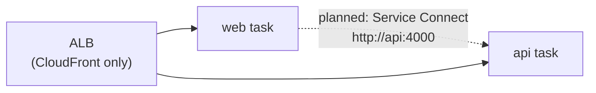

### 10. What breaks, and how we'd notice

Stopped reasons: `CannotPullContainerError`, `ResourceInitializationError: unable to pull secrets`,
`Task failed ELB health checks`, `Your Spot Task was interrupted`, `exec format error` in logs.

### 11. Reach / Allowed / Password

Reach: the service's subnets, security group and public IP. Allowed: execution role at start, task
role while running, ECS service-linked role for wiring. Password: injected secrets.

### 12. Cost

Spot ARM task ≈ $0.003 an hour plus $0.005 for its public IP; compute layer ≈ $0.008 an hour
([docs/17](../17-infra-ecs-api.md)).

### 13. Interview answers at 3 levels

Simple: AWS runs our containers. Senior: Fargate Spot services with rolling deploys and a circuit
breaker. Lead: stateless tasks make scaling and Spot easy; production needs an on-demand base and 2+
tasks.

### 14. Follow-up questions interviewers ask

*Why run migrations as a separate task?* So exactly one process migrates, with the deployed code.

### 15. Say it in 30 seconds

"Two ECS services on Fargate Spot, one ARM task each, recipes versioned as task definitions, with
health checks, circuit breaker rollback and ECS Exec for debugging."

### 16. Status

✅ built (dev sizing). Planned: Service Connect so the web task can reach the api (SSR on AWS is 🟡 until then).

---

## 5. IAM roles

### 1. In one line

Three roles decide what ECS and our code may do in AWS: the api execution role, the api task role and
the web execution role.

### 2. Real-life comparison

Separate keys for the removal company (start-up work) and the tenant (daily life).

### 3. Picture it

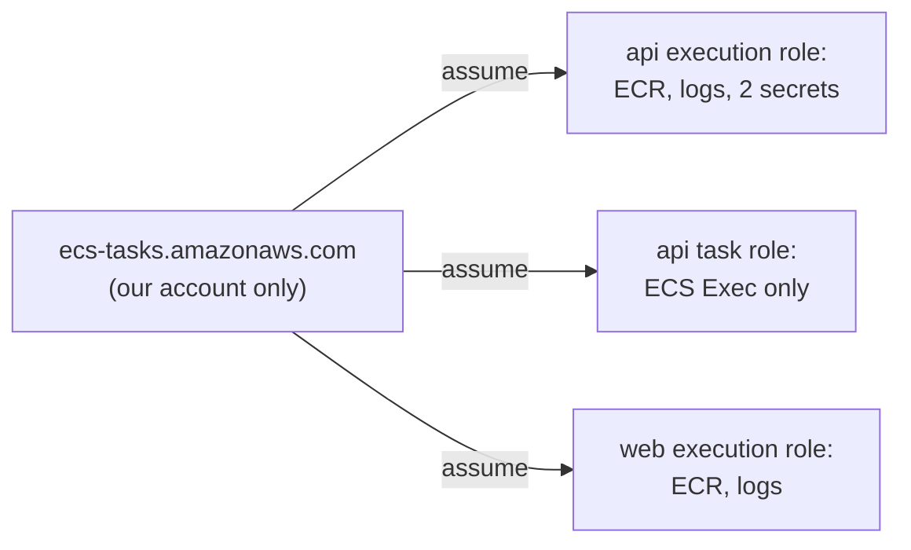

### 4. Where in our code

`compute/iam.ts` → `createIamRoles`; `compute/web-iam.ts` → `createWebIamRole`. Cards:
[execution-vs-task-role](concepts/execution-vs-task-role.md), [least-privilege](concepts/least-privilege.md);
[aws-foundations chapters 4-5](aws-foundations.md#5-roles-sts-and-the-confused-deputy).

### 5. See it yourself

`aws iam get-role --role-name minitickets-dev-api-task-role --query Role.AssumeRolePolicyDocument`.

### 6. How it connects

Uses the secret ARNs. Gives image pulls, secret injection, log shipping and ECS Exec.

### 7. Our settings and WHY

Exact secret ARNs; `aws:SourceAccount` against the confused deputy; no web task role.

### 8. Trade-offs

Small blast radius vs more roles to review.

### 9. Alternatives and when to choose them

Runtime secret reads with the task role; OIDC roles for CI.

### 10. What breaks, and how we'd notice

`ResourceInitializationError: unable to pull secrets`; ECS Exec "agent not running".

### 11. Reach / Allowed / Password

This chapter **is** Allowed.

### 12. Cost

Free.

### 13. Interview answers at 3 levels

Simple: roles say what each part may do. Senior: execution vs task role split. Lead: trust policies
reviewed like permissions; per-service roles.

### 14. Follow-up questions interviewers ask

*Can our running code read the secrets through IAM?* No.

### 15. Say it in 30 seconds

"ECS's execution role pulls the image, reads exactly two secrets and writes logs; our running code's
task role only allows ECS Exec; web has no secrets and no task role."

### 16. Status

✅ built.

---

## 6. Secrets Manager

### 1. In one line

Two secrets, the RDS-managed master password and the full `rediss://` URL, injected into the api at
task start.

### 2. Real-life comparison

A bank safe: our papers name only the box number.

### 3. Picture it

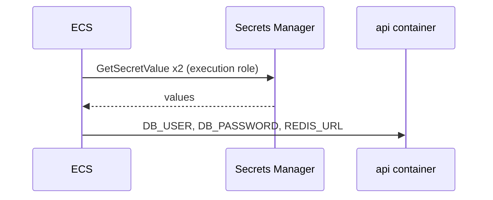

### 4. Where in our code

`data/secrets.ts` → `createSecrets`; `data/postgres.ts` → `manageMasterUserPassword`;
`compute/task.ts` → `secrets`. Cards: [secrets-manager](concepts/secrets-manager.md),
[rds-managed-password](concepts/rds-managed-password.md),
[secrets-management](concepts/secrets-management.md), [kms](concepts/kms.md).

### 5. See it yourself

`aws secretsmanager list-secrets --query "SecretList[].Name"` (names only).

### 6. How it connects

Uses the cache's endpoint and token. Gives the **Password** for Postgres and Valkey.

### 7. Our settings and WHY

ARNs only in code; `recoveryWindowInDays: 0` so the data switch can recreate the name.

### 8. Trade-offs

Read once at start: rotation needs a restart.

### 9. Alternatives and when to choose them

Runtime reads with caching; IAM database auth; Parameter Store.

### 10. What breaks, and how we'd notice

After an RDS rotation: `password authentication failed`, `/ready` 503
([docs/17](../17-infra-ecs-api.md), section 3.17).

### 11. Reach / Allowed / Password

Reach: public endpoint via the internet gateway. Allowed: `read-secrets`. Password: STS-signed calls.

### 12. Cost

≈ $0.80 a month for two secrets while data is on.

### 13. Interview answers at 3 levels

Simple: a safe for passwords. Senior: two secrets injected by ECS. Lead: runtime reads for rotation,
alert on unusual readers.

### 14. Follow-up questions interviewers ask

*What happens on rotation?* Running tasks keep the old value until restarted.

### 15. Say it in 30 seconds

"RDS keeps its own password in Secrets Manager and we store the Redis URL there; ECS injects both at
task start, and our code only ever sees ARNs."

### 16. Status

✅ built, with the rotation limit.

---

## 7. RDS Postgres

### 1. In one line

A private, encrypted Postgres 17 that only the api can reach, over verified TLS.

### 2. Real-life comparison

A vault in the basement, maintained by a vault company.

### 3. Picture it

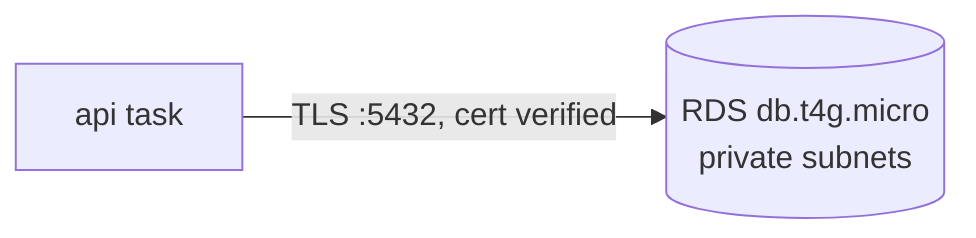

### 4. Where in our code

`data/postgres.ts` → `createPostgres`; `apps/api/src/config/database.ts` (TLS); `apps/api/Dockerfile`
(RDS CA bundle). Cards: [rds-postgres](concepts/rds-postgres.md),
[tls-in-transit](concepts/tls-in-transit.md), [encryption-at-rest](concepts/encryption-at-rest.md),
[backups-dr](concepts/backups-dr.md), [high-availability](concepts/high-availability.md).

### 5. See it yourself

`aws rds describe-db-instances … --query "DBInstances[0].[PubliclyAccessible,StorageEncrypted,MultiAZ]"`
→ `false, true, false`.

### 6. How it connects

Uses the private subnets and the db group. Gives the users table; migrations run with
`pnpm infra:migrate`.

### 7. Our settings and WHY

Smallest Graviton class, gp3, single-AZ, 1-day backups, no final snapshot, no deletion protection:
cheap, disposable dev.

### 8. Trade-offs

Data is lost on "off"; an AZ failure is an outage.

### 9. Alternatives and when to choose them

Multi-AZ, Aurora, RDS Proxy as connections grow.

### 10. What breaks, and how we'd notice

Timeout = Reach; `password authentication failed` = Password; `relation "users" does not exist` = run
the migration.

### 11. Reach / Allowed / Password

Answered in full in [aws-foundations, chapter 3](aws-foundations.md#3-the-three-questions-reach-allowed-password).

### 12. Cost

≈ $0.019 an hour (instance + storage), ≈ $14 a month if always on ([docs/14](../14-infra-data.md)).

### 13. Interview answers at 3 levels

Simple: our managed database. Senior: private, encrypted, verified TLS, managed password. Lead:
Multi-AZ, PITR, least-privilege app user for production.

### 14. Follow-up questions interviewers ask

*Why can't you connect from your laptop?* No public IP, no route, only the api group allowed.

### 15. Say it in 30 seconds

"Postgres 17 on RDS in private subnets, encrypted, reachable only from the api on 5432 over verified
TLS, with an RDS-managed password."

### 16. Status

✅ built (dev settings).

---

## 8. ElastiCache Valkey

### 1. In one line

One Valkey 8.2 node that stores login sessions, TLS-only with an auth token.

### 2. Real-life comparison

The coat check: fast, small, disposable.

### 3. Picture it

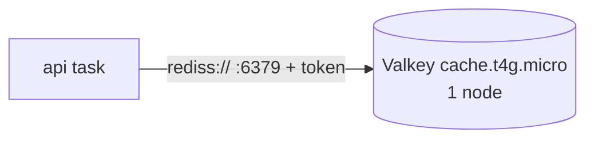

### 4. Where in our code

`data/cache.ts` → `createCache`. Card: [elasticache-valkey](concepts/elasticache-valkey.md).

### 5. See it yourself

`aws elasticache describe-replication-groups … --query "ReplicationGroups[0].[TransitEncryptionEnabled,AtRestEncryptionEnabled,AuthTokenEnabled]"`.

### 6. How it connects

Uses the private subnets and the redis group; gives the session store and, via the secret, `REDIS_URL`.

### 7. Our settings and WHY

Valkey for price and licence; one node; no snapshots; TLS and at-rest encryption set at creation.

### 8. Trade-offs

A node failure logs everyone out.

### 9. Alternatives and when to choose them

Replica + automatic failover; Serverless; DynamoDB with TTL.

### 10. What breaks, and how we'd notice

`WRONGPASS` = token; hang = `redis://` instead of `rediss://` or the security group.

### 11. Reach / Allowed / Password

Reach: redis group from the api group. Allowed: no IAM. Password: the auth token over TLS.

### 12. Cost

≈ $0.013 an hour ([docs/14](../14-infra-data.md)).

### 13. Interview answers at 3 levels

Simple: our session store. Senior: TLS + token, one node. Lead: replica with failover; sessions make the
api stateless, which moves availability here.

### 14. Follow-up questions interviewers ask

*Why no backups?* Sessions are disposable.

### 15. Say it in 30 seconds

"Sessions live in a single TLS-only Valkey node with an auth token; the api gets the `rediss://` URL from
Secrets Manager."

### 16. Status

✅ built (dev sizing).

---

## 9. CloudWatch Logs

### 1. In one line

Everything the containers print lands in `/minitickets/dev/api` and `/minitickets/dev/web`, one stream
per task, kept 7 days.

### 2. Real-life comparison

A logbook per department, a chapter per shift.

### 3. Picture it

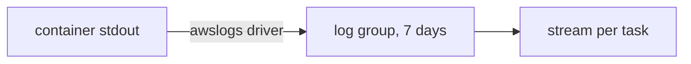

### 4. Where in our code

`compute/logs.ts` → `createLogs`; `logConfiguration` in `compute/task.ts` and `compute/web-task.ts`.
Cards: [cloudwatch-logs](concepts/cloudwatch-logs.md), [metrics](concepts/metrics.md),
[alerting](concepts/alerting.md).

### 5. See it yourself

`aws logs tail /minitickets/dev/api --since 15m`.

### 6. How it connects

Uses the execution role and the path out; gives the debugging window and the migration script's output.

### 7. Our settings and WHY

7-day retention: storage is billed and dev logs are not read after a week.

### 8. Trade-offs

Logs, but no alarms on them.

### 9. Alternatives and when to choose them

Metric filters + alarms; FireLens to other tools.

### 10. What breaks, and how we'd notice

Missing group or permission: the task fails to start.

### 11. Reach / Allowed / Password

Reach: public endpoint; Allowed: execution role.

### 12. Cost

≈ $0 for a few MB.

### 13. Interview answers at 3 levels

Simple: our logs in AWS. Senior: awslogs, group per app, stream per task, JSON. Lead: metric filters and
retention by compliance.

### 14. Follow-up questions interviewers ask

*Where do you look first when a task dies?* The stopped reason, then this log stream.

### 15. Say it in 30 seconds

"The awslogs driver ships every container line to a group per app, one stream per task, kept seven
days."

### 16. Status

✅ built.

---

## 10. The network: VPC, subnets, route tables, internet gateway

### 1. In one line

A `10.0.0.0/16` VPC with two public and two private `/24` subnets across two AZs; only the public ones
route to the internet gateway.

### 2. Real-life comparison

An office building: ground floors with a street door, upper floors reached only by internal stairs.

### 3. Picture it

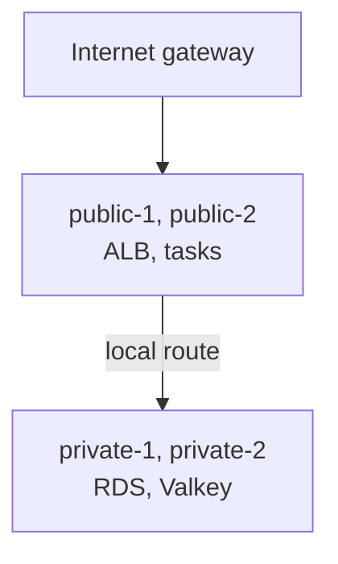

### 4. Where in our code

`network.ts` → `createNetwork`: `vpc`, `internetGateway`, `publicSubnets`, `privateSubnets`,
`publicRouteTable`, `privateRouteTable`, four associations. Cards: [vpc](concepts/vpc.md),
[subnets](concepts/subnets.md), [route-tables](concepts/route-tables.md),
[regions-and-azs](concepts/regions-and-azs.md).

### 5. See it yourself

`aws ec2 describe-route-tables --filters Name=vpc-id,Values=$(pulumi stack output vpcId)`.

### 6. How it connects

Gives every other layer its place: public subnets to the ALB and tasks, private to the data stores.

### 7. Our settings and WHY

No NAT gateway (~$33 a month): tasks sit in public subnets with public IPs, protected by their security
groups.

### 8. Trade-offs

Cheaper, but tasks are addressable from the internet (not open).

### 9. Alternatives and when to choose them

Private tasks with NAT or VPC endpoints for production.

### 10. What breaks, and how we'd notice

No route out: image pulls fail at task start.

### 11. Reach / Allowed / Password

The foundation of Reach.

### 12. Cost

$0 (public IPv4 addresses on the ALB and tasks are billed with those resources).

### 13. Interview answers at 3 levels

Simple: our private network. Senior: public vs private is the route table. Lead: plan CIDRs across VPCs;
NAT vs endpoints by traffic and cost.

### 14. Follow-up questions interviewers ask

*What makes a subnet public?* A `0.0.0.0/0` route to an internet gateway.

### 15. Say it in 30 seconds

"Two AZs, a public and a private subnet in each; only public subnets route to the internet gateway, and
we skip NAT to save money."

### 16. Status

✅ built.

---

## 11. Security groups

### 1. In one line

Five stateful firewalls where every door names exactly one caller group.

### 2. Real-life comparison

Badge readers: the server room opens only for the api badge, whoever wears it today.

### 3. Picture it

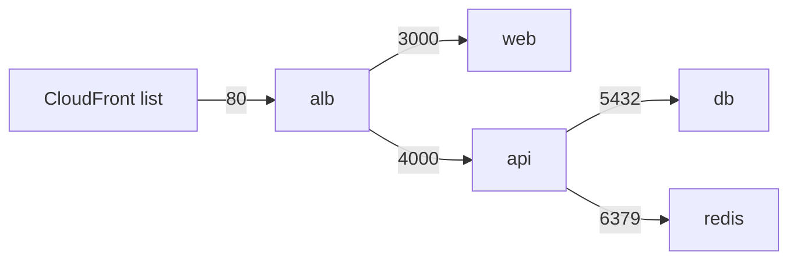

### 4. Where in our code

`security.ts` → `createSecurityGroups`. Card: [security-groups](concepts/security-groups.md).

### 5. See it yourself

`aws ec2 describe-security-group-rules --filters Name=group-id,Values=$(pulumi stack output dbSgId)`.

### 6. How it connects

Worn by the ALB, tasks, RDS and Valkey. Gives Reach and lock 1 of origin protection.

### 7. Our settings and WHY

Group references, not IPs; no egress for the data stores; stale alb description kept to avoid a replace.

### 8. Trade-offs

Precise inbound; open outbound on alb, web, api.

### 9. Alternatives and when to choose them

Tight egress with VPC endpoints; NACLs as a coarse extra layer.

### 10. What breaks, and how we'd notice

Missing rule → timeouts and `Target.Timeout`.

### 11. Reach / Allowed / Password

Pure Reach.

### 12. Cost

Free.

### 13. Interview answers at 3 levels

Simple: firewalls. Senior: stateful, group-referenced, default deny. Lead: read like an architecture
diagram; watch changes to them.

### 14. Follow-up questions interviewers ask

*Why no outbound rules on the db group?* Stateful: replies pass anyway.

### 15. Say it in 30 seconds

"Five groups; each ingress rule names one caller group, so only CloudFront reaches the ALB, only the ALB
reaches the apps, and only the api reaches the data."

### 16. Status

✅ built.

---

## 12. ECR

### 1. In one line

Two private, immutable image repositories that ECS pulls from.

### 2. Real-life comparison

A warehouse where box labels can never be moved.

### 3. Picture it

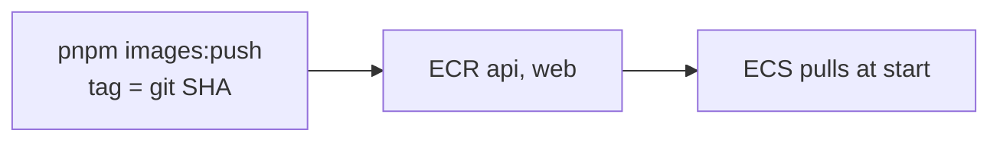

### 4. Where in our code

`registry.ts` → `createRegistry`; `scripts/push-images.sh`. Cards: [ecr](concepts/ecr.md),
[immutable-image-tags](concepts/immutable-image-tags.md), [image-scanning](concepts/image-scanning.md).

### 5. See it yourself

`aws ecr describe-images --repository-name minitickets-dev-api`.

### 6. How it connects

Gives images to the task definitions; the tag lives in `Pulumi.dev.yaml`.

### 7. Our settings and WHY

Immutable SHA tags, scan on push, keep 10 tagged images; always on (cents a month).

### 8. Trade-offs

10 images limit how far back rollback goes without a rebuild.

### 9. Alternatives and when to choose them

Push from CI with OIDC; pin by digest.

### 10. What breaks, and how we'd notice

`CannotPullContainerError` when a tag was never pushed.

### 11. Reach / Allowed / Password

Reach: public endpoint. Allowed: execution role. Laptop: 12-hour token from `get-login-password`.

### 12. Cost

≈ $0.10 per GB-month; a few cents.

### 13. Interview answers at 3 levels

Simple: our image store. Senior: immutable SHA tags + lifecycle. Lead: build once, promote the same
digest.

### 14. Follow-up questions interviewers ask

*Why not `latest`?* You can't tell what runs.

### 15. Say it in 30 seconds

"Two immutable ECR repos tagged by git SHA from a clean tree, scanned on push, trimmed to ten images."

### 16. Status

✅ built.

---

## 13. The budget

### 1. In one line

A $20 monthly AWS Budget that emails at 25/50/100% actual and 100% forecast, credits excluded.

### 2. Real-life comparison

A smoke alarm for the bill.

### 3. Picture it

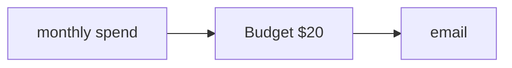

### 4. Where in our code

`budget.ts` → `createBudget`. Cards: [budget-alerts](concepts/budget-alerts.md),
[alerting](concepts/alerting.md).

### 5. See it yourself

Billing → Budgets → `minitickets-dev-monthly-cost`.

### 6. How it connects

The safety net for forgetting the [switches](#14-pulumi-and-the-switches).

### 7. Our settings and WHY

`includeCredit: false` to see the real cost.

### 8. Trade-offs

Lagging, and it stops nothing.

### 9. Alternatives and when to choose them

Budget actions; Cost Anomaly Detection.

### 10. What breaks, and how we'd notice

A wrong email address: alerts go nowhere.

### 11. Reach / Allowed / Password

Not a connection.

### 12. Cost

Listed as $0 in the step docs.

### 13. Interview answers at 3 levels

Simple: a spending alarm. Senior: 4 notifications, credits excluded. Lead: pair with tags and anomaly
detection.

### 14. Follow-up questions interviewers ask

*Does it stop spending?* No.

### 15. Say it in 30 seconds

"A $20 monthly budget with three actual and one forecast alert, credits excluded."

### 16. Status

✅ built.

---

## 14. Pulumi and the switches

### 1. In one line

All of the above is Pulumi TypeScript, wired in `infra/index.ts`, with three switches that create or
delete the expensive layers.

### 2. Real-life comparison

A blueprint with light switches per room.

### 3. Picture it

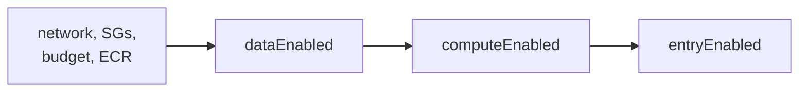

### 4. Where in our code

`infra/index.ts` (all steps). Cards: [infrastructure-as-code](concepts/infrastructure-as-code.md),
[cost-switches](concepts/cost-switches.md).

### 5. See it yourself

`cd infra && pulumi preview` (read-only); `pnpm infra:graph`.

### 6. How it connects

Creates every chapter above in dependency order.

### 7. Our settings and WHY

Missing config = off; invalid combinations stop with `RunError`; outputs `null` when off.

### 8. Trade-offs

"Off" deletes the data; "on" takes 25-40 minutes.

### 9. Alternatives and when to choose them

Scale to zero, scheduled stop, ephemeral environments.

### 10. What breaks, and how we'd notice

Hidden replaces (read `+-` in previews); forgetting "off" (budget email).

### 11. Reach / Allowed / Password

Pulumi acts with the owner's AWS profile; it never prints credentials.

### 12. Cost

See the [cost story](#the-cost-story).

### 13. Interview answers at 3 levels

Simple: infrastructure in code. Senior: typed layer functions, switches, preview first. Lead: previews in
CI, policy checks, drift detection.

### 14. Follow-up questions interviewers ask

*Why does `index.ts` wire everything?* One file shows every dependency.

### 15. Say it in 30 seconds

"Pulumi TypeScript with one function per layer, wired in `index.ts`, and three switches that turn the
hourly-billed layers on and off."

### 16. Status

✅ built.

---

## The deploy story

How code gets from a commit to `https://<id>.cloudfront.net`. The full runbook with every command and
expected output is [docs/20-deploy-day.md](../20-deploy-day.md).

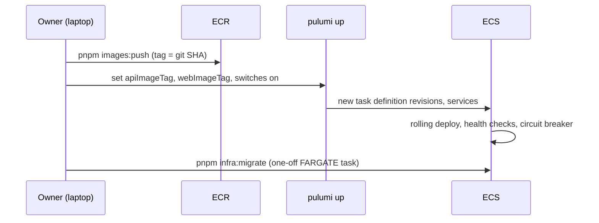

1. **Build and push:** `pnpm images:push` refuses a dirty tree, builds ARM64 images and pushes them as
   `:<short SHA>` to immutable repos ([immutable-image-tags](concepts/immutable-image-tags.md)).
2. **Point Pulumi at them:** `pulumi config set apiImageTag/webImageTag`, commit `Pulumi.dev.yaml`.
3. **Data on, then compute + entry on:** `pulumi up` (owner). The api task definition waits for
   CloudFront's `appUrl` (its `WEB_ORIGIN`).
4. **Rolling deploy:** new task first, healthy, old one drained 30 s, SIGTERM, graceful shutdown
   ([zero-downtime-deploys](concepts/zero-downtime-deploys.md)); the
   [circuit breaker](concepts/circuit-breaker.md) rolls back a revision that never gets healthy
   (after 3 failed tasks: AWS's default of 50% of the desired count, minimum 3).
5. **Migrate:** `pnpm infra:migrate` runs the same task definition once with
   `node dist/migrate.js`, on on-demand Fargate.
6. **Verify:** browser, cookie flags, e2e tests against `appUrl`, the blocked ALB, cache Hit/Miss,
   `/ready` via ECS Exec, logs with the real visitor IP.
7. **Off:** entry, compute, data (or all at once); about 20-30 minutes, mostly CloudFront.

**Not built:** continuous deployment. CI checks and builds images but pushes nothing
([docs/10](../10-ci.md)); migrations are not yet gated before the service update.

## The security story

Every defense layer, outside in, and the attack it stops:

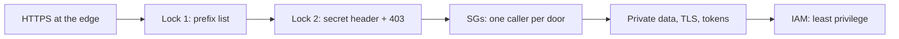

| Layer | Where | Attack or mistake it stops |
| ----- | ----- | -------------------------- |
| HTTPS + `redirect-to-https` | `entry/cdn.ts` | Eavesdropping and cookie theft on public Wi-Fi; the `Secure` cookie needs it |
| Methods per behavior | `entry/cdn.ts` (pages: GET/HEAD) | POSTs to page paths never reach the origin |
| Never cache `/trpc/*` | `entry/cdn.ts` | One user's data served to another from the cache |
| Lock 1: CloudFront prefix list | `security.ts` | Skipping CloudFront by calling the ALB directly |
| Lock 2: `X-Origin-Verify` + 403 default | `entry/listener.ts`, `entry/origin-secret.ts` | Someone else's CloudFront distribution pointed at our ALB |
| `dropInvalidHeaderFields` | `entry/alb.ts` | Request smuggling with malformed headers |
| Security groups by group reference | `security.ts` | Anything but the ALB reaching the apps; anything but the api reaching the data |
| Private subnets, no public IP for data | `network.ts`, `data/postgres.ts` | Direct internet access to the database or cache |
| TLS to RDS with verified certificate | `apps/api/src/config/database.ts`, `apps/api/Dockerfile` | A machine in the middle impersonating the database |
| TLS + auth token on Valkey | `data/cache.ts` | Reading session ids on the network; unauthenticated commands |
| Encryption at rest | `data/postgres.ts`, `data/cache.ts` | Reading stolen disks or snapshots |
| Machine-generated secrets, ARNs only in code | `data/*.ts`, `compute/task.ts`, `.dockerignore` | Passwords leaking through git, images, outputs or logs |
| Execution vs task role, exact ARNs | `compute/iam.ts`, `compute/web-iam.ts` | A compromised app process reading other secrets via IAM |
| `aws:SourceAccount` on trust policies | `compute/iam.ts` | The confused deputy |
| Immutable SHA tags | `registry.ts`, `scripts/push-images.sh` | Silently swapped images; untraceable deploys |
| Read-only CI token | `.github/workflows/ci.yml` | A malicious dependency in CI writing to the repo |

App-level defenses (argon2id, session cookie flags, CSRF, XSS, rate limiting) are in the
[app security story](app-story.md#the-app-security-story). **Gaps we know about:** no WAF, no rate limiting yet, the edge → ALB hop is plain HTTP, the
origin secret never rotates, tasks have public IPs, open egress on alb/web/api, no alarms.

## The cost story

Per-hour prices from the step docs (approximate, `us-east-1`):

| Layer | What costs money | ~Per hour |
| ----- | ---------------- | --------- |
| Always on | VPC, subnets, routes, SGs, budget: $0; ECR: cents a month | ~$0 |
| Data | RDS `db.t4g.micro` + 20 GB gp3 (~$0.019), Valkey `cache.t4g.micro` (~$0.013), 2 secrets (~$0.001) | ~$0.033 |
| Compute | api Spot task (~$0.003) + its public IPv4 ($0.005); logs ~$0 | ~$0.008 |
| Entry | ALB fixed ($0.0225) + LCU (~$0.001) + 2 ALB IPv4 ($0.010) + web Spot task (~$0.003) + its IPv4 ($0.005); CloudFront $0 | ~$0.04 |
| **Everything on** | | **~$0.08** (about $2 a day) |

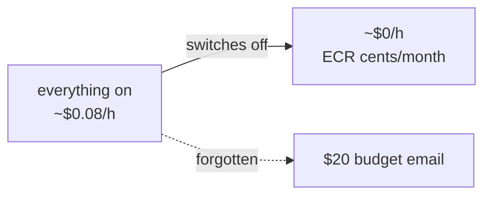

Lessons in the numbers:

- **Public IPv4 addresses cost more than our Spot tasks** ($0.005 vs ~$0.003 an hour).
- **A NAT gateway (~$0.045 an hour + traffic) would cost more than everything else together**, which
  is why tasks sit in public subnets.
- **The ALB is the biggest fixed cost** of the entry layer; CloudFront is free at our traffic.
- **Spot saves about 70%** on tasks; the migration pays on-demand price for safety.
- **Always-on would be ~$58 a month** at these rates (0.08 × 24 × 30), well over the $20 budget,
  which is why the switches exist. (Derived from the hourly numbers above, not measured on a bill.)

## What we'd change for production

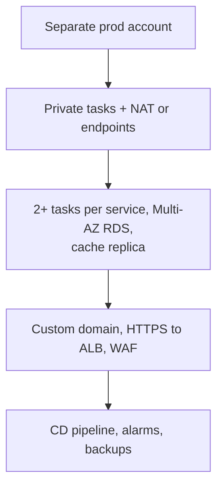

| Area | Dev today | Production |
| ---- | --------- | ---------- |
| Accounts | one dev account | separate prod account (Organizations) |
| Tasks | 1 Spot task each, public subnets | 2+ per service across AZs, on-demand base + Spot, private subnets, NAT or VPC endpoints, auto scaling |
| RDS | single-AZ, 1-day backups, no final snapshot, no deletion protection | Multi-AZ, 7-35 days PITR, final snapshot, deletion protection, app user with fewer rights |
| Secrets | read at task start, master user | runtime reads with rotation, or IAM database auth |
| Valkey | 1 node | replica with automatic failover across AZs |
| Edge | `*.cloudfront.net`, HTTP to the ALB, static secret header | custom domain, ACM, HTTPS to the ALB, rotated secret or private origin, WAF + rate limiting |
| ALB | deletion protection off | on, with access logs |
| Deploys | laptop push, owner's `pulumi up`; `app.close()` right at SIGTERM | CI/CD with OIDC role, migrations before service update, expand/contract; a short wait after SIGTERM before closing (planned, see [zero-downtime-deploys](concepts/zero-downtime-deploys.md)) |
| Observability | logs only, cost alert | golden-signal alarms, dashboards, tracing, SLOs, CloudTrail alerts |
| Images | basic scan (OS packages only, at push), not enforced; npm dependencies not scanned | dependency scanning (Inspector enhanced scanning or Trivy in CI), CI vulnerability gate, digest pinning |

## How this connects

- **Uses:** [aws-foundations.md](aws-foundations.md) (Reach / Allowed / Password, IAM, roles), the step
  docs [12](../12-infra-network.md) to [20](../20-deploy-day.md), and the code in `infra/`.
- **Gives:** the AWS round of the [README](README.md) reading paths; the context for the
  [concept cards](concept-map.md); the base for Phase 4's ADRs and `system-design.md`.
