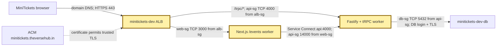
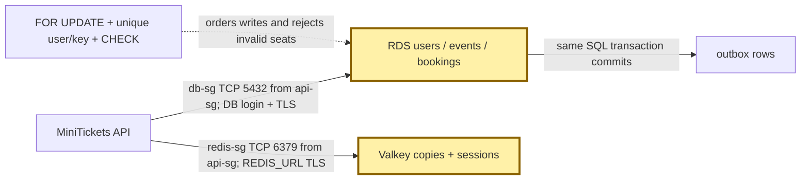
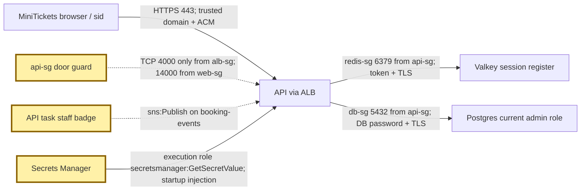
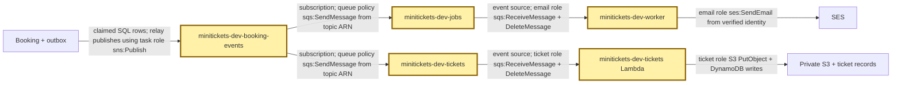
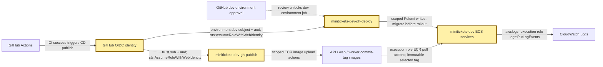
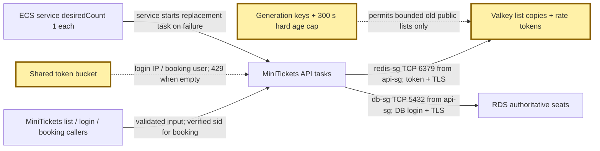

# Learn the MiniTickets city, one concept at a time

History: see [CHANGELOG.md](CHANGELOG.md) or run `pnpm docs:history`

Start here for concepts. Follow one request, then its data, guards, background work, delivery and growth. Read each diagram, trace the numbered flow, then say the 30-second answer aloud. Open the linked explorer beside the card.

**Batch 1** cards have the short interview format. **Batch 2** cards keep their earlier text for now; they are included so every concept has a place. Read Batch 1 first for the interview, then return to Batch 2 in the same order.

The maps show source-configured connections, not proof of a live deployment. The committed dev setup uses `us-east-1`, HTTPS at the ALB and `cdnEnabled=false`. AWS console labels can change; verify the named resource before drawing conclusions.

## Part 1: The request path

- [Regions and availability zones](concepts/regions-and-azs.md) — **Batch 2** — after this you can answer: why does the city network have neighborhoods in two districts?
- [VPC and CIDR blocks](concepts/vpc.md) — **Batch 1** — after this you can answer: what belongs inside the MiniTickets gated city?
- [Public vs private subnets](concepts/subnets.md) — **Batch 1** — after this you can answer: why do workers use public neighborhoods while data stays private?
- [Route tables and the internet gateway](concepts/route-tables.md) — **Batch 1** — after this you can answer: which road can each MiniTickets neighborhood use?
- [CloudFront](concepts/cloudfront.md) — **Batch 1** — after this you can answer: what would change if MiniTickets enabled the edge cache?
- [Application Load Balancer, listener, default 403](concepts/alb.md) — **Batch 1** — after this you can answer: how does one HTTPS entrance choose web or API?
- [Target groups and ALB health checks](concepts/target-groups.md) — **Batch 1** — after this you can answer: how does the ALB find a worker after its address changes?
- [Health checks](concepts/health-checks.md) — **Batch 1** — after this you can answer: which checks prove a worker can receive traffic?
- [ECS cluster](concepts/ecs-cluster.md) — **Batch 1** — after this you can answer: what does the MiniTickets cluster group together?
- [ECS service](concepts/ecs-service.md) — **Batch 1** — after this you can answer: who replaces a crashed MiniTickets worker?
- [Task definition](concepts/task-definition.md) — **Batch 1** — after this you can answer: what recipe starts a worker with the right image and settings?
- [Fargate](concepts/fargate.md) — **Batch 1** — after this you can answer: which machine work does AWS do for MiniTickets?
- [Same-origin path routing](concepts/same-origin-routing.md) — **Batch 2** — after this you can answer: why can the browser call /trpc without another API domain?
- [ECS Service Connect and Cloud Map (service discovery)](concepts/service-connect.md) — **Batch 2** — after this you can answer: how does the web worker find api:4000 privately?
- [Server-to-server calls (web server → API)](concepts/server-to-server-calls.md) — **Batch 2** — after this you can answer: why does server rendering use an internal API address?
- [HTTP/1.1 vs HTTP/2 vs HTTP/3](concepts/http-versions.md) — **Batch 2** — after this you can answer: which connection speaks HTTP/1.1 or HTTP/2?
- [SSR vs CSR](concepts/csr-vs-ssr.md) — **Batch 1** — after this you can answer: what arrives from the server and what changes in the browser?
- [Server Components vs Client Components](concepts/server-client-components.md) — **Batch 2** — after this you can answer: where does each MiniTickets component run?
- [App Router](concepts/app-router.md) — **Batch 2** — after this you can answer: how do folders become MiniTickets pages?
- [Streaming with Suspense](concepts/streaming-suspense.md) — **Batch 2** — after this you can answer: how can the page shell arrive before the events list?
- [Hydration (and handing the server's data to the browser)](concepts/hydration.md) — **Batch 2** — after this you can answer: how does the browser reuse server data and attach behavior?
- [Client state vs server state](concepts/state-management.md) — **Batch 2** — after this you can answer: which MiniTickets state belongs in the URL, browser or server?
- [TanStack Query](concepts/tanstack-query.md) — **Batch 2** — after this you can answer: how do browser components share fetched MiniTickets data?
- [Cache invalidation after a mutation](concepts/query-invalidation.md) — **Batch 2** — after this you can answer: how does a successful write make a browser query stale?
- [tRPC client and request batching](concepts/trpc-client.md) — **Batch 2** — after this you can answer: how does a typed browser call become an HTTP request?
- [RPC vs REST (why tRPC)](concepts/rpc-vs-rest.md) — **Batch 2** — after this you can answer: why does MiniTickets call named procedures instead of REST resources?
- [End-to-end types](concepts/end-to-end-types.md) — **Batch 2** — after this you can answer: which mistakes do shared types catch, and which still need validation?
- [Layered architecture](concepts/layered-api.md) — **Batch 2** — after this you can answer: where do validation, business rules and SQL belong?
- [Fastify app](concepts/fastify-app.md) — **Batch 2** — after this you can answer: how does MiniTickets assemble its HTTP server?
- [tRPC context, built once per request](concepts/trpc-context.md) — **Batch 2** — after this you can answer: how does one request carry its verified user to a procedure?
- [tRPC middleware chain](concepts/trpc-middleware.md) — **Batch 2** — after this you can answer: where are shared procedure checks applied?
- [Feature folders](concepts/feature-folders.md) — **Batch 2** — after this you can answer: how do you find a feature without mixing routing and UI?
- [Tailwind CSS (utility classes)](concepts/tailwind.md) — **Batch 2** — after this you can answer: how are MiniTickets styles expressed next to components?
- [Forms](concepts/accessible-forms.md) — **Batch 2** — after this you can answer: how can a keyboard or screen reader use the forms?
- [Central error handling](concepts/error-handling.md) — **Batch 2** — after this you can answer: how does a service failure become a useful HTTP error?
- [HTTP methods and status codes](concepts/http-status-codes.md) — **Batch 2** — after this you can answer: when should MiniTickets answer 400, 401, 403, 409 or 500?
- [Showing API errors in the UI (field errors, 401 redirect)](concepts/ui-error-handling.md) — **Batch 2** — after this you can answer: how does the page show and recover from an API failure?

## Part 2: Data

- [RDS Postgres](concepts/rds-postgres.md) — **Batch 1** — after this you can answer: where is the final truth for users, bookings and seats?
- [Postgres schema with Drizzle ORM (UUID keys)](concepts/drizzle-schema.md) — **Batch 2** — after this you can answer: how do TypeScript tables become database rules?
- [SQL migrations](concepts/migrations.md) — **Batch 2** — after this you can answer: how does a new schema reach an existing MiniTickets database?
- [Seed data](concepts/seed-data.md) — **Batch 2** — after this you can answer: which rows make the local app useful immediately?
- [Indexes (B-tree)](concepts/indexing.md) — **Batch 2** — after this you can answer: which lookup can an index avoid scanning?
- [EXPLAIN and EXPLAIN ANALYZE](concepts/explain-analyze.md) — **Batch 2** — after this you can answer: how can you prove which SQL step costs time?
- [Connection pooling](concepts/connection-pooling.md) — **Batch 2** — after this you can answer: why can ten waiting bookings exhaust one API task?
- [Row locks](concepts/row-locks.md) — **Batch 1** — after this you can answer: how do two buyers avoid taking the same last seat?
- [Database CHECK constraints](concepts/db-check-constraints.md) — **Batch 2** — after this you can answer: what stops a script from saving a negative seat count?
- [Unique constraint vs check-then-insert (race condition)](concepts/unique-constraint-race.md) — **Batch 2** — after this you can answer: why is insert-and-handle safer than check-then-insert?
- [Idempotency keys](concepts/idempotency.md) — **Batch 1** — after this you can answer: how does a lost response retry return the same booking?
- [SQL vs NoSQL](concepts/sql-vs-nosql.md) — **Batch 2** — after this you can answer: why does MiniTickets use both relational rows and key-based records?
- [Postgres page cache](concepts/postgres-page-cache.md) — **Batch 2** — after this you can answer: why can a second SQL read be faster without Redis?
- [Valkey](concepts/elasticache-valkey.md) — **Batch 1** — after this you can answer: which fast copies and login records live in Valkey?
- [TTL (time to live)](concepts/ttl.md) — **Batch 2** — after this you can answer: when does each MiniTickets temporary record expire?
- [Keyset pagination](concepts/keyset-pagination.md) — **Batch 2** — after this you can answer: how does search continue without an OFFSET scan?

## Part 3: Security

- [Security groups](concepts/security-groups.md) — **Batch 1** — after this you can answer: which guard admits each MiniTickets connection?
- [Execution role vs task role](concepts/execution-vs-task-role.md) — **Batch 1** — after this you can answer: which badge starts the API and which badge its code wears?
- [Least privilege](concepts/least-privilege.md) — **Batch 2** — after this you can answer: why does each MiniTickets badge get only named actions?
- [Secrets Manager](concepts/secrets-manager.md) — **Batch 1** — after this you can answer: how does a password reach a worker without entering the image?
- [Secrets management](concepts/secrets-management.md) — **Batch 2** — after this you can answer: which values belong in environment settings versus a secret safe?
- [RDS-managed master password (and the rotation limit)](concepts/rds-managed-password.md) — **Batch 2** — after this you can answer: who creates the RDS password and how does ECS read it?
- [KMS keys (AWS-managed)](concepts/kms.md) — **Batch 2** — after this you can answer: who controls the keys protecting stored secrets and data?
- [Encryption at rest](concepts/encryption-at-rest.md) — **Batch 2** — after this you can answer: which MiniTickets disks and objects are protected while stored?
- [Encryption in transit (TLS)](concepts/tls-in-transit.md) — **Batch 2** — after this you can answer: which MiniTickets connections verify an encrypted channel?
- [TLS termination](concepts/tls-termination.md) — **Batch 2** — after this you can answer: where is HTTPS opened and what protocol continues inside?
- [Origin protection](concepts/origin-protection.md) — **Batch 2** — after this you can answer: what stops someone bypassing CloudFront when that mode is enabled?
- [Reverse proxies and `X-Forwarded-For` (`trustProxy`)](concepts/trust-proxy.md) — **Batch 2** — after this you can answer: which forwarded address can MiniTickets trust for rate limits?
- [Authentication vs authorization](concepts/authn-vs-authz.md) — **Batch 2** — after this you can answer: how does knowing a caller differ from allowing an action?
- [Password hashing with argon2id](concepts/password-hashing.md) — **Batch 2** — after this you can answer: why is a stolen password hash expensive to guess?
- [Sessions vs JWT](concepts/sessions-vs-jwt.md) — **Batch 1** — after this you can answer: why does MiniTickets check a central visitor-badge register?
- [Session cookie flags](concepts/session-cookie.md) — **Batch 2** — after this you can answer: which cookie flags protect sid and what do they not prevent?
- [Session revocation](concepts/session-revocation.md) — **Batch 2** — after this you can answer: how can MiniTickets cancel all of one user's badges?
- [Rbac](concepts/rbac.md) — **Batch 2** — after this you can answer: where is the current admin role checked?
- [Protected procedures](concepts/protected-procedure.md) — **Batch 2** — after this you can answer: why can callers not choose another user's booking identity?
- [Route guard in the Next.js proxy (UX only, not security)](concepts/route-guard-proxy.md) — **Batch 2** — after this you can answer: why is a page redirect only a convenience guard?
- [CSRF (cross-site request forgery)](concepts/csrf.md) — **Batch 2** — after this you can answer: how does MiniTickets reject a mutation sent by another website?
- [CORS](concepts/cors.md) — **Batch 2** — after this you can answer: which browser cross-origin calls are permitted?
- [Csp](concepts/csp.md) — **Batch 2** — after this you can answer: how does a fresh nonce permit only intended scripts?
- [XSS (cross-site scripting)](concepts/xss.md) — **Batch 2** — after this you can answer: what happens if attacker-controlled text becomes executable code?
- [SQL injection](concepts/sql-injection.md) — **Batch 2** — after this you can answer: why must search text remain a parameter rather than SQL syntax?
- [Open redirect protection](concepts/open-redirect.md) — **Batch 2** — after this you can answer: why must the login return path stay inside MiniTickets?
- [User enumeration](concepts/user-enumeration.md) — **Batch 2** — after this you can answer: why do unknown-email and wrong-password answers look the same?
- [Validation at boundaries](concepts/validation-at-boundaries.md) — **Batch 2** — after this you can answer: why are shared inputs checked again on the API?
- [Config validation](concepts/config-validation.md) — **Batch 2** — after this you can answer: how does MiniTickets reject an incomplete runtime setup?
- [Log redaction](concepts/log-redaction.md) — **Batch 2** — after this you can answer: which secrets and personal values must stay out of logs?

## Part 4: Async and serverless

- [Outbox](concepts/outbox.md) — **Batch 1** — after this you can answer: how does MiniTickets keep a booking from losing its confirmation?
- [SNS](concepts/sns.md) — **Batch 1** — after this you can answer: how does one booking event reach email and ticket work independently?
- [SQS](concepts/sqs.md) — **Batch 1** — after this you can answer: what keeps work waiting safely while a worker is busy?
- [DLQ](concepts/dead-letter-queue.md) — **Batch 1** — after this you can answer: where does repeatedly failing work go before an owner retries it?
- [Lambda](concepts/aws-lambda.md) — **Batch 1** — after this you can answer: how does a queued message start MiniTickets worker code?
- [DynamoDB](concepts/dynamodb.md) — **Batch 1** — after this you can answer: how do workers remember finished jobs and recover ticket creation?
- [S3 + presigned URLs](concepts/presigned-urls.md) — **Batch 1** — after this you can answer: how can an owner fetch a private S3 file without AWS credentials?
- [SES](concepts/ses-email.md) — **Batch 1** — after this you can answer: what must be true before a booking email can leave AWS?
- [Ticket signing](concepts/ticket-signing.md) — **Batch 2** — after this you can answer: what proves a QR claim came from MiniTickets?
- [Retry policy](concepts/retry-policy.md) — **Batch 2** — after this you can answer: which failures should MiniTickets retry and with what identity?
- [Reminders](concepts/reminders.md) — **Batch 2** — after this you can answer: how would a reminder branch from the current booking flow?
- [Door checkin](concepts/door-checkin.md) — **Batch 2** — after this you can answer: how would a door worker prevent a second ticket use?
- [Live seats](concepts/live-seats.md) — **Batch 2** — after this you can answer: how would browsers hear seat hints without treating them as truth?

## Part 5: Delivery

- [Monorepo with pnpm workspaces, shared package](concepts/monorepo.md) — **Batch 2** — after this you can answer: why do MiniTickets apps and shared schemas share one workspace?
- [Infrastructure as Code with Pulumi](concepts/infrastructure-as-code.md) — **Batch 2** — after this you can answer: how does the Pulumi blueprint name and connect city pieces?
- [Config from the environment (12-factor), build time vs run time](concepts/twelve-factor-config.md) — **Batch 2** — after this you can answer: why can one image run with different runtime settings?
- [Docker multi-stage builds (and Next.js standalone)](concepts/docker-multi-stage.md) — **Batch 2** — after this you can answer: which build tools stay out of the shipped image?
- [Docker layer caching](concepts/docker-layer-caching.md) — **Batch 2** — after this you can answer: why can an unchanged dependency layer make a build faster?
- [ARM64 (Graviton) images and tasks](concepts/arm64-graviton.md) — **Batch 2** — after this you can answer: why must the image architecture match the task architecture?
- [Container hardening](concepts/container-hardening.md) — **Batch 2** — after this you can answer: what runs inside the shipped worker and under which user?
- [Image vulnerability scanning](concepts/image-scanning.md) — **Batch 2** — after this you can answer: which image findings block MiniTickets CI today?
- [ECR](concepts/ecr.md) — **Batch 1** — after this you can answer: where does a CI-passed, published worker image wait before ECS uses it?
- [Immutable image tags (git SHA)](concepts/immutable-image-tags.md) — **Batch 2** — after this you can answer: why does a commit tag make rollback traceable?
- [Testing pyramid](concepts/testing-pyramid.md) — **Batch 2** — after this you can answer: which mistakes belong in unit, API or browser checks?
- [Static checks](concepts/static-checks.md) — **Batch 2** — after this you can answer: what can TypeScript and lint catch before tests run?
- [Unit tests (Vitest, next to the code)](concepts/unit-tests.md) — **Batch 2** — after this you can answer: how do small tests isolate MiniTickets business decisions?
- [In-process API tests (no real network)](concepts/in-process-api-tests.md) — **Batch 2** — after this you can answer: how does Fastify injection test HTTP behavior without a port?
- [End-to-end tests with Playwright (and test data isolation)](concepts/e2e-tests.md) — **Batch 2** — after this you can answer: which behavior needs a real browser and running stack?
- [CI](concepts/ci-pipeline.md) — **Batch 1** — after this you can answer: which checks must pass before MiniTickets can publish?
- [OIDC](concepts/cd-oidc.md) — **Batch 1** — after this you can answer: how does GitHub borrow a short-lived AWS staff badge?
- [Release guard](concepts/release-guard.md) — **Batch 2** — after this you can answer: why can an older approved workflow not overwrite a newer release?
- [Rolling deploy and rollback](concepts/zero-downtime-deploys.md) — **Batch 1** — after this you can answer: how does ECS replace workers and recover a failed rollout?
- [Circuit breaker](concepts/circuit-breaker.md) — **Batch 2** — after this you can answer: which ECS failure stops a deployment and rolls it back?
- [ECS Exec](concepts/ecs-exec.md) — **Batch 2** — after this you can answer: how can an owner inspect a running task without opening SSH?
- [CloudWatch Logs](concepts/cloudwatch-logs.md) — **Batch 1** — after this you can answer: how does one request leave a trace in API and worker diaries?
- [Structured JSON logs (Fastify's logger, pino)](concepts/structured-logging.md) — **Batch 2** — after this you can answer: why do named log fields beat unstructured text?
- [Request IDs and correlation IDs](concepts/correlation-ids.md) — **Batch 2** — after this you can answer: how can one booking be followed from HTTP to an email job?
- [Metrics](concepts/metrics.md) — **Batch 2** — after this you can answer: which measurements show MiniTickets behavior over time?
- [Tracing](concepts/tracing.md) — **Batch 2** — after this you can answer: what more would a distributed trace show than a shared request ID?
- [CloudWatch alarms](concepts/alerting.md) — **Batch 1** — after this you can answer: which four symptoms can page the MiniTickets owner?
- [Budget alerts](concepts/budget-alerts.md) — **Batch 2** — after this you can answer: how does the owner learn about unexpected AWS spend?
- [Cost on/off switches](concepts/cost-switches.md) — **Batch 2** — after this you can answer: which committed switches remove optional AWS running costs?

## Part 6: Performance and scale

The map combines three paths: legacy `events.list` uses the list cache; only login and booking spend rate-limit tokens. The current browser catalogue calls `events.search`, which bypasses the list cache.

- [Cache-aside](concepts/cache-aside.md) — **Batch 1** — after this you can answer: when does MiniTickets use a spare catalogue instead of SQL?
- [Cache key versioning](concepts/cache-key-versioning.md) — **Batch 2** — after this you can answer: why does changing the cached shape need a new key version?
- [Cache filter keys](concepts/cache-filter-keys.md) — **Batch 2** — after this you can answer: why must different event filters get different cache entries?
- [Cache invalidation](concepts/cache-invalidation.md) — **Batch 2** — after this you can answer: why does a generation bump beat deleting one list key?
- [Cache stampede](concepts/cache-stampede.md) — **Batch 2** — after this you can answer: how do many misses share one rebuild?
- [Stale while revalidate](concepts/stale-while-revalidate.md) — **Batch 2** — after this you can answer: how long can MiniTickets serve old public data and why?
- [Next data cache](concepts/next-data-cache.md) — **Batch 2** — after this you can answer: which public-data helper remains separate from dynamic HTML?
- [CDN caching](concepts/cdn-caching.md) — **Batch 2** — after this you can answer: which files could CloudFront share safely and which HTML cannot be shared?
- [Rate limiting](concepts/rate-limiting.md) — **Batch 1** — after this you can answer: how do all API tasks share one caller allowance?
- [Inventory gate](concepts/inventory-gate.md) — **Batch 2** — after this you can answer: how does Redis reject doomed purchases without owning seats?
- [Search races](concepts/search-races.md) — **Batch 2** — after this you can answer: why can a slow old search not replace a newer result?
- [Virtualization](concepts/virtualization.md) — **Batch 2** — after this you can answer: why does a large event list mount only a small visible window?
- [Compression at the edge (gzip / Brotli)](concepts/compression.md) — **Batch 2** — after this you can answer: which response bytes are reduced before crossing the network?
- [Web vitals](concepts/web-vitals.md) — **Batch 2** — after this you can answer: how do real visitors report loading, interaction and layout problems?
- [Lighthouse ci](concepts/lighthouse-ci.md) — **Batch 2** — after this you can answer: what production page budgets would a future lab check enforce?
- [Load balancing algorithms](concepts/load-balancing-algorithms.md) — **Batch 2** — after this you can answer: how would choosing a different healthy worker affect load?
- [Vertical vs horizontal scaling](concepts/scaling.md) — **Batch 2** — after this you can answer: what gets faster when MiniTickets adds tasks and what stays serial?
- [Autoscaling](concepts/autoscaling.md) — **Batch 2** — after this you can answer: which policy would adjust desiredCount if it were built?
- [Stateless API servers](concepts/stateless-servers.md) — **Batch 2** — after this you can answer: why can a replacement API task serve an existing user's session?
- [High availability across availability zones](concepts/high-availability.md) — **Batch 2** — after this you can answer: which current MiniTickets components still have one-copy risks?
- [Fargate Spot](concepts/fargate-spot.md) — **Batch 2** — after this you can answer: what happens when AWS takes back a spare worker machine?
- [Monolith vs microservices](concepts/monolith-vs-microservices.md) — **Batch 2** — after this you can answer: why keep one layered API instead of splitting every feature?
- [Fail fast and timeouts when a dependency is down](concepts/fail-fast.md) — **Batch 2** — after this you can answer: which deadline prevents a slow dependency consuming every worker?
- [Graceful degradation](concepts/graceful-degradation.md) — **Batch 2** — after this you can answer: which failures allow an old public list and which must deny work?
- [Graceful shutdown (and PID 1 signals)](concepts/graceful-shutdown.md) — **Batch 2** — after this you can answer: how does a task stop taking work and finish bounded in-flight work?
- [Backups, snapshots, disaster recovery](concepts/backups-dr.md) — **Batch 2** — after this you can answer: what can a backup restore and what still needs a recovery drill?
- [Slo error budget](concepts/slo-error-budget.md) — **Batch 2** — after this you can answer: how would MiniTickets measure a reliability promise?

## How this connects

Use the [concept map](concept-map.md) to look up a topic, the [request stories](app-story.md) to follow a full flow, and the [infra guide](guides/infra-build-along.md) to build the city picture. [CHANGELOG.md](CHANGELOG.md) records this rewrite.
